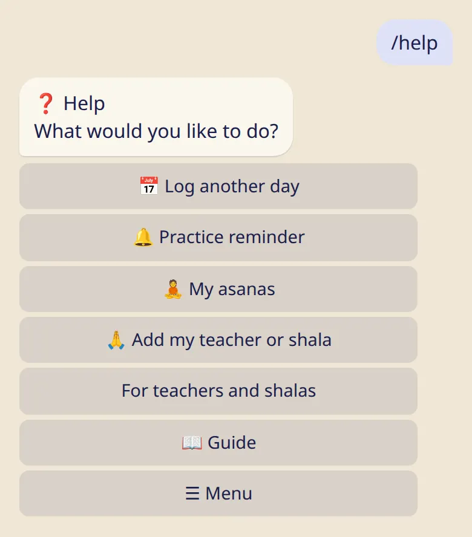

Every command of the bot, with one line on what it does. You don't need any of them: every screen is a few taps from :ftl[menu-open]. Commands are shortcuts.

## In the command menu

The menu next to the message field lists five.

| Command        | What it does                                                          |
| -------------- | --------------------------------------------------------------------- |
| :cmd[start]    | Today: practice or rest? The first time, the bot asks where to start. |
| :cmd[schedule] | :ftl[menu-classes]: this week's classes at all your shalas.           |
| :cmd[moon]     | Upcoming moon days and their reminders.                               |
| :cmd[settings] | Language, city, day off, reminders and the rest.                      |
| :cmd[help]     | The things people ask most, one tap each, and a link to this guide.   |

## Shortcuts

These are in no list, but they work when you type them.

- :cmd[log]: today's question.
- :cmd[asanas]: your asanas.
- :cmd[remind]: the daily practice reminder.
- :cmd[teachers]: your teachers and shalas.
- :cmd[classes]: the classes you teach this week.
- :cmd[menu]: the Menu.
