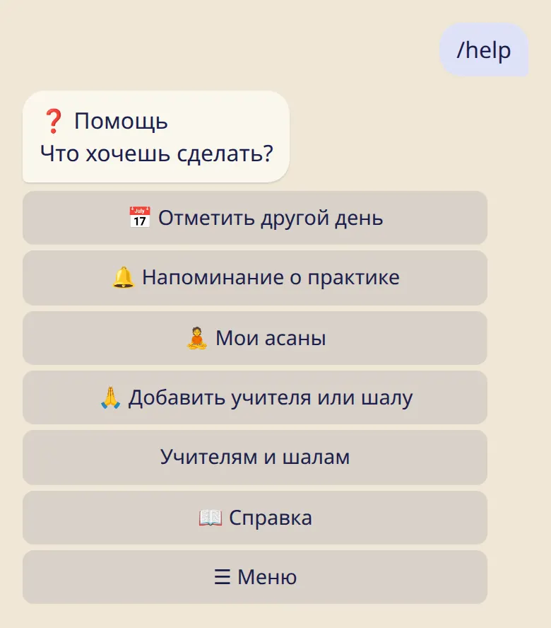

Все команды бота и по одной строке о том, что каждая делает. Без них можно обойтись: до любого экрана несколько касаний от кнопки :ftl[menu-open]. Команды — это короткие пути.

## В меню команд

В меню рядом с полем сообщения их пять.

| Команда        | Что делает                                                                |
| -------------- | ------------------------------------------------------------------------- |
| :cmd[start]    | Сегодня: практика или отдых? В первый раз бот спросит, с чего начать.     |
| :cmd[schedule] | Занятия всех твоих шал по твоему времени.                                 |
| :cmd[moon]     | Ближайшие лунные дни и напоминания о них.                                 |
| :cmd[settings] | Язык, город, выходной, напоминания и остальное.                           |
| :cmd[help]     | То, о чём спрашивают чаще всего, в одно касание, и ссылка на эту справку. |

<!-- shots-pending:  -->

## Короткие пути

Этих команд нет ни в одном списке, но они работают, если их набрать.

- :cmd[log]: вопрос про сегодня.
- :cmd[asanas]: твои асаны.
- :cmd[remind]: ежедневное напоминание о практике.
- :cmd[teachers]: твои учителя и шалы.
- :cmd[classes]: занятия, которые ты ведёшь на этой неделе.
- :cmd[menu]: Меню.
