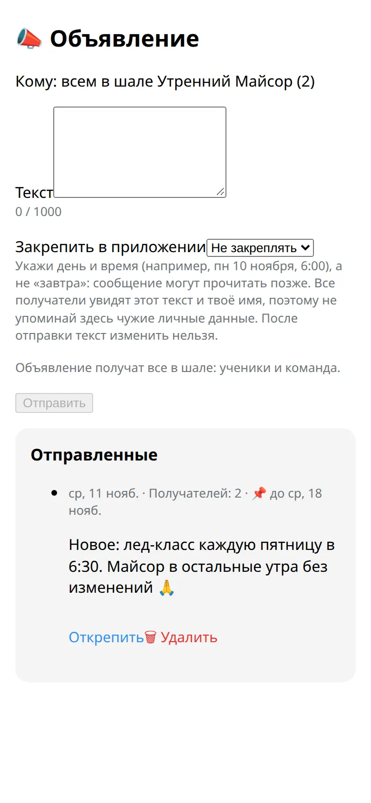

Расскажи всем в шале об изменениях одним сообщением.

## Как отправить

1. Открой шалу и нажми :ftl[ann-announce]. В боте эта кнопка открывает форму в приложении.
2. Напиши текст, до 1000 знаков.
3. Если хочешь, закрепи его на неделю или на месяц.
4. Нажми :ftl[ann-send] и подтверди.

Объявление приходит всем в шале, ученикам и команде, сообщением от бота с названием шалы и твоим именем.

## Кто может отправлять

Владелец, управляющие, преподаватели и администратор. Ассистенты не могут.

## Закрепить, открепить, удалить

- Закреплённое объявление видно на карточке шалы и стоит первым в списке объявлений в приложении.
- Своё объявление можно удалить или открепить. Владелец и управляющие могут удалить или открепить любое объявление.
- Удаление убирает объявление из приложения, и тем, кто его ещё не получил, оно уже не придёт. Доставленные сообщения остаются в чатах.

## Полезно знать

- Шала может отправить до 3 объявлений за 24 часа, считая всех, кто пишет от её имени.
- Оно приходит примерно в течение 10 минут. Если у человека тихие часы — без звука.
- Участники могут отключить уведомления об объявлениях шалы и по-прежнему читать их в приложении. Об этом никому не сообщается.
- Объявление нельзя изменить. Если в тексте опечатка, удали его и отправь заново.
- Пиши день и время, а не «завтра».

## Дальше

- [Вопросы и ответы](../../reference/faq/)
