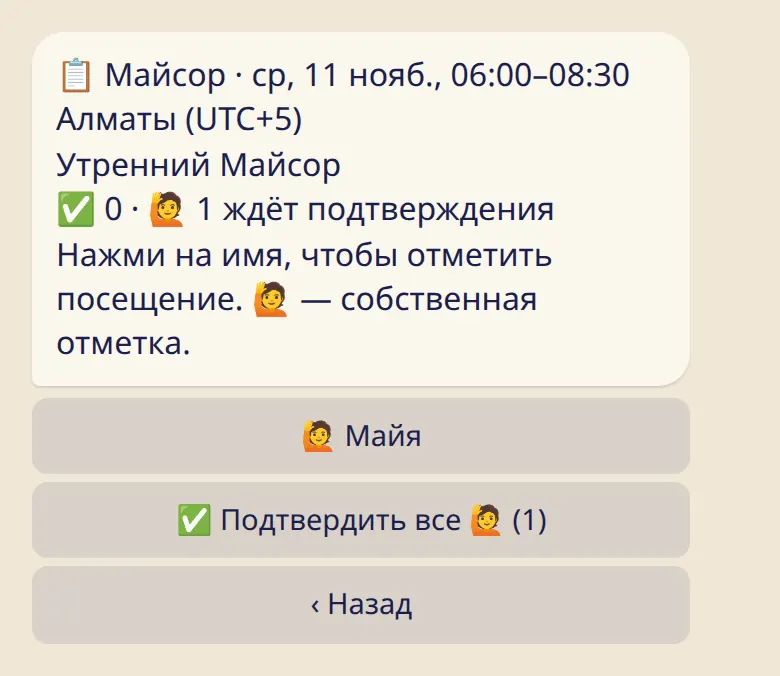

Посмотри, кто был на занятии, и поправь список. Посещения не связаны с личным журналом практики.

## Открыть список

- **В боте:** отправь :cmd[classes] или открой расписание шалы и нажми :ftl[attend-staff-open]{from=bot}. Выбери занятие.
- **В приложении:** нажми на занятие в нужную дату в расписании шалы.

Отмечать занятие можно после его начала, в течение 7 дней.

## Отметить, кто пришёл

- Нажми на имя, чтобы отметить, что человек пришёл. Нажми ещё раз, чтобы снять отметку.
- 🙋 рядом с именем — отметка самого ученика. :ftl[attend-confirm-all]{n=1} подтверждает все такие отметки сразу.
- ✅ — подтверждённая отметка.

В приложении отметь имена галочками и сохрани. Если список длинный, есть поиск по имени.

## Кто в списке

Ученики шалы и люди из команды, которые здесь практикуют.

## Что видят ученики

- Только свои отметки. Свою отметку можно убрать в любой момент.
- Нигде не видно, что кого-то не было. Списка тех, кто не пришёл, нет.
- Когда ты отмечаешь или подтверждаешь, никто не получает сообщений.

## Полезно знать

- Отмечать посещения может любой человек из команды, в том числе ассистенты и администратор.
- Отменённое занятие отметить нельзя.
- Посещения не связаны с журналом практики. Отметка о посещении не записывает ученику практику, и ничего из его журнала ты здесь не видишь.

## Дальше

- [Объявления шалы](../announcements/)
