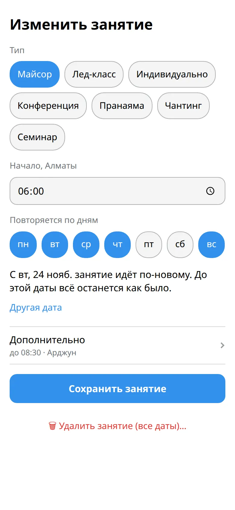
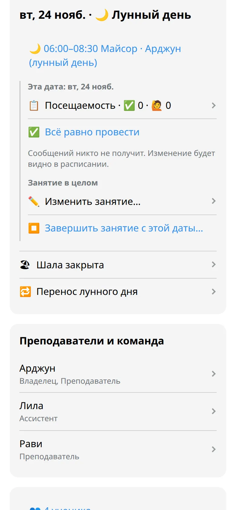

Перенеси занятие на другое время или день, заверши его с нужной даты или удали. Более ранние даты останутся как были.

## Изменить занятие

1. В приложении открой вкладку :ftl[tab-shala] и нажми на свою шалу. Из бота на тот же экран ведёт :ftl[shala-classes-edit] на карточке шалы.
2. Нажми на строку занятия в разделе :ftl[shala-classes-title]: откроется его форма, и изменение будет действовать с сегодняшнего дня. Или в расписании нажми на занятие в ту дату, с которой нужно изменение, а потом :ftl[class-edit].
3. Измени, что нужно, и нажми :ftl[class-form-save].

- **Изменение действует с выбранной даты.** Более ранние даты останутся как были. Нужна другая? Нажми :ftl[class-form-applies-other]: подойдёт любая, начиная с сегодняшней.
- **Если занятие в эту дату уже началось**, изменение действует со следующей даты занятия.
- **Занятие, у которого первая дата ещё впереди**, и занятие на одну дату просто меняются.

## Завершить занятие

1. В расписании нажми на занятие в первую дату, когда его уже не должно быть.
2. Нажми :ftl[class-end] и подтверди.

Эта дата и все следующие пропадут из расписания. Более ранние даты останутся. Строка есть, только пока эта дата не началась.

## Удалить занятие

Открой форму, как в разделе «Изменить занятие»: :ftl[occurrence-delete] — в самом низу. Это для занятия, добавленного по ошибке. Если занятие уже проходило, лучше заверши его.

## Полезно знать

- У занятия есть последняя дата? Форма и вопрос перед завершением или удалением показывают, какие даты изменятся.
- Менять занятия могут владелец, управляющие, преподаватели и администратор. Ассистенты не могут.
- Об этих изменениях никто не получает сообщений. Если это важно, отправь объявление.
- Отменить или изменить только одну дату: смотри [Закрытые дни, переносы и замены](../closures-and-swaps/).

## Дальше

- [Закрытые дни, переносы и замены](../closures-and-swaps/)
- Назад: [Занятия и неделя](../classes/)
