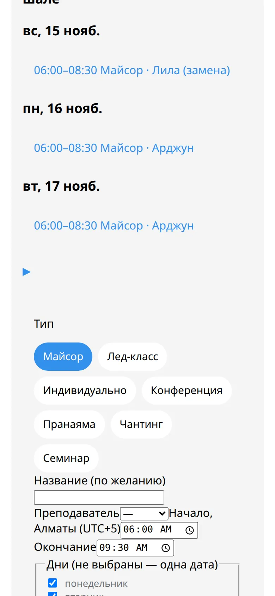
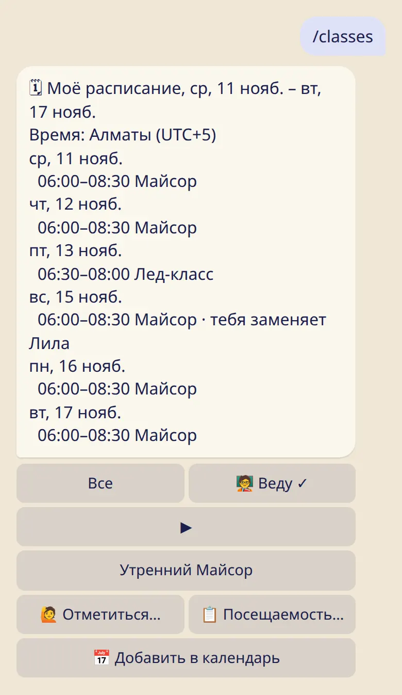

Добавь майсор, лед-классы и другие занятия один раз — и каждый увидит неделю по своему времени.

## Добавить занятие

1. В приложении открой шалу и нажми :ftl[schedule-add-class].
2. Выбери :ftl[class-form-type]: :ftl[context-mysore], :ftl[context-led], :ftl[context-private], :ftl[class-type]{type=conference}, :ftl[class-type]{type=pranayama}, :ftl[class-type]{type=chanting} или :ftl[class-type]{type=workshop}.
3. Укажи преподавателя, начало и конец по времени шалы и дни недели. Занятие может повторяться каждую неделю или раз в 2–4 недели. Если не отмечен ни один день, оно пройдёт один раз, в первую дату.
4. Нажми :ftl[class-form-save].

## Как это видят люди

- Каждый в шале видит неделю в своём часовом поясе, с его названием. Тем, кто в другом поясе, показано и время шалы.
- Индивидуальные занятия видит только команда.
- Онлайн-занятие отмечено значком 🌐, и время для него можно задать по другому городу.
- Время задаётся по часам в городе шалы. Занятие в 06:00 остаётся в 06:00 и после перевода часов.

## Изменить или удалить занятие

Нажми на занятие в расписании.

- Его можно изменить для всех дат или начиная с выбранной даты. Более ранние даты останутся как были.
- :ftl[occurrence-delete] убирает его со всех дат.

Про изменения на одну дату смотри [Закрытые дни, переносы и замены](../closures-and-swaps/).

## Занятия, которые ведёшь ты

:cmd[classes] показывает твою неделю во всех твоих шалах, включая занятия, где ты кого-то заменяешь.

## Выходной и лунные дни

Их задаёт владелец или управляющий в разделе :ftl[shala-edit]:

- **Выходной**, один или два дня. В расписании недели они отмечены как :ftl[schedule-day-off].
- **Лунные дни**: :ftl[shala-moon-policy-option]{p=closed}, :ftl[shala-moon-policy-option]{p=pranayama} или :ftl[shala-moon-policy-option]{p=open}. При первом варианте занятия в лунный день сами показываются как отменённые.

## Полезно знать

- Расписание могут менять владелец, управляющие, преподаватели и администратор. Ассистенты не могут.
- Об изменениях в расписании никто не получает сообщений. Если это важно, отправь объявление.
- В шале может быть до 40 занятий в расписании.

## Дальше

- [Закрытые дни, переносы и замены](../closures-and-swaps/)
