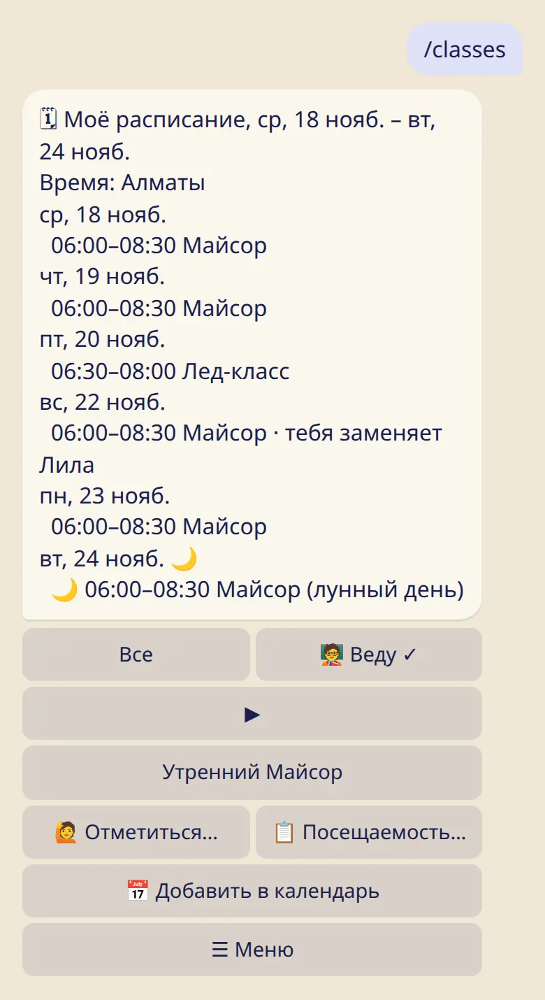

Добавь майсор, лед-классы и другие занятия один раз — и каждый увидит неделю по своему времени.

## Добавить занятие

1. В приложении открой вкладку :ftl[tab-shala], нажми на свою шалу, а потом :ftl[schedule-add-class]: это первая строка расписания.
2. Выбери :ftl[class-form-type]: :ftl[context-mysore], :ftl[context-led], :ftl[context-private], :ftl[class-type]{type=conference}, :ftl[class-type]{type=pranayama}, :ftl[class-type]{type=chanting} или :ftl[class-type]{type=workshop}.
3. Укажи начало по времени шалы и дни в поле :ftl[class-form-days]. Если занятие пройдёт только один день, выбери :ftl[class-form-once] и укажи дату.
4. Нажми :ftl[class-form-save].

Майсор уже заполнен: с 06:00 до 09:30, каждый день, кроме выходного шалы. Два нажатия — и он сохранён.

Остальное — под кнопкой :ftl[class-form-more]:

- **:ftl[class-form-length]**: 60, 75, 90 или 120 минут либо :ftl[class-form-length-other] и число минут. У майсора вместо этого поле :ftl[class-form-until].
- **Название и преподаватель.** Если ты преподаёшь в этой шале, твоё имя уже подставлено.
- **:ftl[class-form-every]**: каждую неделю или раз в 2–4 недели.
- **:ftl[class-form-from]** и **:ftl[class-form-end]**.
- **:ftl[class-form-online]** и город, по времени которого идёт занятие.

Занятие сохранено, а нужно иначе? Смотри [Изменить, завершить или удалить занятие](../change-class/).

## Как это видят люди

- Каждый в шале видит неделю по часам своего города, и город назван. Тем, кто живёт по времени другого города, показано и время шалы.
- Индивидуальные занятия видит только команда.
- Онлайн-занятие отмечено значком 🌐, и время для него можно задать по другому городу.
- Время задаётся по часам в городе шалы. Занятие в 06:00 остаётся в 06:00 и после перевода часов.

## Занятия, которые ведёшь ты

В боте открой :ftl[menu-open] → :ftl[menu-classes] и нажми :ftl[my-schedule-filter]{f=mine}: там твоя неделя во всех твоих шалах, включая занятия, где ты кого-то заменяешь.

## Выходной и лунные дни

Их задаёт владелец или управляющий в разделе :ftl[shala-edit]:

- **Выходной**, один или два дня. В расписании недели они отмечены как :ftl[schedule-day-off].
- **Лунные дни**: :ftl[shala-moon-policy-option]{p=closed}, :ftl[shala-moon-policy-option]{p=pranayama} или :ftl[shala-moon-policy-option]{p=open}. При первом варианте занятия в лунный день сами показываются как отменённые.

## Полезно знать

- Расписание могут менять владелец, управляющие, преподаватели и администратор. Ассистенты не могут.
- Об изменениях в расписании никто не получает сообщений. Если это важно, отправь объявление.
- В шале может быть до 40 занятий в расписании.

## Дальше

- [Изменить, завершить или удалить занятие](../change-class/)
- [Закрытые дни, переносы и замены](../closures-and-swaps/)
