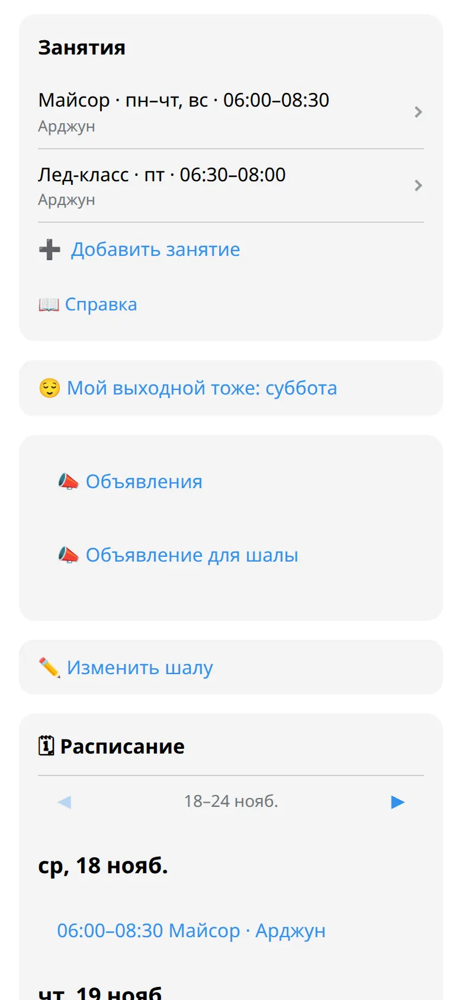
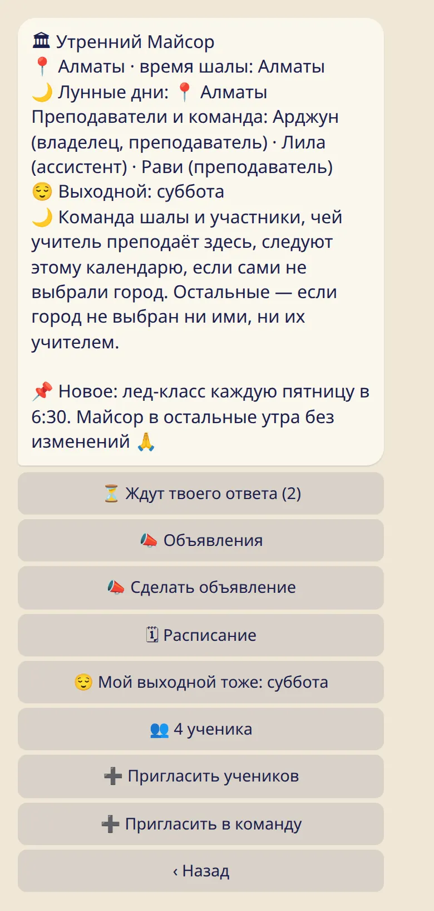
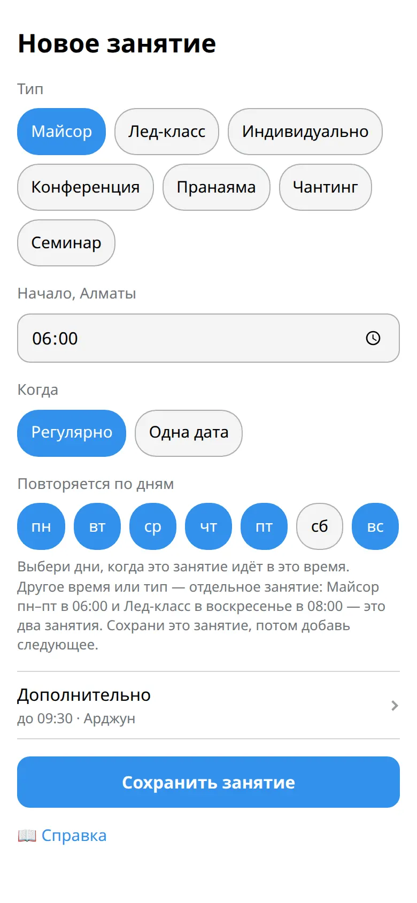

Настрой недельные занятия шалы один раз — и каждый увидит неделю по своему времени.

## Одно занятие или два?

Занятие — это один тип в одно время в те дни, когда оно повторяется. Другое время или другой тип — уже другое занятие. Например, неделя такая:

- Майсор с понедельника по пятницу, с 06:00 до 09:30;
- Лед-класс в воскресенье, с 08:00 до 09:30, с названием «Полная первая серия» (название — под кнопкой :ftl[class-form-more]).

Это два занятия. Сохрани первое, потом нажми :ftl[class-add-another] и добавь второе. На карточке шалы это две строки в разделе :ftl[shala-classes-title]:

- «Майсор · пн–пт · 06:00–09:30»
- «Лед-класс Полная первая серия · вс · 08:00–09:30»

Одно и то же время в разные дни — это одно занятие. Майсор с понедельника по четверг и Лед-класс в 07:00 в пятницу и воскресенье — тоже два занятия: «Майсор · пн–чт · 06:00–09:30» и «Лед-класс · пт, вс · 07:00–08:30».

## Где занятия

- **В приложении:** открой вкладку :ftl[tab-shala] и нажми на свою шалу. В разделе :ftl[shala-classes-title] — все занятия, по строке на каждое, а в конце — :ftl[schedule-add-class].
- **Из бота:** открой карточку шалы (:ftl[menu-open] → :ftl[menu-teacher] → твоя шала или :ftl[menu-help] → :ftl[help-shala-classes]). Занятия перечислены и там. Нажми :ftl[shala-classes-edit]: приложение откроется на этой карточке. Пока занятий в шале нет, кнопка называется :ftl[schedule-add-class] и сразу открывает форму.

## Добавить занятие

1. На карточке шалы в приложении нажми :ftl[schedule-add-class] в разделе :ftl[shala-classes-title].
2. Выбери :ftl[class-form-type]: :ftl[context-mysore], :ftl[context-led], :ftl[context-private], :ftl[class-type]{type=conference}, :ftl[class-type]{type=pranayama}, :ftl[class-type]{type=chanting} или :ftl[class-type]{type=workshop}.
3. Укажи начало по времени шалы, а в поле :ftl[class-form-days] — дни, когда это занятие идёт в это время. Если занятие пройдёт только один день, выбери :ftl[class-form-once] и укажи дату.
4. Нажми :ftl[class-form-save]. На карточке появится :ftl[class-form-saved], а строка под списком станет :ftl[class-add-another]: нажми на неё для следующего занятия.

Майсор уже заполнен: с 06:00 до 09:30, каждый день, кроме выходного шалы. Два нажатия — и он сохранён.

Остальное — под кнопкой :ftl[class-form-more]:

- **:ftl[class-form-length]**: 60, 75, 90 или 120 минут либо :ftl[class-form-length-other] и число минут. У Майсора вместо этого поле :ftl[class-form-until].
- **Название и преподаватель.** Если ты преподаёшь в этой шале, твоё имя уже подставлено.
- **:ftl[class-form-every]**: каждую неделю или раз в 2–4 недели.
- **:ftl[class-form-from]** и **:ftl[class-form-end]**.
- **:ftl[class-form-online]** и город, по времени которого идёт занятие.

## Изменить занятие

Нажми на его строку в разделе :ftl[shala-classes-title]. Откроется его форма с датой, с которой действует изменение. Смотри [Изменить, завершить или удалить занятие](../change-class/).

## Как это видят люди

- Каждый в шале видит неделю по часам своего города, и город назван. Тем, кто живёт по времени другого города, показано и время шалы.
- Индивидуальные занятия видит только команда.
- Онлайн-занятие отмечено значком 🌐, и время для него можно задать по другому городу.
- Время задаётся по часам в городе шалы. Занятие в 06:00 остаётся в 06:00 и после перевода часов.

## Занятия, которые ведёшь ты

В боте открой :ftl[menu-open] → :ftl[menu-classes] и нажми :ftl[my-schedule-filter]{f=mine}: там твоя неделя во всех твоих шалах, включая занятия, где ты кого-то заменяешь.

## Выходной и лунные дни

Их задаёт владелец или управляющий в разделе :ftl[shala-edit]:

- **Выходной**, один или два дня. В расписании недели они отмечены как :ftl[schedule-day-off].
- **Лунные дни**: :ftl[shala-moon-policy-option]{p=closed}, :ftl[shala-moon-policy-option]{p=pranayama} или :ftl[shala-moon-policy-option]{p=open}. При первом варианте занятия в лунный день автоматически показываются как отменённые.

## Полезно знать

- Добавлять и менять занятия могут владелец, управляющие, преподаватели и администратор. Ассистенты и ученики видят расписание по датам, а не список занятий.
- Об изменениях в расписании никто не получает сообщений. Если это важно, отправь объявление.
- В шале может быть до 40 занятий одновременно. Считаются только идущие занятия: заверши то, что больше не проводится.

## Дальше

- [Изменить, завершить или удалить занятие](../change-class/)
- [Закрытые дни, переносы и замены](../closures-and-swaps/)
