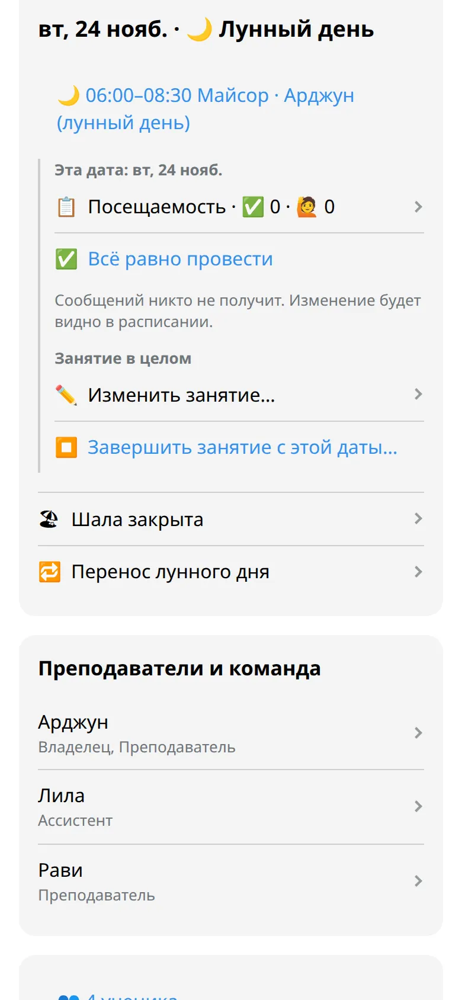

Праздник, перенос лунного дня, другой учитель на одно утро: как изменить один день, не трогая остальное.

## Отменить одно занятие

- **В приложении:** нажми на занятие в нужную дату, затем :ftl[occurrence-cancel]. Передумаешь — нажми :ftl[occurrence-restore].
- **В боте:** открой в карточке шалы :ftl[schedule-open] и нажми :ftl[class-cancel-pick]. Там перечислены занятия на ближайшие 48 часов.

Занятие остаётся в расписании с пометкой об отмене, так что никому не придётся гадать, куда оно делось.

Об отмене никому не приходит сообщение. После отмены в приложении там же появляется строка :ftl[occurrence-tell] — она открывает объявление с готовым текстом. Прочитай его, поправь, если нужно, и отправь. Для индивидуального занятия такой строки нет.

Верхние строки относятся только к этой дате. Строки под заголовком :ftl[occurrence-whole-class] меняют занятие начиная с этой даты: смотри [Изменить, завершить или удалить занятие](../change-class/).

## Замена на одно утро

В приложении нажми на занятие в нужную дату и выбери человека в поле :ftl[occurrence-teacher]. В расписании рядом с его именем появится пометка «замена», а в разделе :ftl[menu-classes] в боте оба учителя увидят, кто кого заменяет.

## Закрыть шалу на несколько дней

1. В приложении открой шалу и нажми :ftl[closure-title] под расписанием недели.
2. Укажи :ftl[closure-start] и :ftl[closure-end].
3. Нажми :ftl[closure-add].

Все занятия в эти дни показываются как отменённые, с причиной «шала закрыта». Закрыть можно до 92 дней подряд, начиная с сегодняшнего. :ftl[closure-remove] снова открывает эти дни.

## Лунные дни

Что происходит в лунный день, зависит от настройки шалы: смотри [Занятия и неделя](../classes/).

- Чтобы всё же провести одно занятие в лунный день, нажми на него, затем :ftl[occurrence-hold].
- Если твоя шала отмечает лунный день не в ту дату, что в календаре приложения, проведи занятия в день из календаря и отмени их в свой. Личные лунные дни и напоминания участников по-прежнему показывают дату из календаря, поэтому отправь ещё и объявление.

## Перенести лунный день

Когда лунный день выпадает на день практики, в некоторых шалах занятия этого дня проводят в выходной на той же неделе. Если у вас так принято, это можно настроить здесь.

1. На экране шалы нажми :ftl[swap-title] под расписанием недели.
2. Выбери :ftl[swap-from] и день в поле :ftl[swap-to].
3. Нажми :ftl[swap-add].

Новым днём может быть выходной шалы или день, в котором нет занятия того же типа, не дальше 6 дней. Это не может быть другой лунный день или день, когда шала закрыта. Переносятся только занятия, отменённые из-за лунного дня или закрытия. :ftl[swap-remove] возвращает всё как было.

## Полезно знать

- Об этих изменениях никто не получает сообщений. Они видны в расписании и в календарях, на которые люди подписаны. Если это важно, отправь ещё и объявление.
- Вносить эти изменения могут владелец, управляющие, преподаватели и администратор.

## Дальше

- [Посещения](../attendance/)
