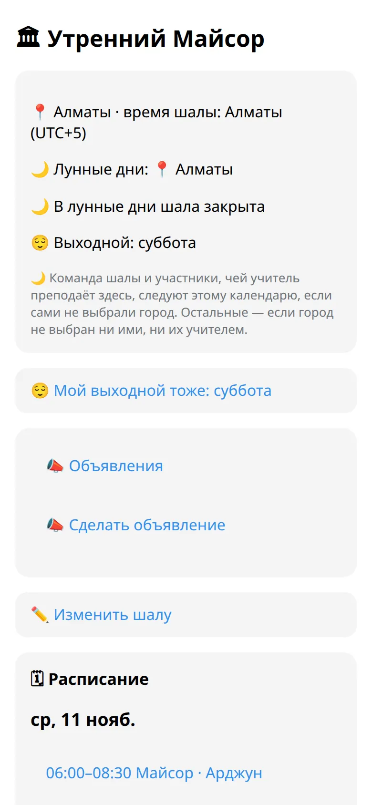
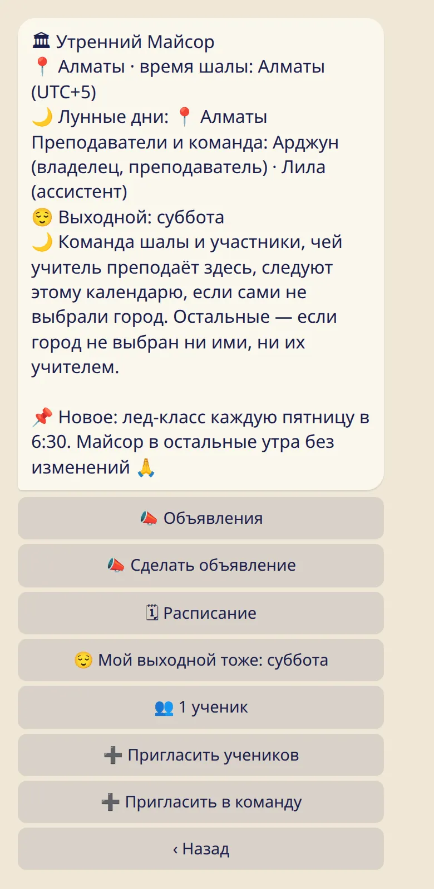
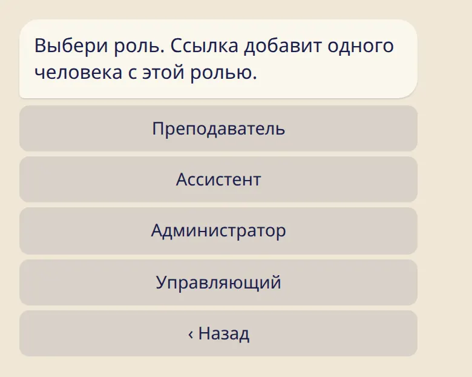

Создай шалу за несколько минут и пригласи остальных учителей и помощников.

## Создать шалу

1. В приложении открой :ftl[settings-open] → :ftl[links-title] и нажми :ftl[shala-create].
2. Заполни :ftl[shala-name-label] и :ftl[shala-city-label]. По городу определяются время шалы и её лунные дни. Если зала нет, отметь :ftl[shala-online-only].
3. В разделе :ftl[shala-my-roles] отметь «Преподаватель», если ты там преподаёшь.
4. Нажми :ftl[shala-create-submit].

## Карточка шалы

В боте отправь :cmd[teachers] и нажми на название шалы.

На карточке видны место и время шалы, город для лунных дней, команда, выходной и закреплённое объявление, если оно есть.

## Пригласить команду

1. На карточке нажми :ftl[shala-invite-staff].
2. Выбери роль.
3. Отправь ссылку этому человеку.

Такая ссылка добавляет одного человека, срабатывает один раз и действует 7 дней. Перед подтверждением человек видит, что значит присоединиться. Когда он присоединится, тебе придёт сообщение.

## Роли

| Роль                             | Что может                                                                                                                                                                                         |
| -------------------------------- | ------------------------------------------------------------------------------------------------------------------------------------------------------------------------------------------------- |
| :ftl[shala-role]{role=owner}     | Всё. Только владелец назначает управляющих и удаляет шалу.                                                                                                                                        |
| :ftl[shala-role]{role=admin}     | Менять данные шалы, приглашать и убирать людей из команды (кроме других управляющих), убирать ученика, делать новую ссылку для учеников, убирать любое объявление и всё, что может преподаватель. |
| :ftl[shala-role]{role=teacher}   | Занятия, закрытые дни и переносы, объявления, посещения.                                                                                                                                          |
| :ftl[shala-role]{role=office}    | То же, что преподаватель, и ещё убирать ученика из шалы.                                                                                                                                          |
| :ftl[shala-role]{role=assistant} | Посещения.                                                                                                                                                                                        |

Все в команде видят имена учеников, могут показать ссылку для учеников и отмечать посещения. У одного человека может быть несколько ролей. Изменить их может владелец или управляющий: нажми на человека на экране шалы в приложении.

## Пригласить учеников

Нажми :ftl[shala-invite-students], чтобы получить ссылку и QR-код. Эта ссылка одна для всех, и срока у неё нет. Каждый ученик подтверждает сам: смотри [Моя шала](../../students/my-shala/).

Команда видит имена учеников и ничего из их журналов. Чтобы видеть практику ученика, учитель делится своей ссылкой: смотри [Пригласить учеников](../../teachers/invite-students/).

## Лунные дни и выходной

Город для лунных дней, правило для лунных дней и выходной задаёт владелец или управляющий в разделе :ftl[shala-edit]: смотри [Занятия и неделя](../classes/).

## Полезно знать

- У тебя может быть до 3 своих шал. В шале может быть до 30 человек в команде и до 1000 учеников.
- Выйти из команды можно в любой момент. Исключение — владелец: он может только удалить шалу.
- Удаление убирает шалу для всех, кто в ней состоит, и отменить его нельзя. Журналы у всех остаются.
- Никто не получает сообщения, когда человека убирают или когда шалу удаляют.

## Дальше

- [Занятия и неделя](../classes/)
