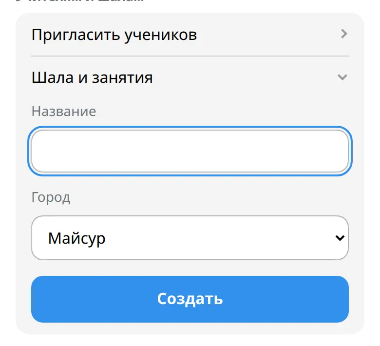
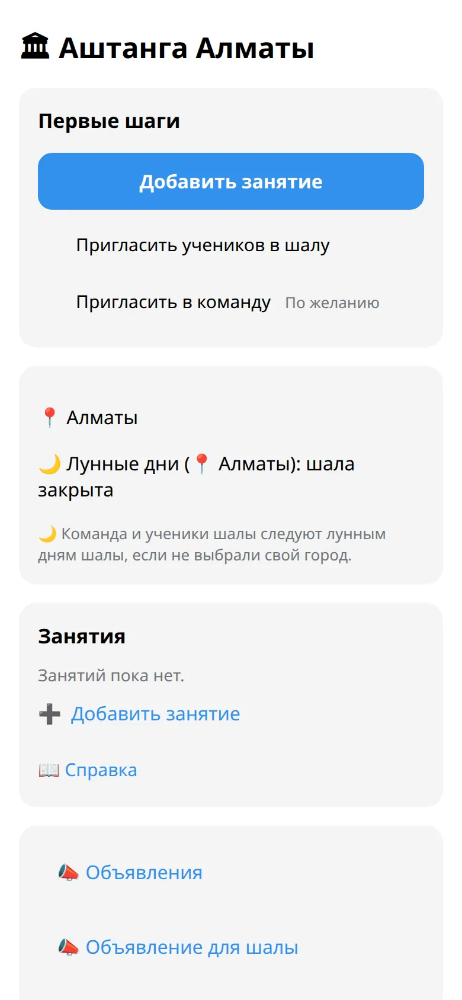
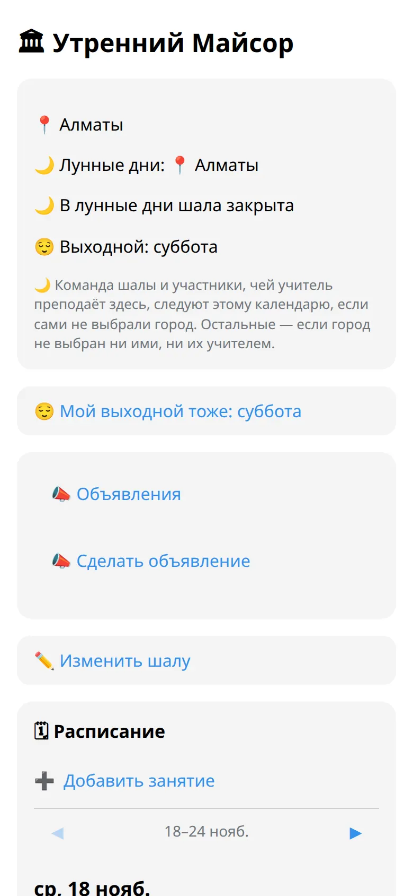
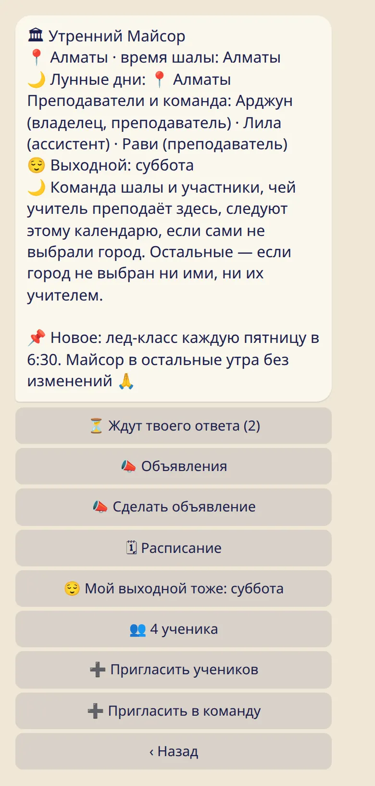
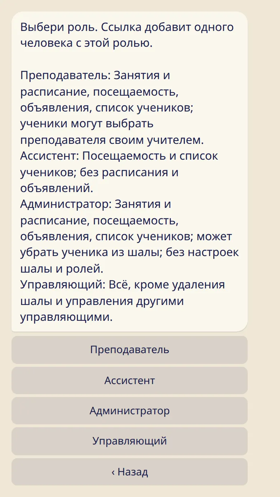

Создай шалу за несколько минут и пригласи остальных учителей и помощников.

## Создать шалу

1. В боте открой :ftl[menu-open] → :ftl[menu-teach] → :ftl[welcome-path-shala] и нажми :ftl[shala-create]: приложение откроется сразу на форме. В приложении открой вкладку :ftl[tab-shala] и нажми :ftl[shala-start-shala] внизу, в разделе :ftl[shala-starts-title].
2. Заполни :ftl[shala-name-label] и :ftl[shala-city-label]. По городу определяются время шалы и её лунные дни.
3. Нажми :ftl[shala-create-submit]. Откроется экран твоей шалы.

Больше форма ни о чём не спрашивает. Ты с самого начала владелец и :ftl[shala-role]{role=teacher}. Только онлайн? Отметь :ftl[shala-online-only] потом, в разделе :ftl[shala-edit].

Ты уже в команде шалы? Тогда в разделе :ftl[welcome-path-shala] сначала твои шалы — каждая открывает свою карточку, — а после них :ftl[shala-create-another]. Строка :ftl[menu-teach] остаётся в меню, пока у тебя нет своих учеников. Потом она в разделе :ftl[menu-help].

## Потом добавь занятия

Когда шала создана, вкладка :ftl[tab-today] в приложении и «Сегодня» в боте подсказывают: :ftl[next-class] Нажми :ftl[next-class-do]: в боте эта кнопка открывает форму занятия в приложении. Смотри [Занятия и неделя](../classes/).

После первого занятия подсказка меняется: :ftl[next-shala-invite] Кнопка под ней — :ftl[next-shala-invite-do]. Каждая подсказка исчезает сама, когда шаг сделан.

## Первые шаги

На экране новой шалы владелец видит короткий список :ftl[setup-title]:

1. :ftl[setup-class]: смотри [Занятия и неделя](../classes/).
2. :ftl[setup-students]: ссылка и QR-код, одни для всех.
3. :ftl[setup-staff]: только если хочешь. Команды нет? Нажми :ftl[setup-staff-skip], когда останется только этот шаг.

Сделанный шаг отмечается галочкой. Когда шагов не остаётся, список исчезает.

## Карточка шалы

В приложении открой вкладку :ftl[tab-shala] и нажми на название шалы.

В боте открой :ftl[menu-open] → :ftl[menu-teacher] и нажми на название шалы.

На карточке видны место (и время шалы, если оно не такое, как у тебя), одна строка о лунных днях с их городом, команда, выходной и закреплённое объявление, если оно есть. Те, кто может менять расписание, видят ещё раздел :ftl[shala-classes-title]: по строке на занятие. В боте преподаватель, чьего ответа ждут ученики, видит там ещё и строку :ftl[request-waiting-open]{count=2}. В приложении эти люди вверху вкладки :ftl[tab-shala].

Формы — в приложении, а на карточке в боте есть кнопка к каждой: :ftl[shala-classes-edit] для занятий и :ftl[shala-edit] для данных самой шалы — у владельца и управляющих.

## Пригласить команду

1. На карточке нажми :ftl[shala-invite-staff].
2. Выбери роль.
3. Отправь ссылку этому человеку.

Такая ссылка добавляет одного человека, срабатывает один раз и действует 7 дней. Под каждой ролью написано, что она может. Перед подтверждением человек видит, что значит присоединиться. Когда он присоединится, тебе придёт сообщение. Что он увидит после этого: [Тебя пригласили в команду шалы](../joined-staff/).

## Роли

| Роль                             | Что может                                                                                                                                                                                         |
| -------------------------------- | ------------------------------------------------------------------------------------------------------------------------------------------------------------------------------------------------- |
| :ftl[shala-role]{role=owner}     | Всё. Только владелец назначает управляющих и удаляет шалу.                                                                                                                                        |
| :ftl[shala-role]{role=admin}     | Менять данные шалы, приглашать и убирать людей из команды (кроме других управляющих), убирать ученика, делать новую ссылку для учеников, убирать любое объявление и всё, что может преподаватель. |
| :ftl[shala-role]{role=teacher}   | Занятия, закрытые дни и переносы, объявления, посещения. Ученики шалы могут выбрать этого человека своим учителем.                                                                                |
| :ftl[shala-role]{role=office}    | Занятия, закрытые дни и переносы, объявления, посещения, а ещё убирать ученика из шалы.                                                                                                           |
| :ftl[shala-role]{role=assistant} | Посещения.                                                                                                                                                                                        |

Все в команде видят имена учеников, могут показать ссылку для учеников и отмечать посещения. У одного человека может быть несколько ролей. Изменить их может владелец или управляющий: нажми на человека в разделе :ftl[shala-staff-title]{from=app} на экране шалы в приложении. Владелец там же меняет и свои роли: нажми на своё имя.

## Пригласить учеников в шалу

Нажми :ftl[shala-invite-students], чтобы получить ссылку и QR-код. Эта ссылка одна для всех, и срока у неё нет. Каждый ученик подтверждает сам: смотри [Моя шала](../../students/my-shala/).

После этого бот спрашивает каждого ученика, кто его учитель. Выбрать можно только людей с ролью :ftl[shala-role]{role=teacher}, и из журнала ничего не видно, пока этот учитель не подтвердит: смотри [Пригласить учеников](../../teachers/invite-students/). Личная ссылка учителя работает как раньше.

Команда видит имена учеников и ничего из их журналов. Кто кого выбрал, знают только ученик и этот учитель: владелец и остальная команда этого не видят.

## Лунные дни и выходной

Город для лунных дней, правило для лунных дней и выходной задаёт владелец или управляющий в разделе :ftl[shala-edit]: смотри [Занятия и неделя](../classes/).

## Полезно знать

- Если роли :ftl[shala-role]{role=teacher} нет ни у кого в команде, ученикам некого выбрать. Карточка шалы в боте подскажет это владельцу и управляющим, а кнопка :ftl[app-open-shala] откроет шалу, где эту роль можно дать.
- У тебя может быть до 3 своих шал. В шале может быть до 30 человек в команде и до 1000 учеников.
- Выйти из команды можно в любой момент. Исключение — владелец: он может только удалить шалу.
- Удаление убирает шалу для всех, кто в ней состоит, и отменить его нельзя. Журналы у всех остаются.
- Никто не получает сообщения, когда человека убирают или когда шалу удаляют.

## Дальше

- [Занятия и неделя](../classes/)
- [Тебя пригласили в команду шалы](../joined-staff/)
