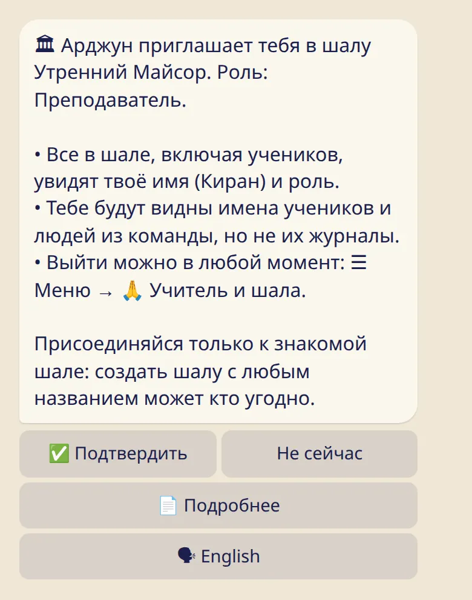
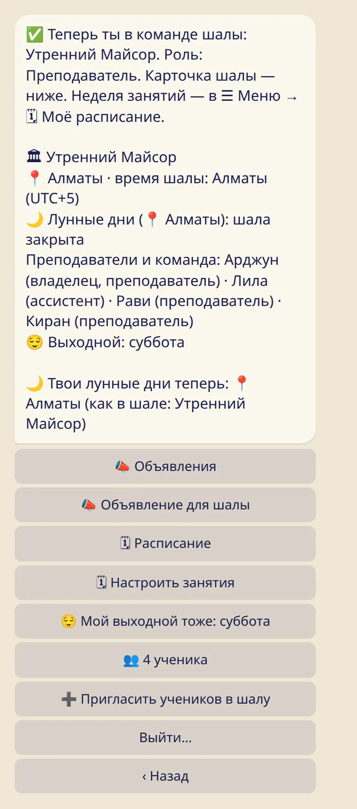

Что делает ссылка в команду: твоя роль, карточка шалы, твоя неделя занятий, ученики шалы и твои ученики.

## Принять приглашение

1. Владелец шалы или управляющий присылает тебе ссылку. Открой её. Бот скажет, кто тебя приглашает, в какую шалу и с какой ролью, и коротко — что значит присоединиться. Полный текст — под кнопкой :ftl[consent-details].
2. Удобнее читать на другом языке? Кнопка с названием этого языка переключит бота на него.
3. Нажми :ftl[shala-staff-yes]. Нужно подумать? Нажми :ftl[invite-decline].

Ссылка добавляет одного человека, срабатывает один раз и действует 7 дней. Если срок прошёл, попроси новую у того, кто её прислал.

## Что может твоя роль

| Роль                             | Что может                             |
| -------------------------------- | ------------------------------------- |
| :ftl[shala-role]{role=admin}     | :ftl[shala-role-hint]{role=admin}     |
| :ftl[shala-role]{role=teacher}   | :ftl[shala-role-hint]{role=teacher}   |
| :ftl[shala-role]{role=office}    | :ftl[shala-role-hint]{role=office}    |
| :ftl[shala-role]{role=assistant} | :ftl[shala-role-hint]{role=assistant} |

Все в команде видят имена учеников и команды шалы, но не их журналы, и могут отмечать, кто пришёл на занятие. Ролей может быть несколько. Меняет их владелец или управляющий в приложении.

## Ты в команде

Сразу после подтверждения бот напишет, что ты в команде, назовёт шалу и твою роль, а ниже покажет карточку шалы.

На карточке, в зависимости от роли:

- место, лунные дни шалы и её команда;
- :ftl[shala-classes-title] — по строке на занятие — и кнопка :ftl[shala-classes-edit], чтобы изменить их в приложении;
- :ftl[schedule-open]: неделя шалы по датам;
- :ftl[shala-students]{n=12}: ученики шалы;
- :ftl[shala-invite-students]: ссылка, по которой ученики присоединяются к шале.

Потом карточка найдётся в :ftl[menu-open] → :ftl[menu-teacher] → шала или, если твоя роль меняет расписание, в :ftl[menu-help] → :ftl[help-shala-classes]. В приложении открой вкладку :ftl[tab-shala] и нажми на шалу.

## Твоя неделя

:ftl[menu-open] → :ftl[menu-classes] показывает занятия этой недели во всех твоих шалах. :ftl[my-schedule-filter]{f=mine} оставляет те, что ведёшь ты, включая занятия, где ты кого-то заменяешь. В приложении это вкладка :ftl[tab-shala] → :ftl[my-schedule-open]{from=app}, со следующими неделями.

## Ученики шалы и твои ученики

- **Ученики шалы** присоединились по ссылке шалы. Под кнопкой :ftl[shala-students]{n=12} на карточке видны их имена и ничего из журналов.
- **Твои ученики** — в :ftl[menu-open] → :ftl[menu-students], вместе с их практикой. Ученик шалы попадает в твой список, когда выбирает тебя учителем и ты подтверждаешь (выбрать тебя можно, если у тебя роль :ftl[shala-role]{role=teacher}), или когда открывает твою личную ссылку.

Поэтому ссылок две. :ftl[shala-invite-students] — чтобы присоединиться к шале. :ftl[links-invite] — только твоя. Смотри [Пригласить учеников](../../teachers/invite-students/).

## Лунные дни

Теперь твои лунные дни считаются по календарю шалы, если в :ftl[menu-moon] не выбран свой город или «следовать за учителем». У тебя есть свои ученики, а город не выбран? Тогда вместе с карточкой бот предложит оставить город шалы своим, чтобы твои ученики отдыхали в те же дни. Смотри [Лунные дни твоих учеников](../../teachers/moon-days/).

## Выйти

На карточке шалы нажми :ftl[shala-leave] (у управляющего эта кнопка под :ftl[shala-more-button]), а потом :ftl[shala-leave-yes]. Никто не получит сообщения, а журнал останется как есть. С ролью :ftl[shala-role]{role=teacher} в вопросе будет ещё: :ftl[shala-leave-own-students]

## Полезно знать

- Объявления шалы тоже приходят тебе через бота. Их можно отключить.
- Владелец или управляющий может поменять тебе роли или убрать тебя из команды. Сообщений никто не получает.
- Владелец выйти не может, только удалить шалу.

## Дальше

- [Занятия и неделя](../classes/)
- [Посещения](../attendance/)
