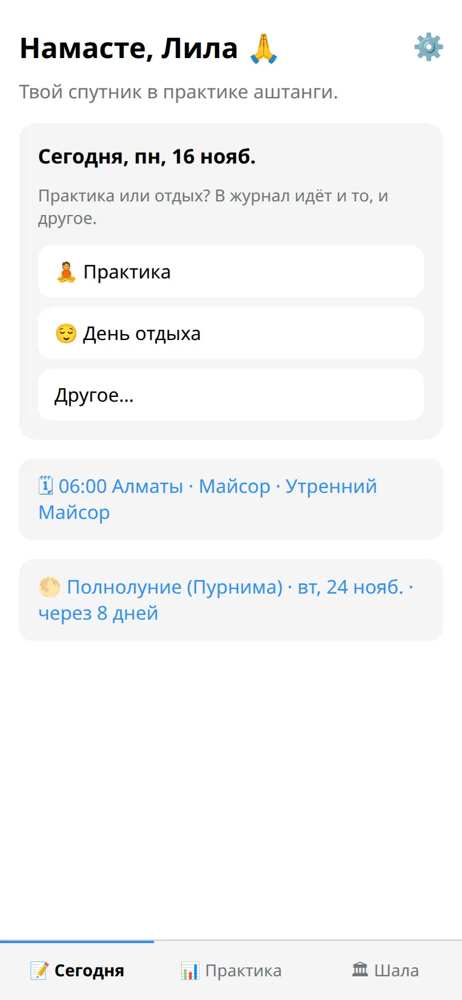

У Tristhana две части, и журнал у них общий. Бот нужен для быстрых отметок и напоминаний. Приложение — для календаря, статистики и всего, где больше деталей.

## Бот

Это чат с [@tristhana_bot](https://t.me/tristhana_bot). В нём удобно:

- отметить сегодня в два касания (:cmd[start] открывает сегодняшний день);
- получать мягкое ежедневное напоминание и предупреждение перед лунными днями;
- смотреть ближайшие лунные дни и свои занятия;
- отмечать новую асану;
- получать сообщения от учителя или шалы.

Набирать команды не нужно. :ftl[menu-open] — последняя кнопка под вопросом про сегодня, и за ней всё остальное. Если написать боту любое сообщение, тоже откроется меню.

## Приложение

Оно открывается прямо в Telegram: нажми кнопку рядом с полем сообщения или :ftl[menu-open] → :ftl[menu-practice] в боте. Внизу три вкладки:

- :ftl[tab-today]: отметить день в одно касание, увидеть занятие на сегодня и ближайший лунный день;
- :ftl[tab-practice]: год и каждый месяц, прошлые дни, значки, самочувствие за год и твои асаны;
- :ftl[tab-shala]: твои учителя, ученики и шалы, расписание и объявления.

Шестерёнка :ftl[settings-open] в верхнем углу открывает настройки: имя, город, выходной, напоминания и тихие часы.

## Полезно знать

- Всё, что отмечено в боте, видно в приложении, и наоборот.
- Ботом можно пользоваться без приложения, а приложением — без бота. Но напоминания всегда приходят от бота.
- Приложение подстраивается под тему твоего Telegram, светлую или тёмную.
- Хочешь быстро осмотреться? В боте :ftl[menu-help] собирает то, о чём спрашивают чаще всего: всё в одно касание. В приложении под шестерёнкой есть :ftl[guide-open]: она открывает эту справку.

## Дальше

- [Отметить практику](../../students/log-practice/)
- [Все команды бота](../../reference/commands/)
