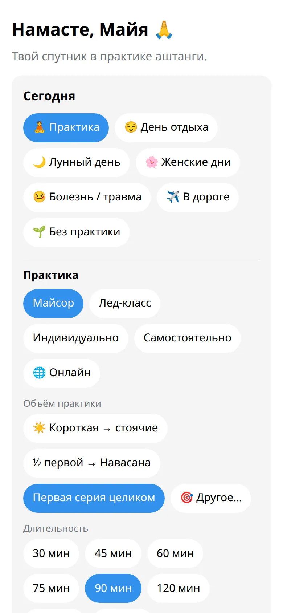

У Tristhana две части, и журнал у них общий. Бот нужен для быстрых отметок и напоминаний. Приложение — для календаря, статистики и всего, где больше деталей.

## Бот

Это чат с [@tristhana_bot](https://t.me/tristhana_bot). В нём удобно:

- отметить сегодня в одно-два касания (:cmd[start] или :cmd[log]);
- получать мягкое ежедневное напоминание и предупреждение перед лунными днями;
- смотреть ближайшие лунные дни (:cmd[moon]) и свои занятия (:cmd[schedule]);
- отмечать новую асану (:cmd[asanas]);
- получать сообщения от учителя или шалы.

## Приложение

Оно открывается прямо в Telegram: нажми кнопку рядом с полем сообщения или :ftl[start-open-app] под сообщением бота. В нём удобно:

- видеть весь год сразу и каждый месяц подробно;
- заполнять и менять прошлые дни в календаре;
- смотреть значки и самочувствие за год, делать карточку, чтобы поделиться;
- менять имя, город, выходной, напоминания и тихие часы.

## Полезно знать

- Всё, что отмечено в боте, видно в приложении, и наоборот.
- Ботом можно пользоваться без приложения, а приложением — без бота. Но напоминания всегда приходят от бота.
- Приложение подстраивается под тему твоего Telegram, светлую или тёмную.
- Хочешь быстро осмотреться? :ftl[tour-open]{from=bot} под :cmd[help] покажет бота за шесть коротких шагов, в том числе про учителей и шалы. В приложении своё :ftl[tour-open] в разделе :ftl[settings-open]: оно показывает то, что есть на твоём экране, поэтому у учителя или участника шалы шагов на один-два больше.

## Дальше

- [Отметить практику](../../students/log-practice/)
- [Все команды бота](../../reference/commands/)
