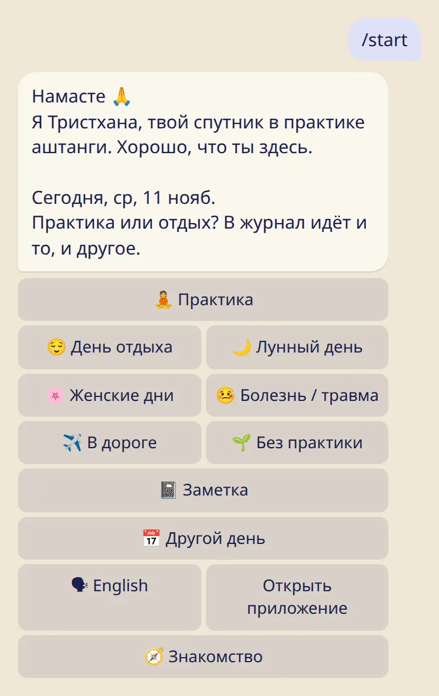

Открой бота, выбери язык и отметь первый день. Это займёт пару минут.

## По шагам

1. Открой [@tristhana_bot](https://t.me/tristhana_bot) в Telegram и отправь :cmd[start].
2. Бот спросит, как прошёл день. Нажми :ftl[status-practiced] или :ftl[status-rest]: в журнал идёт и то, и другое.
3. Готово, первый день отмечен. Хочешь календарь и статистику? Нажми :ftl[start-open-app].

_Картинки бота нарисованы по его настоящим сообщениям._
