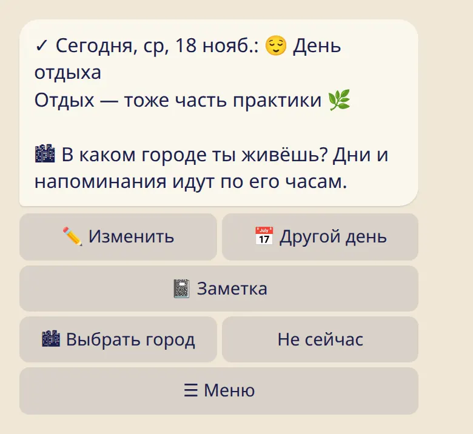

Открой бота, выбери, с чего начать, и отметь первый день. Это займёт пару минут.

## По шагам

1. Открой [@tristhana_bot](https://t.me/tristhana_bot) в Telegram и запусти его.
2. Бот спросит: :ftl[welcome-ask] Нажми :ftl[welcome-path-practice]. Если ты преподаёшь, два других ответа — для тебя.
3. Теперь он спросит про сегодня. Нажми :ftl[status-practiced] или :ftl[status-rest]: в журнал идёт и то, и другое.
4. После практики нажми :ftl[practice-done]. Вот и всё, первый день отмечен.
5. Под сохранённым днём бот спросит: :ftl[city-ask] Нажми :ftl[city-ask-button] и выбери город или нажми :ftl[next-not-now]: тогда бот больше не спросит, а город можно будет выбрать в разделе :ftl[menu-settings].

_Картинки бота нарисованы по его настоящим сообщениям._

## Полезно знать

- **Сегодня три касания, с завтрашнего дня — два.** Первый вопрос бот задаёт только один раз. Дальше бот сразу открывается на сегодняшнем дне.
- **Вчерашнее сообщение?** Если нажать кнопки в сообщении «Сегодня» за прошлый день, бот спросит, на какой день записать: на сегодня или на дату из того сообщения. Ничего не попадёт не в тот день.
- **Другой день.** Внизу «Сегодня» есть :ftl[log-another-day], рядом с :ftl[menu-open], — для дня, который ещё не отмечен.
- **Без регистрации, и команды учить не нужно.** Аккаунт появляется в тот момент, когда ты запускаешь бота. Всё остальное — под кнопкой :ftl[menu-open], в том числе :ftl[menu-asanas].
- **Заметки.** Бот понимает кнопки, а не сообщения. Чтобы сохранить заметку к дню, отметь день и нажми :ftl[diary-button].
- **Язык.** Бот сразу говорит на языке твоего Telegram. Кнопка с названием другого языка на первом экране переключает его, а позже язык можно сменить в разделе :ftl[menu-settings].
- **Время твоего города.** По городу идут часы твоих дней и напоминаний. Выбери его, когда бот спросит, или в любой момент в разделе :ftl[menu-settings]. Если один раз открыть приложение, оно тоже сообщит боту время телефона.

## Три вкладки приложения

- :ftl[tab-today]: отметить день в одно касание.
- :ftl[tab-practice]: календарь месяца, год и твои асаны.
- :ftl[tab-shala]: твоя шала, твой учитель и твои ученики, и первым — что нужно сделать.

## Дальше

- [Бот и приложение](../bot-and-app/): что для чего.
- [Отметить практику](../../students/log-practice/): детали, прошлые дни, изменения.
