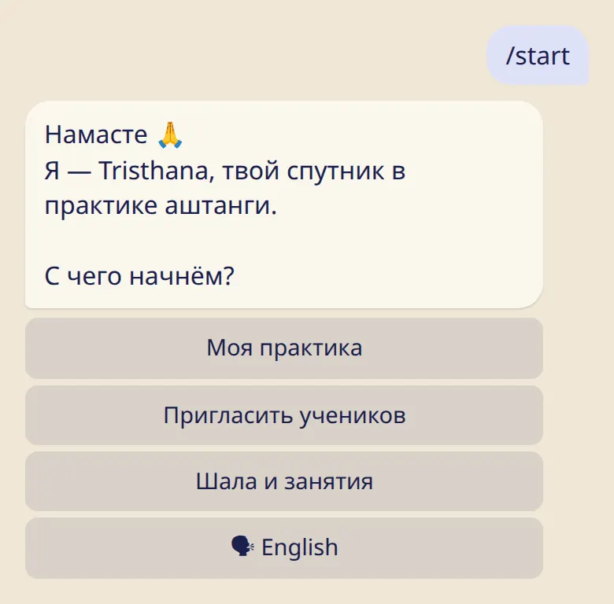
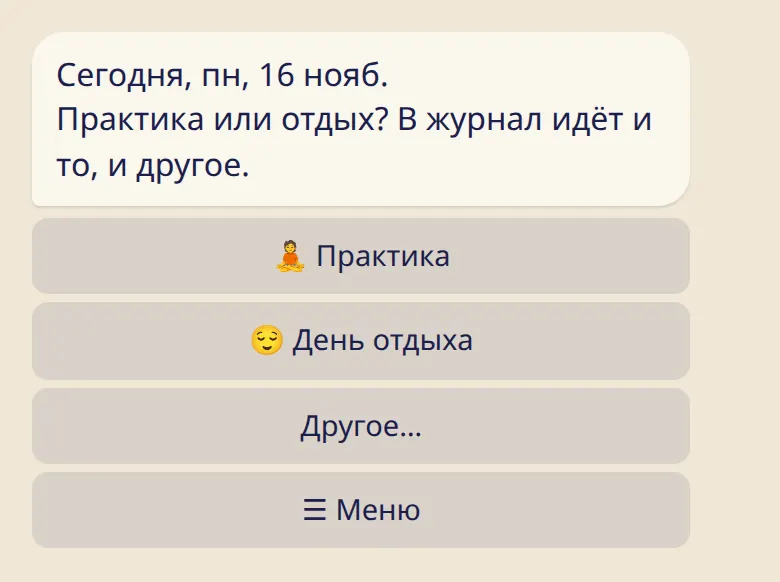

Открой бота, выбери, с чего начать, и отметь первый день. Это займёт пару минут.

## По шагам

1. Открой [@tristhana_bot](https://t.me/tristhana_bot) в Telegram и запусти его.
2. Бот спросит: :ftl[welcome-ask] Нажми :ftl[welcome-path-practice]. Если ты преподаёшь, два других ответа — для тебя.
3. Теперь он спросит про сегодня. Нажми :ftl[status-practiced] или :ftl[status-rest]: в журнал идёт и то, и другое.
4. После практики нажми :ftl[practice-done]. Вот и всё, первый день отмечен.

_Картинки бота нарисованы по его настоящим сообщениям._

## Полезно знать

- **Сегодня три касания, с завтрашнего дня — два.** Первый вопрос бот задаёт только один раз. Дальше :cmd[start] сразу открывает сегодняшний день.
- **Без регистрации, и команды учить не нужно.** Аккаунт появляется в тот момент, когда ты запускаешь бота. Всё остальное — под кнопкой :ftl[menu-open].
- **Язык.** Бот сразу говорит на языке твоего Telegram. Кнопка с названием другого языка на первом экране переключает его, а позже язык можно сменить в разделе :ftl[menu-settings].
- **Часовой пояс.** Открой один раз приложение: :ftl[menu-open] → :ftl[menu-practice]. Оно сообщит боту часовой пояс телефона, и дни будут попадать на нужную дату.

## Дальше

- [Бот и приложение](../bot-and-app/): что для чего.
- [Отметить практику](../../students/log-practice/): детали, прошлые дни, изменения.
