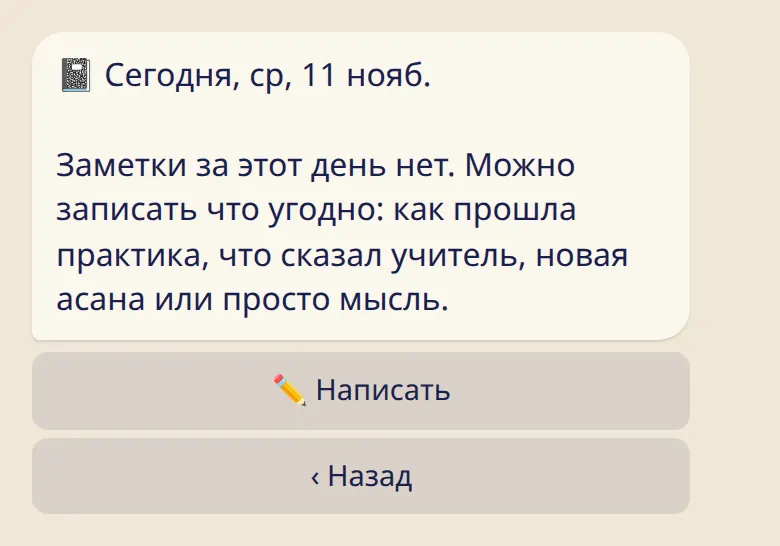

Пара касаний о том, как прошла практика, и личная заметка для всего, что хочется запомнить.

## Самочувствие

Сразу после отметки сегодняшней практики бот показывает ряд смайликов. Нажми один или просто пропусти.

- **Настроение:** пять смайликов.
- **⚡ Энергия** и **🔥 Усилие:** от 1 до 5.
- :ftl[checkin-tags-open]: слова вроде :ftl[checkin-tag]{from=bot tag=open}, :ftl[checkin-tag]{from=bot tag=stiff} или :ftl[checkin-tag]{from=bot tag=calm}.

Всё по желанию. Для прошлого дня практики открой день и нажми :ftl[checkin-edit].

Вопрос не нужен? :cmd[settings] → :ftl[settings-checkin-off].

## Дневник

У каждого дня может быть одна личная заметка: после практики, в день отдыха, в любой день.

1. Открой день (:cmd[log]) и нажми :ftl[diary-button].
2. Нажми :ftl[diary-write] и отправь заметку ответом на сообщение бота.

В приложении та же заметка лежит на карточке дня, в разделе :ftl[diary-title]{from=app}.

## Полезно знать

- Самочувствие и заметки дневника — только твои. Их не видит ни учитель, ни шала.
- Заметки дневника хранятся в зашифрованном виде.
- Заметка, написанная в боте, остаётся и в твоём чате Telegram, пока ты не удалишь там сообщение.
- В заметке может быть до 2000 знаков обычного текста.
- Tristhana не делает выводов из того, что ты пишешь или отмечаешь. Она просто хранит это для тебя.

## Дальше

- [Твои данные: приватность, выгрузка, удаление](../your-data/)
