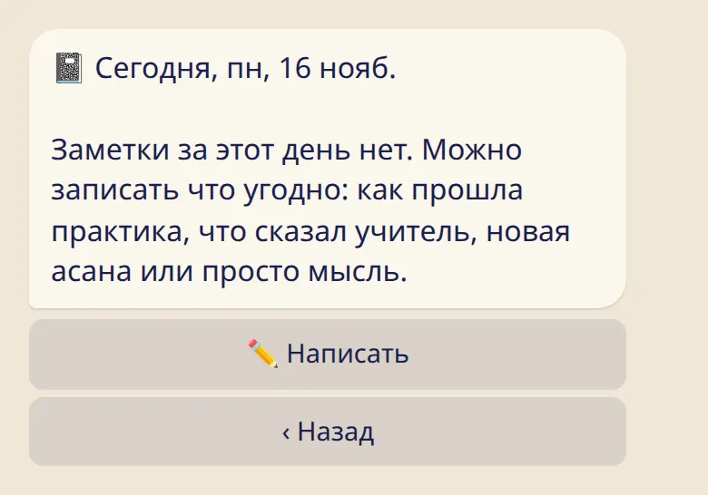

Пара касаний о том, как прошла практика, и личная заметка для всего, что хочется запомнить.

## Самочувствие

Когда ты отмечаешь практику и нажимаешь :ftl[practice-done], бот показывает кнопку :ftl[checkin-edit]{from=bot} — нажми её или просто оставь. В приложении это строка на карточке дня, когда день отмечен как :ftl[status-practiced].

- :ftl[checkin-mood]: пять смайликов.
- :ftl[checkin-energy] и :ftl[checkin-effort].
- :ftl[checkin-tags-open]: слова вроде :ftl[checkin-tag]{from=bot tag=open}, :ftl[checkin-tag]{from=bot tag=stiff} или :ftl[checkin-tag]{from=bot tag=calm}.

Всё по желанию. Для прошлого дня практики выбери этот день, нажми :ftl[status-practiced], а потом :ftl[practice-done]: там та же кнопка.

Кнопка не нужна? :ftl[menu-settings] → :ftl[settings-more-button] → :ftl[settings-checkin-off]. В приложении: шестерёнка → :ftl[settings-more-button], и выключи :ftl[settings-checkin].

## Заметки

У каждого дня может быть одна личная заметка: после практики, в день отдыха, в любой день.

1. Нажми :ftl[diary-button] под сохранённым днём. После практики эта кнопка будет на экране, который откроется после :ftl[practice-done]. Под сохранённым днём отдыха она есть сразу. Для любого другого дня сначала нажми :ftl[log-change].
2. Нажми :ftl[diary-write] и отправь заметку ответом на сообщение бота.

В приложении нажми :ftl[diary-add] на карточке отмеченного дня.

## Полезно знать

- Самочувствие и заметки — только твои. Их не видит ни учитель, ни шала.
- Заметки хранятся в зашифрованном виде.
- Заметка, написанная в боте, остаётся и в твоём чате Telegram, пока ты не удалишь там сообщение.
- В заметке может быть до 2000 знаков обычного текста.
- Бот понимает кнопки, а не сообщения: текст, отправленный в чат без :ftl[diary-write], заметкой не сохранится.
- Tristhana не делает выводов из того, что ты пишешь или отмечаешь, и просто хранит это для тебя.

## Дальше

- [Твои данные: приватность, выгрузка, удаление](../your-data/)
