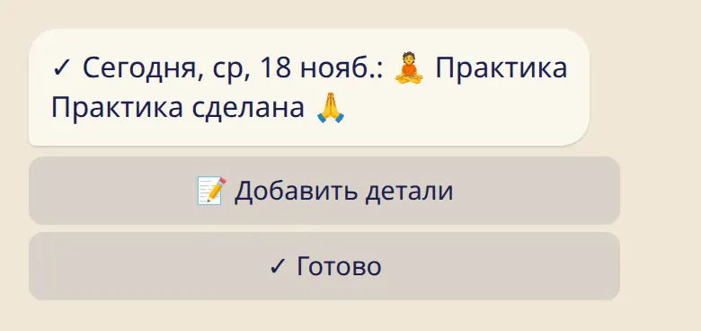
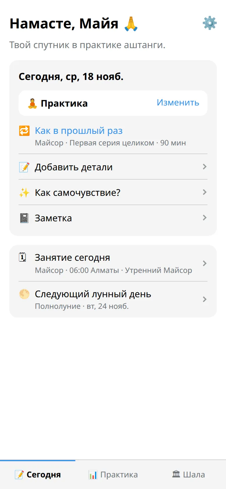

Отметь сегодня, вчера или любой прошлый день и добавь столько деталей, сколько хочется: где, до какой асаны, сколько по времени.

## Отметить сегодня

### В боте

1. Отправь :cmd[start] или нажми :ftl[menu-open] → :ftl[menu-today].
2. Выбери, как прошёл день: :ftl[status-practiced], :ftl[status-rest] или :ftl[today-other] — там лунный день и всё остальное.
3. После практики нажми :ftl[practice-done]. Бот покажет, что сохранил.

### В приложении

На вкладке :ftl[tab-today] нажми :ftl[status-practiced], :ftl[status-rest] или :ftl[today-other]. День сохраняется сразу.

## Добавить детали (по желанию)

Шагов выше достаточно. Если хочется больше, сразу после :ftl[status-practiced] нажми :ftl[practice-add-details]. Можно добавить:

- **Где:** :ftl[context-mysore], :ftl[context-led], :ftl[context-private] или :ftl[context-self]. Если практика была онлайн, добавь :ftl[practice-online].
- **До какой асаны:** :ftl[practice-length]{from=bot} предлагает :ftl[preset-short], :ftl[preset-half-primary] и :ftl[preset-full-primary]. :ftl[preset-other] даёт выбрать серию и последнюю асану.
- **Сколько по времени:** :ftl[practice-duration]{from=bot}, от 30 минут до 3 часов.
- **Время начала:** только в приложении.

:ftl[practice-same-as-last] одним касанием копирует детали прошлой практики. Лед-класс не считается: после него кнопка предложит практику, которая была до него. Строка над кнопками показывает, что скопируется, а если та практика была давно — ещё и её день.

В приложении это неброские строки под тремя вариантами, и ничего не раскрывается, пока не нажмёшь.

## Отметить прошлый день

- **В боте:** нажми :ftl[log-another-day] под сохранённым днём или :ftl[menu-help] → :ftl[help-earlier-day]. Выбери день. :ftl[log-earlier] листает дальше назад.
- **В приложении:** открой вкладку :ftl[tab-practice], нажми на день в календаре месяца и выбери, как он прошёл.

## Изменить или убрать отметку

Под сохранённым днём нажми :ftl[log-change]. Потом выбери другой статус или нажми :ftl[log-clear]{from=bot}, чтобы убрать запись. Если поменять день практики на отдых, детали практики тоже уберутся. В приложении нажми другой вариант на карточке дня или :ftl[today-clear].

## Полезно знать

- Короткая практика — тоже практика. Сурья Намаскар, стоячие и завершающие считаются.
- :ftl[status-skipped] — честный ответ, а не минус. Дни без отметки вообще нигде не считаются.
- В одном дне — одна практика.
- Если даты съехали на день, открой один раз приложение, чтобы бот узнал твой часовой пояс.

## Дальше

- [Отдых, лунные дни и 🌸](../rest-and-moon-days/)
- [Мои асаны](../my-asanas/): чтобы отмечать объём практики быстрее.
