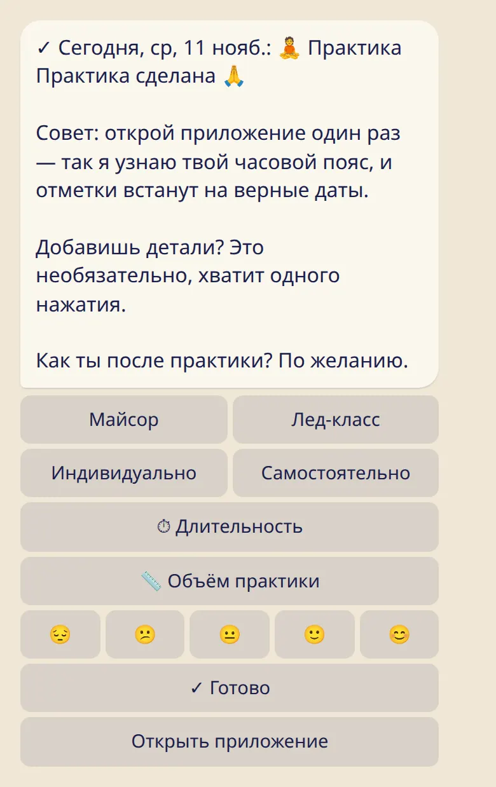

Отметь сегодня, вчера или любой прошлый день и добавь столько деталей, сколько хочется: где, до какой асаны, сколько по времени.

## Отметить сегодня

### В боте

1. Отправь :cmd[log] (или :cmd[start]).
2. Выбери, как прошёл день. Если была практика — :ftl[status-practiced].
3. Готово. Бот покажет, что сохранил.

### В приложении

Открой приложение и нажми на статус на карточке :ftl[today-title].

## Добавить детали (по желанию)

Одного касания достаточно. Если хочется больше, сразу после отметки практики можно добавить:

- **Где:** :ftl[context-mysore], :ftl[context-led], :ftl[context-private] или :ftl[context-self]. Если практика была онлайн, добавь :ftl[practice-online].
- **До какой асаны:** :ftl[practice-length]{from=bot} предлагает :ftl[preset-short], :ftl[preset-half-primary] и :ftl[preset-full-primary]. :ftl[preset-other] даёт выбрать серию и последнюю асану.
- **Сколько по времени:** :ftl[practice-duration]{from=bot}, от 30 минут до 3 часов.
- **Время начала:** только в приложении.

:ftl[practice-same-as-last] одним касанием копирует детали прошлой практики. Лед-класс не считается: после него кнопка предложит практику, которая была до него. Строка над кнопкой показывает, что скопируется, а если та практика была давно — ещё и её день.

## Отметить прошлый день

- **В боте:** нажми :ftl[log-another-day] и выбери день. :ftl[log-earlier] листает дальше назад.
- **В приложении:** открой :ftl[stats-open], нажми на день в календаре месяца и выбери статус.

## Изменить или убрать отметку

Открой день ещё раз. :ftl[log-change] позволяет выбрать другой статус, :ftl[log-clear]{from=bot} убирает запись. Если поменять день практики на отдых, детали практики тоже уберутся.

## Полезно знать

- Короткая практика — тоже практика. Сурья Намаскар, стоячие и завершающие считаются.
- :ftl[status-skipped] — честный ответ, а не минус. Дни без отметки вообще нигде не считаются.
- В одном дне — одна практика.
- Если даты съехали на день, открой один раз приложение, чтобы бот узнал твой часовой пояс.

## Дальше

- [Отдых, лунные дни и 🌸](../rest-and-moon-days/)
- [Мои асаны](../my-asanas/): чтобы отмечать объём практики быстрее.
