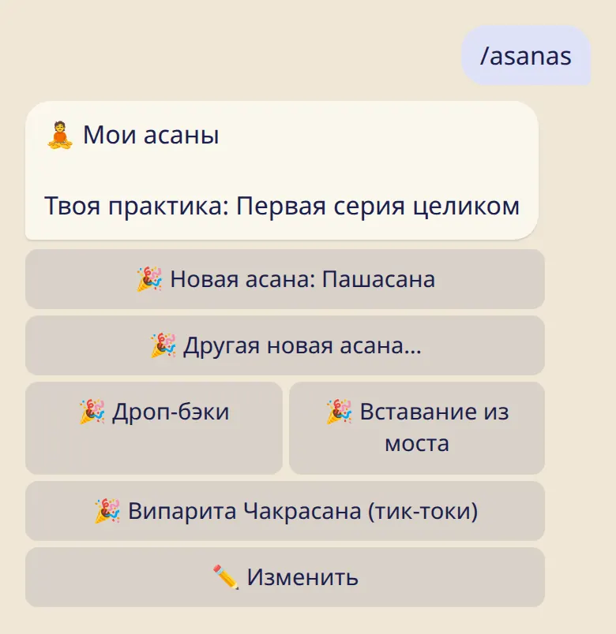
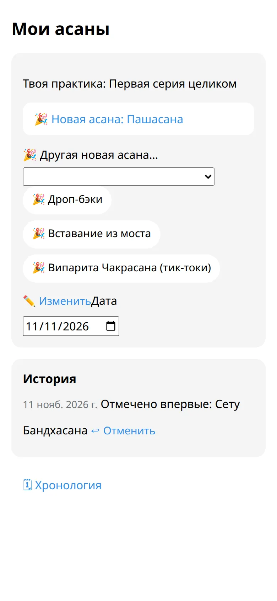

Отмечай последнюю асану, добавляй новую, когда её даёт учитель, и смотри, как всё складывалось со временем.

## Укажи, где заканчивается практика

1. Отправь :cmd[asanas] или нажми :ftl[progression-open] в приложении.
2. В первый раз выбери серию и последнюю асану.

После этого :ftl[practice-length]{from=bot} при отметке предлагает и твою практику.

## Новая асана 🎉

Когда учитель даёт следующую асану, открой :cmd[asanas] и нажми кнопку с её названием. Дали сразу несколько? :ftl[progression-new-other] позволит выбрать.

У дроп-бэков, вставания из прогиба и тик-токов свои кнопки. Отмечай их, когда они появятся в практике, в любом порядке.

## Исправить ошибку

- :ftl[progression-undo] отменяет последнюю отметку.
- :ftl[progression-change] задаёт, где практика заканчивается сейчас, без поздравления. Пригодится после перерыва или если нажата не та асана.

## Когда отмечает учитель

Учитель из твоего списка может отметить новую асану за тебя. Бот сообщит, кто это сделал, а отметку можно отменить, если она не совпадает с практикой.

## Посмотреть историю

В приложении :ftl[timeline-open] показывает твои асаны с датами, начиная с самых новых.

## Полезно знать

- Асаны отмечаешь ты, на доверии. Ничего не «открывается», и никто не проверяет.
- Учитель из твоего списка видит, где практика заканчивается сейчас. Историю учитель не видит.

## Дальше

- [Мой учитель](../my-teacher/)
