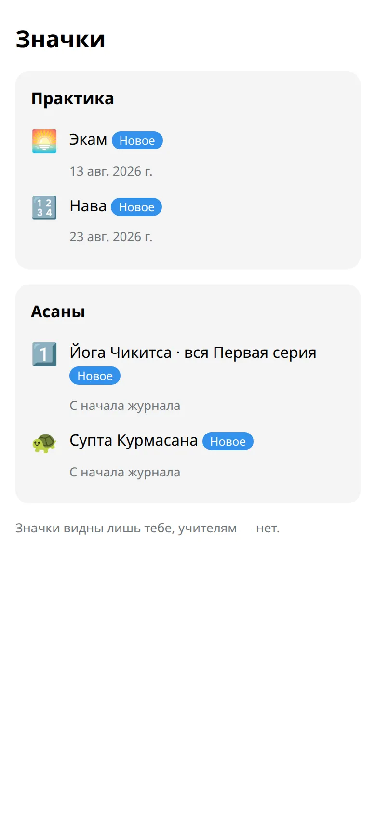

Твой год на одном экране, итоги каждого месяца, тихие значки и карточки, которыми можно поделиться, если захочется.

## Как открыть

Открой приложение и нажми :ftl[stats-open].

## Что на экране

- **Год.** Двенадцать маленьких месяцев. Закрашенный квадрат — практика; более мягкие цвета — отдых, лунные дни, болезнь или поездка. Кружок отмечает полнолуние или новолуние.
- **Месяц словами.** Например, практика в 9 из 10 дней. Второе число — это только дни, отмеченные как практика или :ftl[status-skipped]. Отдых и дни без отметки не учитываются.
- **Подряд.** Сколько практик шло одна за другой. Отдых, лунные дни, болезнь и поездки счёт не сбрасывают.
- **Месяц.** Календарь, а под ним итоги: практики, где они проходили, какие серии, общее время.

Нажми на день в календаре месяца, чтобы отметить или изменить его.

## Значки

Нажми :ftl[badges-open] внизу экрана. Там только те значки, которые у тебя уже есть, и когда они появились. Они только для тебя: учителя их не видят, и никаких рейтингов нет.

## Поделиться карточкой

:ftl[share-open] рядом с годом или месяцем делает картинку для истории или поста. Её можно отправить в историю, сохранить или отправить себе в чат. На карточке только дни практики: ни имени, ни заметок, ни причин отдыха.

## Полезно знать

- На 100-й, 365-й и 1000-й практике бот тихо говорит спасибо. Никто ни с кем не сравнивается.
- Дни 🌸 здесь выглядят как отдых, пока ты не включишь их показ на своём телефоне.

## Дальше

- [Мои асаны](../my-asanas/)
