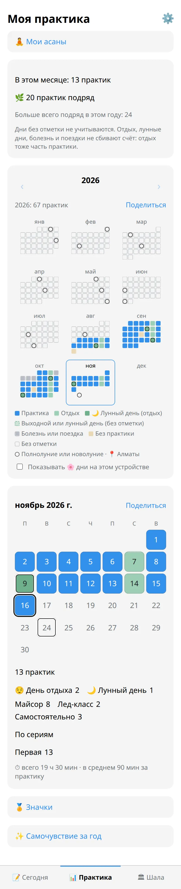
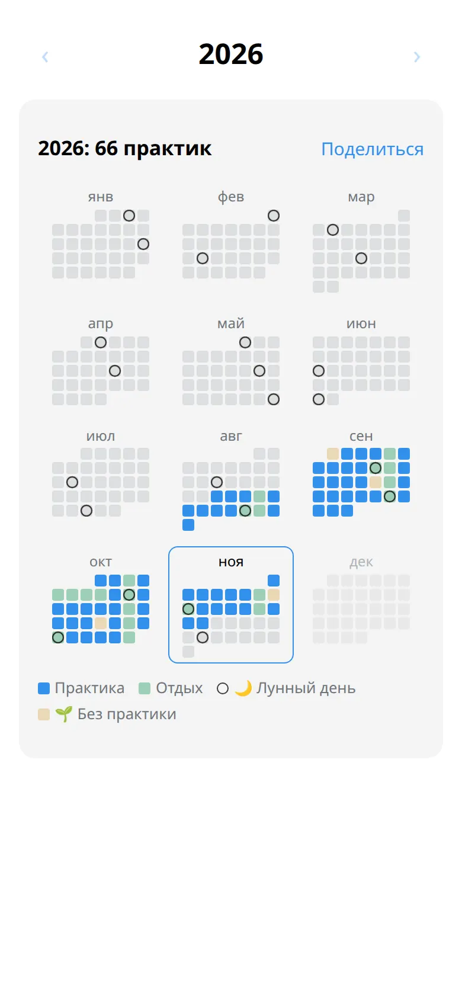
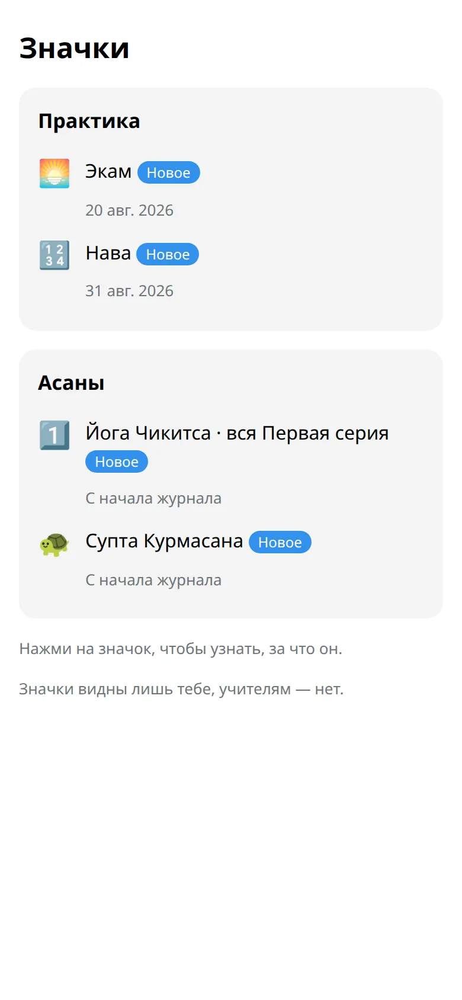
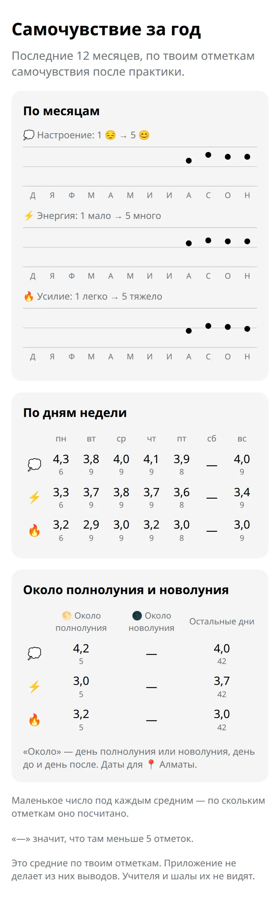

Твой месяц на одном экране, год в одном касании, тихие значки и карточки, которыми можно поделиться, если захочется.

## Как открыть

Открой приложение и перейди на вкладку :ftl[tab-practice]. Она открывается на текущем месяце. Стрелки рядом с названием месяца ведут к другим месяцам.

## Что на экране

- **Четыре отметки:** :ftl[stats-legend-practiced], :ftl[stats-legend-rest], :ftl[status-moon] (кружок вокруг числа) и :ftl[status-skipped]. День без отметки — просто число.
- **Одна строка под календарём:** практики за месяц. Если в месяце только отдых, там написано: :ftl[stats-month-rest] В текущем месяце видно ещё и сколько практик идёт подряд.
- :ftl[stats-more] открывает остальное: отдых по видам, где проходили практики, какие серии и общее время.
- **Год** — это строка под кнопкой :ftl[progression-open]: двенадцать маленьких месяцев с теми же отметками. Нажми на месяц, чтобы открыть его.

Нажми на день, чтобы отметить или изменить его: смотри [Отметить практику](../log-practice/).

## Значки

Нажми :ftl[badges-open] внизу экрана. Там только те значки, которые у тебя уже есть, и когда они появились. Они только для тебя: учителя их не видят, и никаких рейтингов нет.

## Самочувствие за год

Нажми :ftl[trends-open] внизу экрана. Там средние по твоим ответам на :ftl[checkin-edit] после практики за последние 12 месяцев: по месяцам, по дням недели и в дни около полнолуния и новолуния рядом со всеми остальными днями. Маленькое число под каждым средним показывает, за сколько дней оно посчитано.

На экране твои цифры, и приложение не делает из них выводов. Средние появляются, когда ответы есть хотя бы за 10 дней. Месяцу, дню недели или колонке про луну нужно 5 дней, до этого там прочерк. Этот экран видишь лишь ты: учителя и шалы его не видят.

## Поделиться карточкой

:ftl[share-open] рядом с практиками за месяц или итогом за год делает картинку для истории или поста. Её можно отправить в историю, сохранить или отправить себе в чат. На карточке только дни практики: ни имени, ни заметок, ни причин отдыха. А за 3 дня до лунного дня появляется и карточка лунного дня: смотри [Отдых, лунные дни и 🌸](../rest-and-moon-days/#поделиться-карточкой-лунного-дня).

## Полезно знать

- На 100-й, 365-й и 1000-й практике бот тихо говорит спасибо. Никто ни с кем не сравнивается.
- Любой отдых не сбивает счёт практик подряд.
- Если в месяце есть день :ftl[status-skipped], в разделе :ftl[stats-more] появится, например, :ftl[stats-consistency]{x=9 y=10}. Отдых и дни без отметки туда не входят.
- Дни 🌸 в календаре выглядят как отдых. Как отметить их там, смотри в разделе [Отдых, лунные дни и 🌸](../rest-and-moon-days/).

## Дальше

- [Мои асаны](../my-asanas/)
