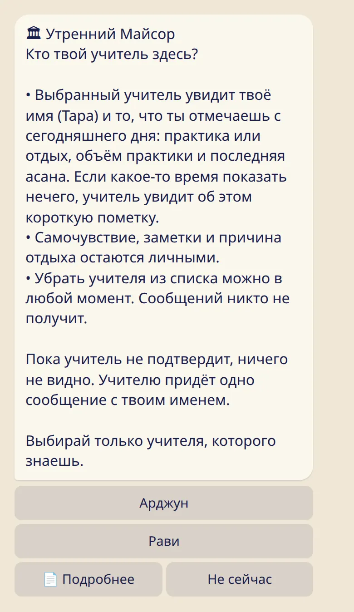
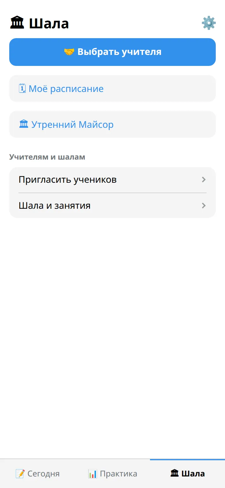
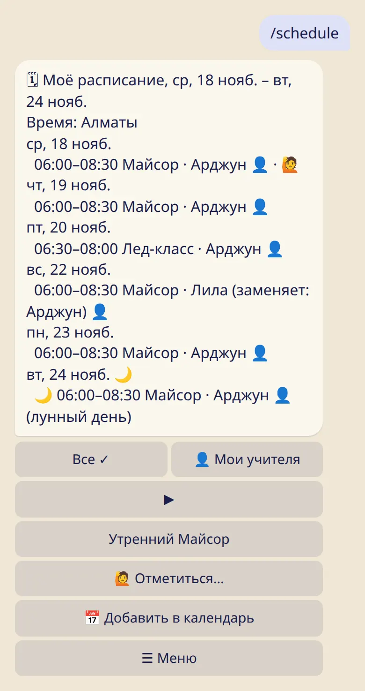
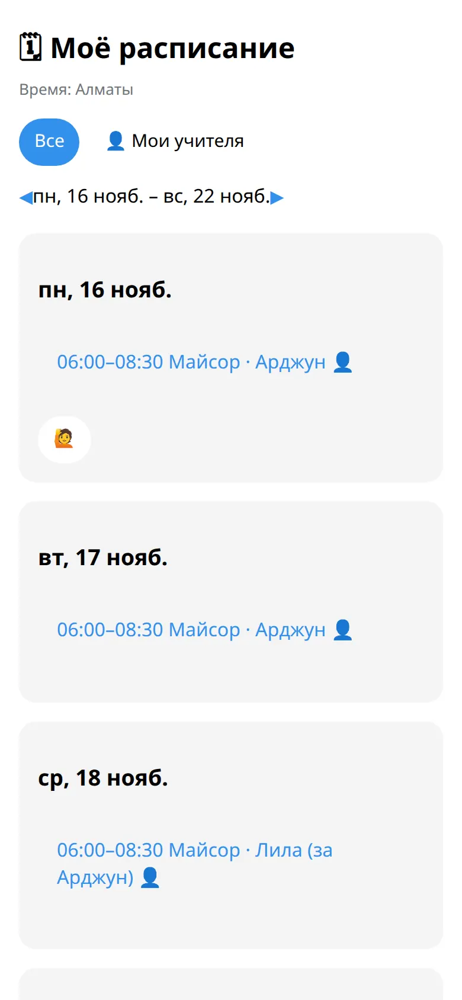

Присоединись к шале, смотри её занятия по своему времени, добавь их в календарь и отмечай занятия, на которых ты бываешь.

## Присоединиться

1. Шала присылает ссылку или показывает QR-код.
2. Открой её. Бот покажет шалу и коротко расскажет, что значит присоединиться. Полный текст — под кнопкой :ftl[consent-details].
3. Нажми :ftl[shala-join-yes].

Учителя и команда шалы видят твоё имя и ничего из твоего журнала. Команда шалы может присылать объявления, их можно отключить. Лунные дни считаются по календарю шалы, если у тебя не выбран свой город. Исключение — основной учитель не в команде шалы и выбрал свой город: тогда по его городу. Смотри [Отдых, лунные дни и 🌸](../rest-and-moon-days/).

## Кто твой учитель здесь?

Сразу после того, как ты присоединишься, бот спросит :ftl[request-ask] и покажет учителей шалы. На том же экране коротко сказано, что будет видеть учитель.

1. Нажми на имя своего учителя. Если учитель в шале один, бот спросит прямо о нём: нажми :ftl[request-yes].
2. Учителю придёт одно сообщение с твоим именем. Когда учитель подтвердит, он появится в списке твоих учителей.

- Пока учитель не подтвердит, он не видит ничего из твоего журнала.
- Пока не знаешь? Нажми :ftl[invite-decline]. Вопрос останется на карточке шалы, под кнопкой :ftl[request-open]{from=bot}. Он есть там и у тех, кто в шале уже давно.
- Вопроса нет? Значит, в этой шале сейчас некого выбрать.

В приложении, пока учителя нет, :ftl[request-open]{from=app} — первая строка на вкладке :ftl[tab-shala]. Там тот же вопрос.

Что будет дальше и как отозвать запрос: [Мой учитель](../my-teacher/).

## Твоё расписание

- **В боте:** :ftl[menu-open] → :ftl[menu-classes] показывает занятия всех твоих шал на эту неделю. Если неделя не помещается в одно сообщение, в конце будет :ftl[schedule-full-app]: эта кнопка откроет всю неделю в приложении.
- **В приложении:** на вкладке :ftl[tab-shala] нажми :ftl[my-schedule-open]{from=app}, чтобы увидеть всю неделю и следующие за ней. Сегодняшнее занятие есть ещё и на вкладке :ftl[tab-today], отдельной строкой.
- **Неделя одной шалы:** на её карточке нажми :ftl[schedule-open]. Строка о лунных днях на карточке говорит, что шала делает в лунные дни.

Время показано по часам твоего города, и город назван. Если шала живёт по времени другого города, видно оба времени. 🌙 рядом с датой — один из твоих лунных дней.

## Добавить в календарь

Под расписанием в боте нажми :ftl[feed-open]. Ты получишь личную ссылку для календаря Google, Apple или Outlook с твоими занятиями и лунными днями. Она обновляется сама.

Ссылка личная: любой, у кого она есть, видит твоё расписание. Если она куда-то утекла, :ftl[feed-rotate] сделает новую.

## Отметить посещение занятия

Под расписанием в боте нажми :ftl[attend-me-open] и выбери занятие. Отметить можно сегодняшний день и шесть предыдущих. Команда шалы может подтвердить твою отметку или отметить тебя сама.

Посещения не связаны с журналом практики. Отметка о посещении не записывает практику, и нигде не видно, что тебя не было.

## Выйти из шалы

Открой :ftl[menu-teacher], нажми на шалу, затем :ftl[shala-leave] и подтверди. Никто не получит сообщения, а журнал останется как есть.

## Дальше

- [Настройки и твой город](../settings/)
