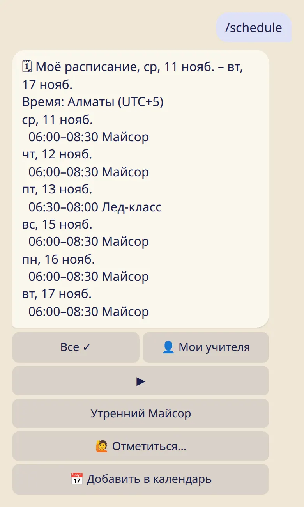
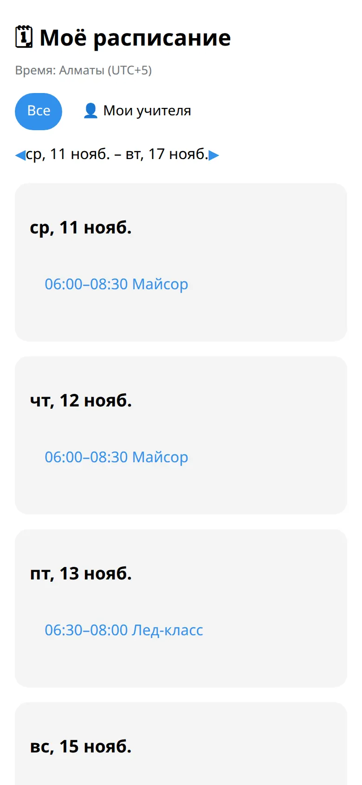

Присоединись к шале, смотри её занятия по своему времени, добавь их в календарь и отмечай занятия, на которых ты бываешь.

## Присоединиться

1. Шала делится ссылкой или QR-кодом.
2. Открой её. Бот покажет шалу и расскажет, что значит присоединиться.
3. Нажми :ftl[shala-join-yes].

Учителя и команда шалы видят твоё имя и ничего из твоего журнала. Команда шалы может присылать объявления, их можно отключить. Лунные дни могут считаться по календарю шалы: смотри [Отдых, лунные дни и 🌸](../rest-and-moon-days/).

## Твоё расписание

- **В боте:** :cmd[schedule] показывает занятия всех твоих шал на эту неделю.
- **В приложении:** нажми :ftl[my-schedule-open]{from=app}, чтобы увидеть всю неделю и следующие за ней.

Время показано в твоём часовом поясе, с его названием. Если шала в другом поясе, видно оба времени. 🌙 рядом с датой — один из твоих лунных дней.

## Добавить в календарь

Под :cmd[schedule] нажми :ftl[feed-open]. Ты получишь личную ссылку для календаря Google, Apple или Outlook с твоими занятиями и лунными днями. Она обновляется сама.

Ссылка личная: любой, у кого она есть, видит твоё расписание. Если она куда-то утекла, :ftl[feed-rotate] сделает новую.

## Отметить посещение занятия

Под :cmd[schedule] нажми :ftl[attend-me-open] и выбери занятие. Отметить можно сегодняшний день и шесть предыдущих. Команда шалы может подтвердить твою отметку или отметить тебя сама.

Посещения не связаны с журналом практики. Отметка о посещении не записывает практику, и нигде не видно, что тебя не было.

## Выйти из шалы

:cmd[teachers] → шала → :ftl[shala-leave]. Никто не получит сообщения, а журнал останется как есть.

## Дальше

- [Настройки и твой город](../settings/)
