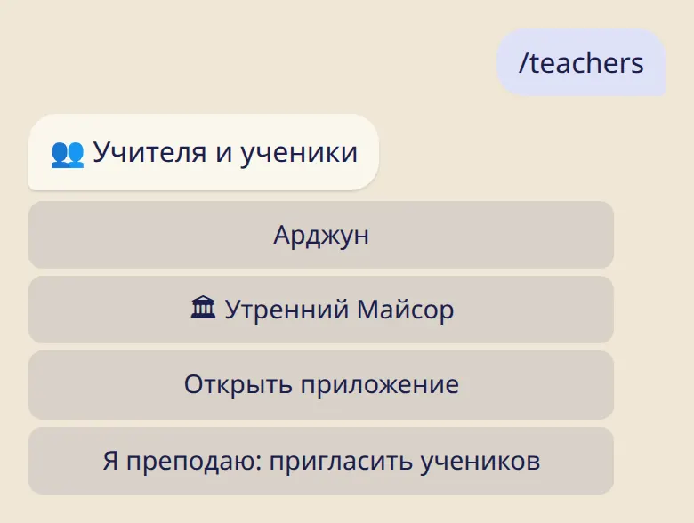

Добавь учителя по ссылке или QR-коду и посмотри, что именно учитель видит, а что нет.

## Добавить учителя

1. Учитель присылает ссылку или показывает QR-код.
2. Открой её. Бот покажет, кто тебя приглашает и что этот человек будет видеть.
3. Нажми :ftl[invite-accept] или :ftl[invite-decline]. Если отказаться, учитель об этом не узнает.

Принимай приглашение, только если знаешь этого человека: имя здесь можно написать любое.

## Что видит учитель

- твоё имя;
- то, что ты отмечаешь со дня, когда учитель появился в списке: практика или отдых и объём практики;
- твою последнюю асану;
- если какое-то время показать нечего — короткую пометку об этом.

## Что остаётся у тебя

- самочувствие и заметки дневника;
- причина отдыха. Любой отдых для учителя выглядит одинаково, каким бы он ни был;
- всё, что отмечено до того, как учитель появился в списке;
- твои значки.

## Твой список

:cmd[teachers] показывает твоих учителей и твои шалы.

- Учителей может быть несколько. ⭐ отмечает основного. Если у тебя не выбран свой город, лунные дни считаются по городу, который выбрал основной учитель. Если основной учитель преподаёт в твоей шале, сначала идёт календарь шалы.
- Нажми на имя, а потом :ftl[links-remove]{from=bot}, чтобы убрать учителя из списка. Никто не получит сообщения.

## Сообщения от учителя

Учитель может отправить через бота короткое объявление всем своим ученикам. Нажми :ftl[ann-mute] под таким сообщением, если получать их не хочется. Никто об этом не узнает, а прочитать их по-прежнему можно в разделе :ftl[ann-list]{from=bot}.

## Полезно знать

- С учителем или без него журнал работает совершенно одинаково.
- Учитель может отметить для тебя новую асану. Тебе придёт сообщение, и отметку можно отменить.

## Дальше

- [Моя шала: расписание, календарь, посещения](../my-shala/)
