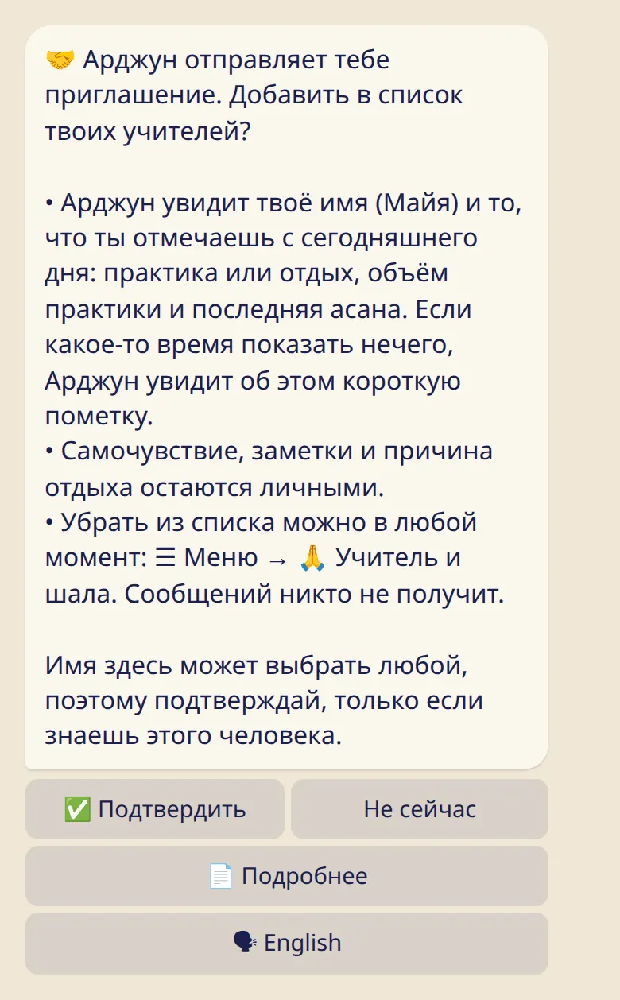
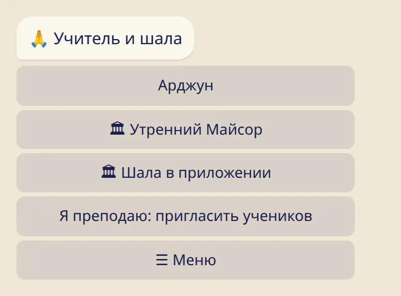
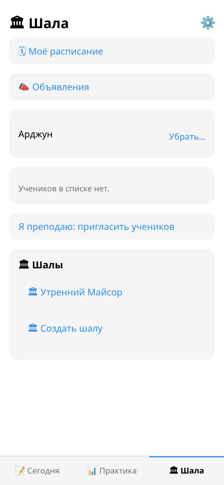

Добавь учителя по его ссылке или через свою шалу и посмотри, что именно учитель видит, а что нет.

## Добавить учителя

1. Учитель присылает ссылку или показывает QR-код.
2. Открой её. Бот покажет, кто тебя приглашает, и в нескольких строках — что этот человек будет видеть. Полный текст — под кнопкой :ftl[consent-details].
3. Нажми :ftl[invite-accept] или :ftl[invite-decline]. Если отказаться, учитель об этом не узнает.

Принимай приглашение, только если знаешь этого человека: имя здесь можно написать любое.

## Выбрать учителя в своей шале

Ссылки от учителя нет? Если учитель преподаёт в твоей шале, выбери его в боте.

1. Открой :ftl[menu-open] → :ftl[menu-teacher] и нажми на свою шалу.
2. Нажми :ftl[request-open], а потом на имя учителя. Полный текст о том, что будет видеть учитель, — под кнопкой :ftl[consent-details].
3. Учитель подтверждает. До этого на карточке шалы написано :ftl[request-waiting-line]{from=bot name=Арджун}.

- Пока учитель не подтвердит, из твоего журнала ничего не видно. Учителю придёт одно сообщение с твоим именем.
- Когда учитель подтвердит, бот напишет тебе. Учитель будет видеть твои дни со дня запроса.
- Ответа нет 7 дней? Бот напишет об этом, один раз. Спроси учителя на занятии или нажми :ftl[request-pick-another].
- Чтобы отозвать запрос, нажми :ftl[request-withdraw]{from=bot name=Арджун} на карточке шалы или :ftl[request-withdraw]{from=app} на вкладке :ftl[tab-shala] в приложении. Никто не получит сообщения.
- За неделю можно выбрать не больше трёх учителей, а того же учителя — снова примерно через месяц.
- Выбирай только учителя, которого знаешь.

Тот же вопрос бот задаёт сразу после того, как ты присоединишься к шале: смотри [Моя шала](../my-shala/).

## Что видит учитель

- твоё имя;
- то, что ты отмечаешь со дня, когда учитель появился в списке, или со дня запроса в шале: практика или отдых и объём практики;
- твою последнюю асану;
- если какое-то время показать нечего — короткую пометку об этом.

## Что остаётся у тебя

- самочувствие и заметки дневника;
- причина отдыха. Любой отдых для учителя выглядит одинаково, каким бы он ни был;
- всё, что отмечено до того, как учитель появился в списке;
- твои значки.

## Твой список

:ftl[menu-open] → :ftl[menu-teacher] показывает твоих учителей и твои шалы. В приложении они на вкладке :ftl[tab-shala].

- Учителей может быть несколько. ⭐ отмечает основного. Если у тебя не выбран свой город, лунные дни считаются по городу, который выбрал основной учитель. Если основной учитель преподаёт в твоей шале, календарь шалы важнее.
- Нажми на имя, а потом :ftl[links-remove]{from=bot}, чтобы убрать учителя из списка. Никто не получит сообщения.

## Сообщения от учителя

Учитель может отправить через бота короткое объявление всем своим ученикам. Нажми :ftl[ann-mute] под таким сообщением, если получать их не хочется. Никто об этом не узнает, а прочитать их по-прежнему можно в разделе :ftl[ann-list]{from=bot}.

## Полезно знать

- С учителем или без него журнал работает совершенно одинаково.
- Учитель может отметить для тебя новую асану. Тебе придёт сообщение, и отметку можно отменить.

## Дальше

- [Моя шала: расписание, календарь, посещения](../my-shala/)
