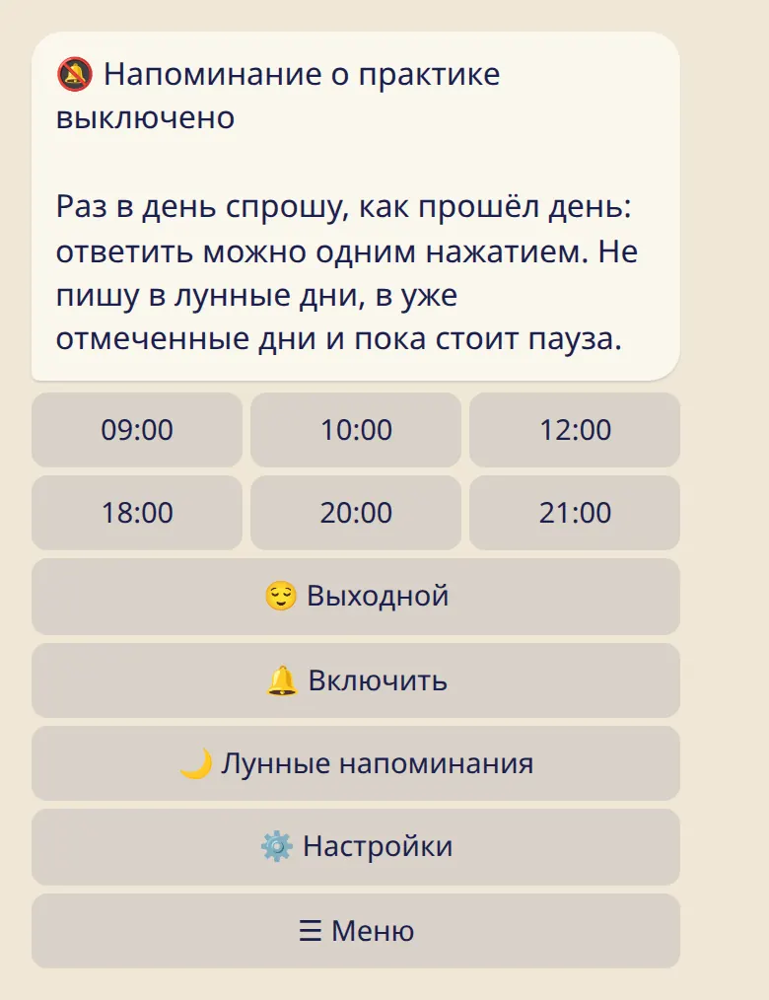
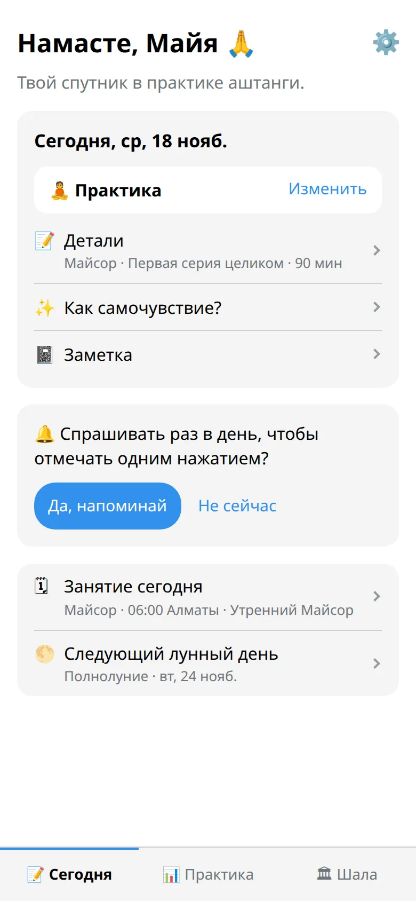

Мягкое ежедневное напоминание отметить практику и предупреждение перед лунными днями. Время выбираешь ты, отключить можно в любой момент.

## Ежедневное напоминание о практике

1. Открой :ftl[menu-open] → :ftl[menu-help] и нажми :ftl[help-reminder].
2. Выбери время и нажми :ftl[remind-turn-on].

Приложение тоже предложит напоминание на вкладке :ftl[tab-today], когда в журнале появится первый день: :ftl[next-reminder-do] включает его одним касанием, :ftl[next-not-now] убирает вопрос.

Раз в день бот спрашивает, как всё прошло. Ответить можно одним касанием:

- :ftl[remind-same] отмечает практику с теми же деталями, что и в прошлый раз;
- :ftl[remind-practiced] даёт добавить детали;
- :ftl[status-rest] отмечает день отдыха;
- :ftl[remind-other] открывает полный список.

Напоминание не приходит в твой выходной, в лунные дни, в уже отмеченные дни и во время паузы (болезнь, поездка или 🌸).

## Напоминания о лунных днях

Они включены с самого начала: за 7 дней и за 1 день до каждого лунного дня, в 19:00 по твоему времени. Поменять дни или отключить можно здесь: :ftl[menu-moon] → :ftl[moon-reminders] в боте.

## Тихие часы и лимит на день

С 22:00 до 07:00 напоминания не приходят, а за день их бывает не больше трёх. И то, и другое меняется в приложении: шестерёнка :ftl[settings-open]{from=app} → :ftl[settings-quiet].

## Полезно знать

- Напоминания выключены, пока ты их не включишь. Бот предложит один раз, после первой практики: :ftl[remind-offer-yes] включает их одним касанием, а :ftl[remind-change-time] позволяет выбрать другой час.
- Если десять напоминаний подряд останутся без ответа, бот перестанет спрашивать и скажет об этом. Включить снова можно тем же путём.
- Напоминание никогда не меняет уже отмеченный день.
- Для напоминаний нужен часовой пояс. Открой один раз приложение или выбери город в разделе :ftl[menu-settings].

## Дальше

- [Настройки и твой город](../settings/)
