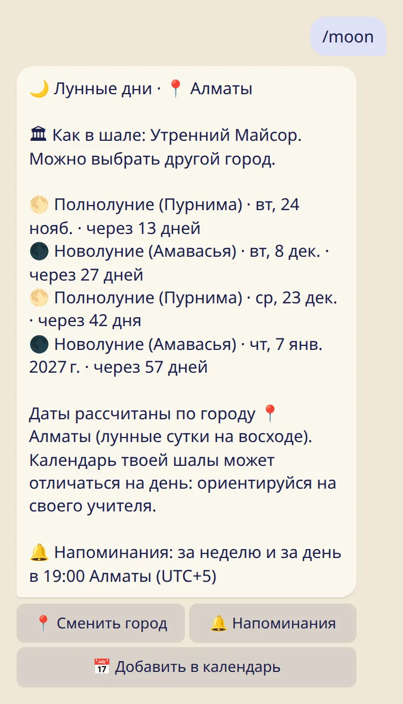
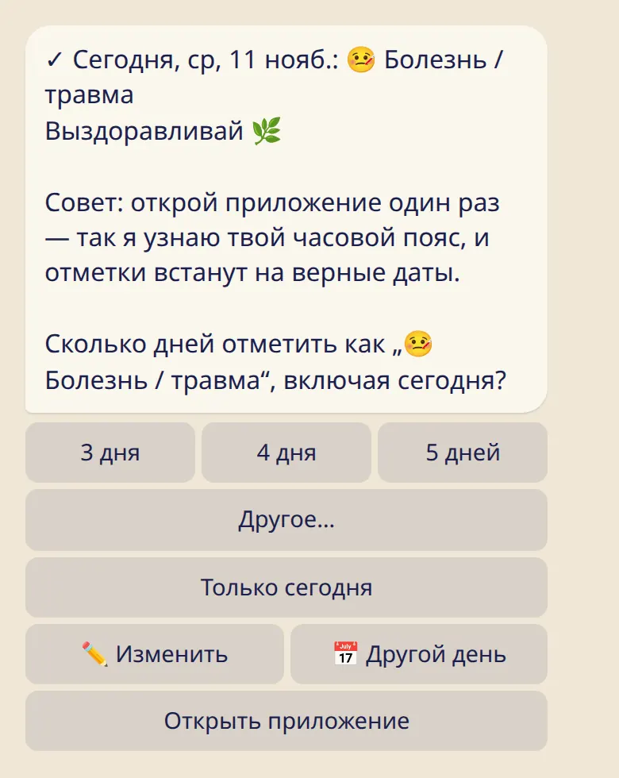

Отдых — часть практики. Здесь о том, как устроены выходные, лунные дни, дни 🌸, болезнь и поездки.

## Каким бывает отдых

Отмечая день, можно выбрать :ftl[status-rest], :ftl[status-moon], :ftl[status-ladies], :ftl[status-sick] или :ftl[status-travel]. Ни один из них не прерывает счёт практик подряд.

## Твой выходной

1. Отправь :cmd[settings] и нажми :ftl[settings-day-off-button].
2. Выбери один или два дня. Остальные дни — дни практики.

С этого момента выходной сам показывается как отдых, а напоминания о практике его пропускают. Если в выходной была практика, просто отметь её: твоя отметка всегда важнее.

## Лунные дни

В аштанге в полнолуние и новолуние традиционно отдыхают. Tristhana сама отмечает эти дни как :ftl[status-moon].

- :cmd[moon] показывает ближайшие лунные дни и город, для которого они рассчитаны.
- Если у тебя выбран свой город, даты считаются для него. Иначе — по городу, который выбрал основной учитель, затем по календарю шалы, затем по Майсуру. Если основной учитель преподаёт в твоей шале, календарь шалы важнее.
- Напоминание приходит за 7 дней и за 1 день, в 19:00 по твоему времени. Кнопка :ftl[moon-reminders] меняет это или отключает.

Лунные дни зависят от места, поэтому в двух городах даты могут отличаться на день. Если в календаре шалы стоит другое, ориентируйся на своего учителя.

## Несколько дней: болезнь, поездка или 🌸

Когда ты отмечаешь сегодня :ftl[status-sick], :ftl[status-travel] или :ftl[status-ladies], бот спрашивает, на сколько дней. Эти дни заполнятся сами, а напоминания о практике не будут приходить, пока эти дни не закончатся.

- :ftl[pause-only]{from=bot rel=today} оставляет отметку на один день.
- Стало лучше раньше? Отметь практику или заверши паузу в :cmd[remind].
- Напоминания о лунных днях во время паузы продолжают приходить.

## 🌸 Женские дни

- Их видишь только ты. Отметка хранится в зашифрованном виде, а учитель и все остальные видят обычный день отдыха.
- В твоей собственной статистике они тоже показаны как отдых, пока ты не включишь :ftl[stats-show-ladies] на своём телефоне.
- Кнопка не нужна? :cmd[settings] → :ftl[settings-ladies-hide] уберёт её из бота и приложения.

## Дальше

- [Напоминания](../reminders/)
- [Моя практика: календарь, месяц, значки](../my-practice/)
