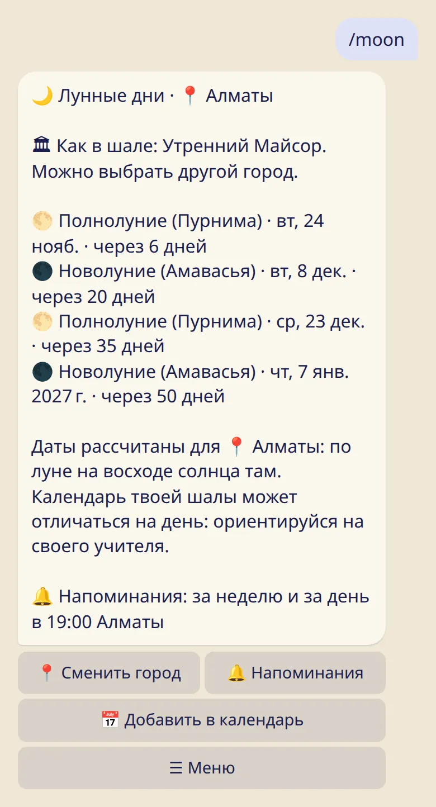
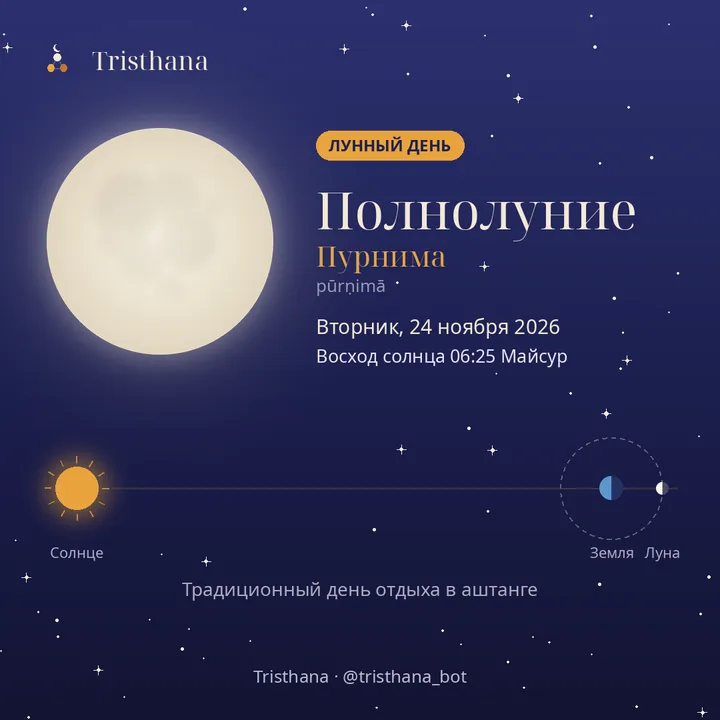
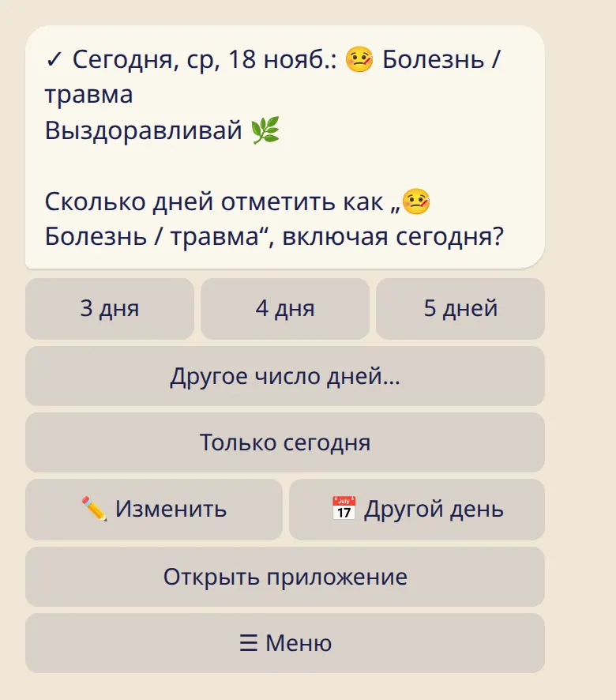

Отдых — часть практики. Здесь о том, как устроены выходные, лунные дни, дни 🌸, болезнь и поездки.

## Каким бывает отдых

Отмечая день, можно выбрать :ftl[status-rest] или нажать :ftl[today-other] — там :ftl[status-moon], :ftl[status-ladies], :ftl[status-sick] и :ftl[status-travel]. Ни один из них не прерывает счёт практик подряд.

## Твой выходной

1. Открой :ftl[menu-open] → :ftl[menu-settings] и нажми на строку выходного (😌). В приложении это такая же строка под шестерёнкой.
2. Выбери один или два дня. Остальные дни — дни практики.

С этого момента выходной сам показывается как отдых, а напоминания о практике в этот день не приходят. Если в выходной была практика, просто отметь её: твоя отметка всегда важнее.

## Лунные дни

В аштанге в полнолуние и новолуние традиционно отдыхают. Эти дни сами отмечаются как :ftl[status-moon].

- :ftl[menu-open] → :ftl[menu-moon] показывает ближайшие лунные дни и город, для которого они рассчитаны. В приложении нажми на строку с лунным днём на вкладке :ftl[tab-today].
- Если у тебя выбран свой город, даты считаются для него. Иначе, если ты в шале, — по календарю шалы. Если основной учитель не в команде твоей шалы и выбрал свой город, то по этому городу. Без шалы — по городу, который выбрал основной учитель, а в остальных случаях — по Майсуру. Смотри [Лунные дни твоих учеников](../../teachers/moon-days/).
- Напоминание приходит за 7 дней и за 1 день, в 19:00 по твоему времени. Кнопка :ftl[moon-reminders] меняет это или отключает.

Лунные дни зависят от места, поэтому в двух городах даты могут отличаться на день. Если шала или учитель объявили другой день, ориентируйся на них.

## Поделиться карточкой лунного дня

Начиная за 3 дня до лунного дня и в сам этот день рядом со строкой с лунным днём на вкладке :ftl[tab-today] есть :ftl[share-open], а на экране лунных дней в приложении — рядом с этим днём. Получится картинка для истории или поста: полнолуние или новолуние, дата лунного дня, время восхода солнца в городе, по которому считаются твои лунные дни, и простая схема: Солнце, Земля и Луна. Её можно выложить в историю, сохранить или прислать себе в чат, как и [карточки практики](../my-practice/#поделиться-карточкой).

На карточке этот город, потому что лунные дни зависят от места. Ни имени, ни твоей практики на ней нет.

## Несколько дней: болезнь, поездка или 🌸

Когда ты отмечаешь сегодня :ftl[status-sick], :ftl[status-travel] или :ftl[status-ladies], бот спрашивает, на сколько дней. Эти дни заполнятся сами, а напоминания о практике не будут приходить, пока эти дни не закончатся.

- :ftl[pause-only]{from=bot rel=today} оставляет отметку на один день.
- Стало лучше раньше? Отметь практику или нажми кнопку, которая завершает паузу: она под вопросом про сегодня.
- Напоминания о лунных днях во время паузы продолжают приходить.

## 🌸 Женские дни

- Их видишь только ты. Отметка хранится в зашифрованном виде, а учитель и все остальные видят обычный день отдыха.
- В твоём календаре в приложении они тоже выглядят как отдых. Шестерёнка → :ftl[settings-more-button] → :ftl[stats-show-ladies] добавляет к этим дням маленькую отметку 🌸, только на этом телефоне.
- Карточка открытого дня всегда показывает то, что отмечено, поэтому прошлый день 🌸 можно отметить прямо из месяца.
- Кнопка не нужна? :ftl[menu-settings] → :ftl[settings-more-button] → :ftl[settings-ladies-hide] уберёт её из бота и приложения. В приложении это переключатель :ftl[settings-ladies-button], там же.

## Дальше

- [Напоминания](../reminders/)
- [Моя практика: календарь, месяц, значки](../my-practice/)
