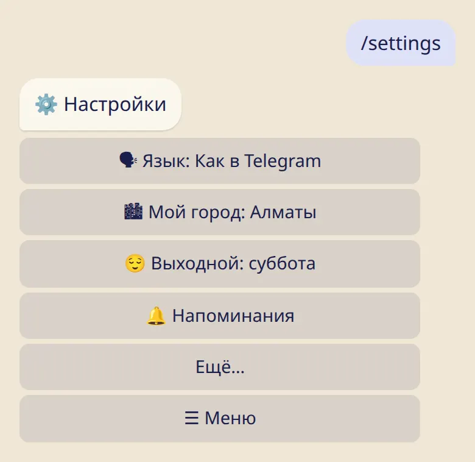
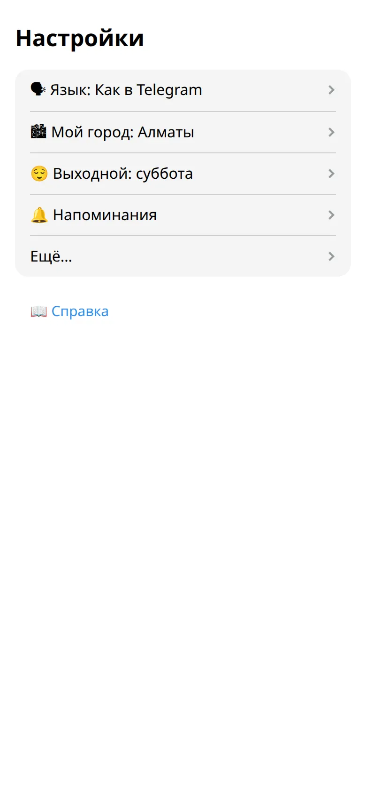
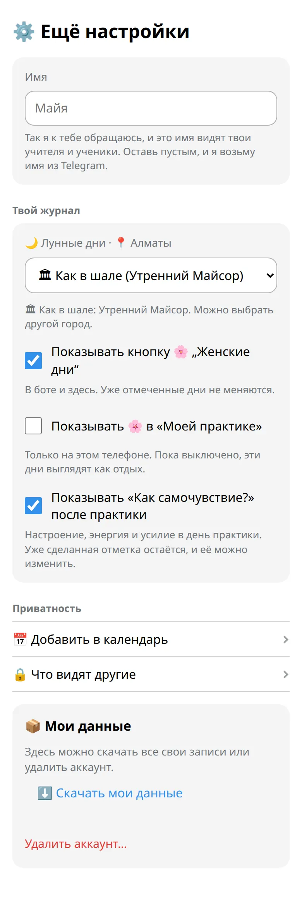

Имя, язык и город, а ещё — по чьему календарю считаются твои лунные дни.

## Где находятся настройки

- **В боте:** :ftl[menu-open] → :ftl[menu-settings].
- **В приложении:** шестерёнка :ftl[settings-open]{from=app} в верхнем углу любой вкладки.

И там, и там одни и те же пять строк. Язык, город и выходной показывают, что выбрано сейчас. Дальше идут :ftl[settings-reminders-button] и :ftl[settings-more-button] — для всего остального. Нажми на строку, чтобы изменить.

## Твой город

По городу задаётся твоё время, чтобы напоминания приходили в нужный час, а дни получали нужную дату.

1. Нажми на вторую строку, с городом, и выбери свой город. Пока город не выбран, строка сама спрашивает: :ftl[settings-city-unset-line]{zone="UTC+5"}.
2. Города нет в списке? Нажми :ftl[settings-city-unlisted]. Можно один раз отправить геопозицию или разрешить приложению взять время телефона.

Геопозиция нужна только для того, чтобы узнать местное время. Она не сохраняется.

В поездке? Когда время на телефоне отличается, приложение спросит, переключиться или оставить домашнее время. Молча оно ничего не меняет.

## Чьи лунные дни

:ftl[settings-more-button] → :ftl[settings-moon-link] в боте выбирает город, для которого рассчитываются твои лунные дни. В приложении это список в разделе :ftl[settings-log-title], тоже под кнопкой :ftl[settings-more-button]. Город может отличаться от того, где ты живёшь: например, это город учителя.

## Остальное

- **Язык:** как в Telegram, английский или русский.
- **Имя:** как бот к тебе обращается и что видят учителя. Меняется в приложении: :ftl[settings-more-button], первое поле.
- **Выходной:** смотри [Отдых, лунные дни и 🌸](../rest-and-moon-days/).
- **Напоминания:** смотри [Напоминания](../reminders/). Тихие часы и лимит сообщений на день — там же, в приложении.
- :ftl[settings-more-button] в приложении — это ещё и переключатели 🌸, :ftl[settings-checkin], ссылка для календаря, :ftl[settings-privacy-open] и :ftl[data-title]{from=app}.

## Полезно знать

- При смене города уже отмеченные дни сохраняют свои даты.
- Меню команд бота остаётся на языке твоего Telegram, даже если здесь выбран другой.
- В боте :ftl[settings-more-button] → :ftl[settings-open-app] открывает настройки приложения.

## Дальше

- [Твои данные: приватность, выгрузка, удаление](../your-data/)
