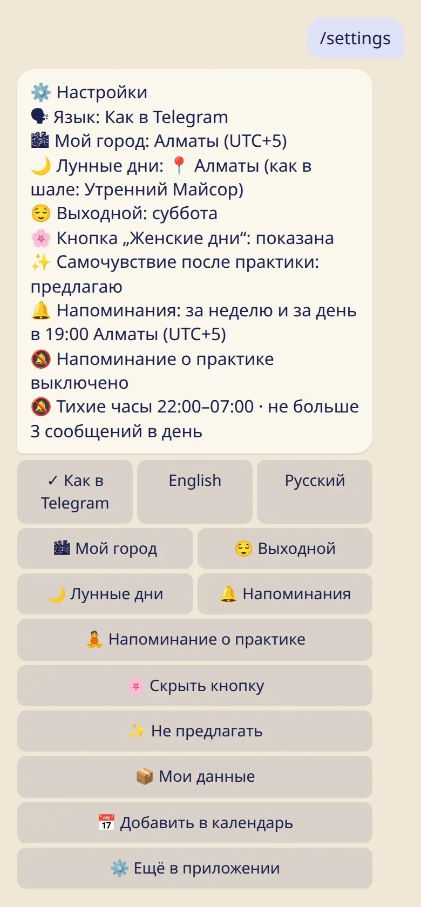
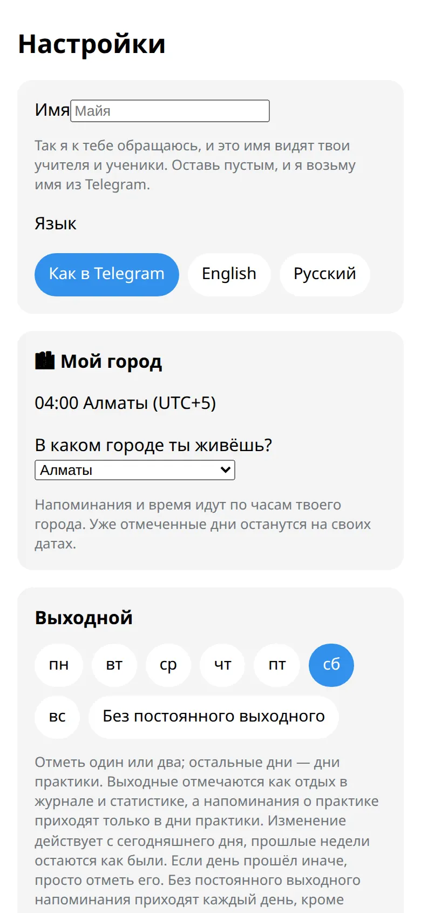

Имя, язык, город и часовой пояс, а ещё — по чьему календарю считаются твои лунные дни.

## Где находятся настройки

- **В боте:** :cmd[settings] показывает всё на одном экране.
- **В приложении:** :ftl[settings-open]{from=app} внизу первого экрана. Кое-что есть только здесь: имя, тихие часы и лимит сообщений на день.

## Твой город

Город задаёт часовой пояс, чтобы напоминания приходили в нужный час, а дни получали нужную дату.

1. Нажми :ftl[settings-city-button] и выбери свой город.
2. Города нет в списке? Нажми :ftl[settings-city-unlisted]. Можно один раз отправить геопозицию или разрешить приложению взять время телефона.

Геопозиция нужна только для того, чтобы найти часовой пояс. Она не сохраняется.

В поездке? Когда время на телефоне отличается, приложение спросит, переключиться или оставить домашнее время. Молча оно ничего не меняет.

## Чьи лунные дни

:ftl[settings-moon-link] выбирает город, для которого рассчитываются твои лунные дни. Он может отличаться от города, где ты живёшь: например, это город учителя.

## Остальное

- **Язык:** как в Telegram, английский или русский.
- **Имя:** как бот к тебе обращается и что видят учителя. Меняется в приложении.
- **Выходной:** смотри [Отдых, лунные дни и 🌸](../rest-and-moon-days/).
- **Напоминания:** смотри [Напоминания](../reminders/).

## Полезно знать

- При смене города уже отмеченные дни сохраняют свои даты.
- Меню команд бота остаётся на языке твоего Telegram, даже если здесь выбран другой.

## Дальше

- [Твои данные: приватность, выгрузка, удаление](../your-data/)
