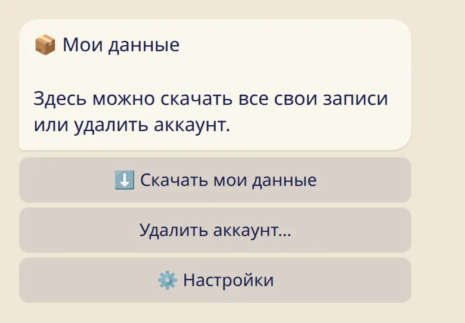

Что остаётся личным, что видит учитель, как скачать все свои записи и как удалить аккаунт.

## Личное остаётся личным

- Журнал — твой. Пока в списке нет учителя, никто больше ничего из него не видит.
- Заметки дневника и дни 🌸 хранятся в зашифрованном виде.
- Самочувствие, заметки дневника, значки и причина отдыха не показываются никому и никогда.
- Учитель, которого ты добавляешь, видит твоё имя, практику или отдых со дня, когда появился в списке, объём практики и последнюю асану, а если какое-то время показать нечего — короткую пометку об этом. Шала видит твоё имя и отметки о посещении занятий.

Подробнее: [Мой учитель](../my-teacher/) и [Приватность простыми словами](../../reference/privacy/).

## Скачать свои данные

1. Отправь :cmd[settings] и нажми :ftl[settings-data-button].
2. Нажми :ftl[export-button]{from=bot}.

Бот пришлёт в чат один ZIP-файл. Внутри — `data.json` для приложений и CSV-файлы для таблиц. В нём есть и личные записи, поэтому, когда файл сохранён, его стоит удалить из чата.

## Удалить аккаунт

На том же экране нажми :ftl[delete-button] и подтверди.

- Всё удаляется сразу: дни, практики, самочувствие, заметки дневника, твои асаны, списки учителей и учеников, настройки.
- Отменить это нельзя. Если данные нужны, сначала скачай их.
- Из резервных копий данные исчезают в течение 30 дней.
- Сообщения в твоём чате Telegram остаются, пока ты не очистишь чат.
- Если у тебя есть своя шала, она удаляется для всех, кто в ней состоит. Их собственные журналы остаются.

Если позже написать боту снова, он начнёт с чистого листа.

## Дальше

- [Вопросы и ответы](../../reference/faq/)
