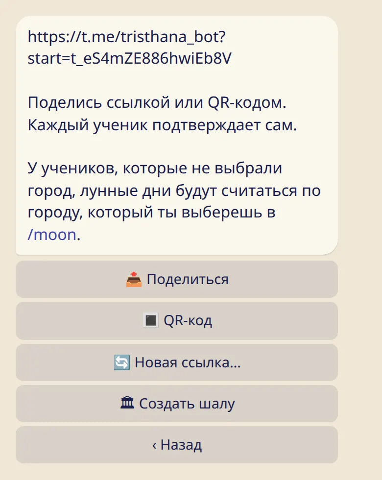

Поделись ссылкой или покажи QR-код. Ученик подтверждает — и вы на связи.

## Получить ссылку

1. Отправь :cmd[teachers].
2. Нажми :ftl[links-invite-first] в первый раз или :ftl[links-invite], когда ученики уже есть.
3. Бот покажет твою личную ссылку. :ftl[invite-share] отправит её в чат. :ftl[invite-qr] сделает картинку: её можно показать с телефона или распечатать и повесить в шале.

В приложении та же ссылка находится в :ftl[settings-open] → :ftl[links-title].

Отдельного аккаунта учителя нет, и подавать заявку не нужно. Если ты преподаёшь, просто поделись ссылкой.

## Что делает ученик

Каждый ученик открывает ссылку и подтверждает сам. Перед этим бот показывает, что именно ты будешь видеть. Добавить кого-то без его согласия нельзя.

- Когда ученик подтверждает, тебе приходит сообщение без звука, а ученик появляется в разделе :ftl[link-students-open].
- Если ученик нажмёт :ftl[invite-decline], ты об этом не узнаешь.

## Если ссылка попала не туда

Нажми :ftl[invite-new]. Старая ссылка и QR-код перестанут работать. Те, кто уже в списке, останутся.

## Убрать ученика

Нажми на имя ученика в списке, а потом :ftl[links-remove]. Никто не получит сообщения.

## Полезно знать

- Одна ссылка подходит всем ученикам и работает сколько угодно.
- В списке может быть до 500 учеников.
- В одном аккаунте можно быть и учителем, и учеником: твои учителя находятся на том же экране.
- У учеников, которые не выбрали город сами, лунные дни считаются по твоему городу: смотри [Лунные дни твоих учеников](../moon-days/).

## Дальше

- [Что ты видишь и чего не видишь никогда](../what-you-see/)
