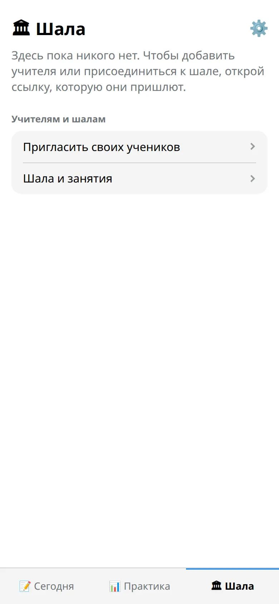
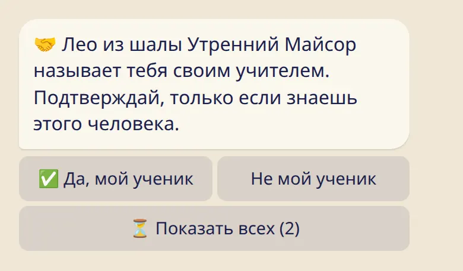
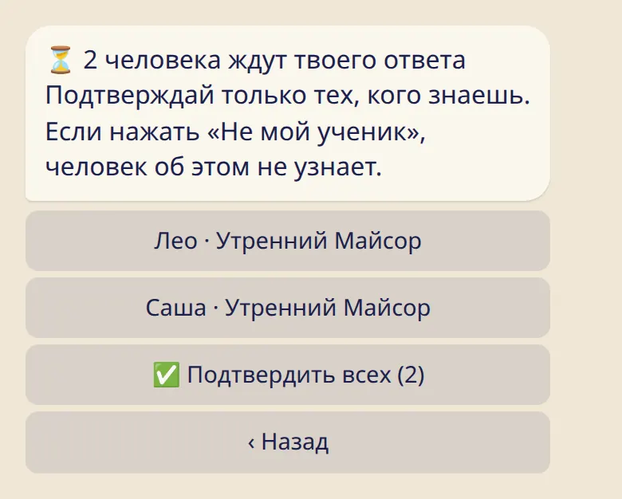
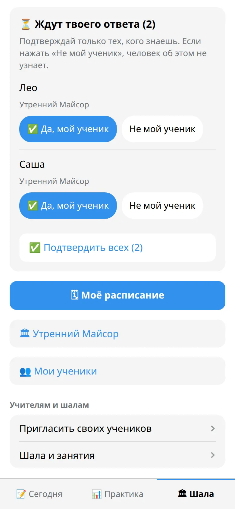

Два способа быть на связи с учеником: отправь свою ссылку или подтверди ученика, который выбрал тебя в шале.

## Две ссылки

- :ftl[links-invite] — твоя личная ссылка. Ученик, который её открывает, сразу попадает в твой список. К шале она не присоединяет.
- :ftl[shala-invite-students] — ссылка шалы, она на карточке шалы. Ученик, который её открывает, присоединяется к шале, видит её занятия и потом может выбрать там учителя.

Какую отправить? Тем, кто ходит на занятия твоей шалы, — ссылку шалы, и там они выберут тебя. Тем, с кем ты занимаешься отдельно, индивидуально или онлайн, — свою ссылку.

## Получить свою ссылку

1. В первый раз открой :ftl[menu-open] → :ftl[menu-teach] и нажми :ftl[welcome-path-invite]. Если ты в команде шалы, первая строка там — :ftl[shala-invite-students], ссылка шалы. Своя ссылка тогда в разделе :ftl[menu-teacher] → :ftl[links-invite-first].
2. Когда ученики уже есть, путь такой: :ftl[menu-open] → :ftl[menu-students] → :ftl[links-invite].
3. :ftl[invite-send] отправит твою личную ссылку в чат. :ftl[invite-qr] сделает картинку: её можно показать с телефона или распечатать и повесить в шале. :ftl[invite-more] покажет ссылку текстом.

В приложении та же ссылка есть на вкладке :ftl[tab-shala]: нажми :ftl[shala-start-invite].

Отдельного аккаунта учителя нет, и подавать заявку не нужно. Если ты преподаёшь, просто отправь свою ссылку.

Если ты в команде шалы, экран твоей ссылки напомнит: :ftl[invite-own-not-shala]

## Ссылка шалы

На карточке шалы, в боте или в приложении, нажми :ftl[shala-invite-students]: ссылка и QR-код, одни для всех. Срока у неё нет. Смотри [Создать шалу и пригласить команду](../../staff/create-shala/).

## Что делает ученик

Каждый ученик открывает ссылку и подтверждает сам. Перед этим бот показывает, что именно ты будешь видеть. Добавить кого-то без его согласия нельзя.

- Когда ученик подтверждает, тебе приходит сообщение без звука, а ученик появляется в разделе :ftl[menu-students].
- Если ученик нажмёт :ftl[invite-decline], ты об этом не узнаешь.

## Когда ученик выбирает тебя в шале

У тебя в шале роль :ftl[shala-role]{role=teacher}? Тогда ученик, который присоединяется к шале, может выбрать тебя своим учителем. Отправлять ему ничего не нужно, а из его журнала ничего не видно, пока ты не подтвердишь.

1. Тебе приходит сообщение без звука: кто называет тебя своим учителем и из какой шалы.
2. Знаешь этого человека? Нажми :ftl[request-yes-mine]. Ученик появится в твоём списке, и ты будешь видеть его дни с даты запроса.
3. Это не твой ученик? Нажми :ftl[request-not-mine]. Человек об этом не узнает. :ftl[request-undo] вернёт запрос.

Все, кто ещё ждёт ответа, собраны в одном списке. В боте это строка :ftl[request-waiting-open]{count=2} вверху разделов :ftl[menu-students] и :ftl[menu-teacher] и карточки шалы. Первые запросы могут прийти, когда учеников ещё нет и раздела :ftl[menu-students] в меню пока нет: тогда открой :ftl[menu-teacher]. :ftl[request-all]{count=2} подтверждает всех, кто есть в списке перед тобой.

В приложении этот список — вверху вкладки :ftl[tab-shala], а под каждым именем кнопки :ftl[request-yes-mine] и :ftl[request-not-mine].

- Подтверждай только тех, кого знаешь.
- Запрос ждёт ответа 7 дней. После этого отправь ученику свою ссылку.
- Больше никто в шале не видит, кто тебя выбрал.
- Твоя ссылка работает как раньше: ученик открывает её, подтверждает и сразу появляется в списке.

## Если ссылка попала не туда

Нажми :ftl[invite-more], а потом :ftl[invite-new] и подтверди. Старая ссылка и QR-код перестанут работать. Те, кто уже в списке, останутся.

## Убрать ученика

Нажми на имя ученика в списке, а потом :ftl[links-remove]. Никто не получит сообщения.

## Полезно знать

- Одна ссылка подходит всем ученикам и работает сколько угодно.
- В списке может быть до 500 учеников.
- В одном аккаунте можно быть и учителем, и учеником.
- У учеников, которые не выбрали город сами, лунные дни считаются по твоему городу (в шале, где ты в команде, — по календарю шалы): смотри [Лунные дни твоих учеников](../moon-days/).

## Дальше

- [Что ты видишь и чего не видишь никогда](../what-you-see/)
