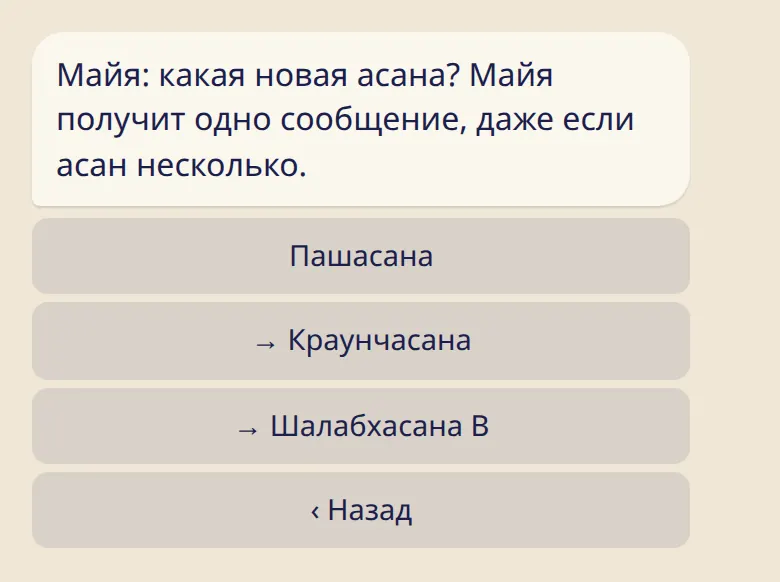

Новая асана для ученика? Отметь её в пару касаний — и у ученика будет маленький праздник.

## Как отметить

1. Открой карточку ученика: :cmd[teachers] → :ftl[link-students-open] → имя.
2. Нажми :ftl[students-give].
3. Выбери асану. Первая строка — следующая асана в серии. Строки со стрелкой → отмечают сразу несколько, до трёх.
4. Нажми :ftl[students-give-yes].

Такая же кнопка есть на карточке ученика в приложении.

## Что получит ученик

Одно сообщение от бота с небольшим поздравлением, даже если асан несколько. На экране :ftl[progression-open] будет видно, что асану отметил учитель, и указано твоё имя.

Ученик может отменить отметку, если она не совпадает с его практикой, пока практика не ушла дальше этой отметки. Это его записи, и последнее слово за ним.

## Полезно знать

- Отмечать можно только вперёд, до трёх асан за раз. Асаны, которые даются вместе, например Шалабхасана A и B, считаются за одну. Всё остальное, например вернуться назад или указать другую серию, ученик меняет сам на экране :ftl[progression-open].
- Если ученик ещё не указал последнюю асану, карточка так и скажет. Попроси указать её один раз, и после этого можно отмечать новые.
- Список переходит из серии в серию: после Сету Бандхасаны идёт Пашасана.
- Отметить асану может любой учитель из списка ученика. Люди из команды шалы не могут, пока ученик не добавит кого-то из них как учителя.
- Свою отметку отменить нельзя. Если нажата не та строка, попроси ученика отменить её.

## Дальше

- [Объявления](../announcements/)
