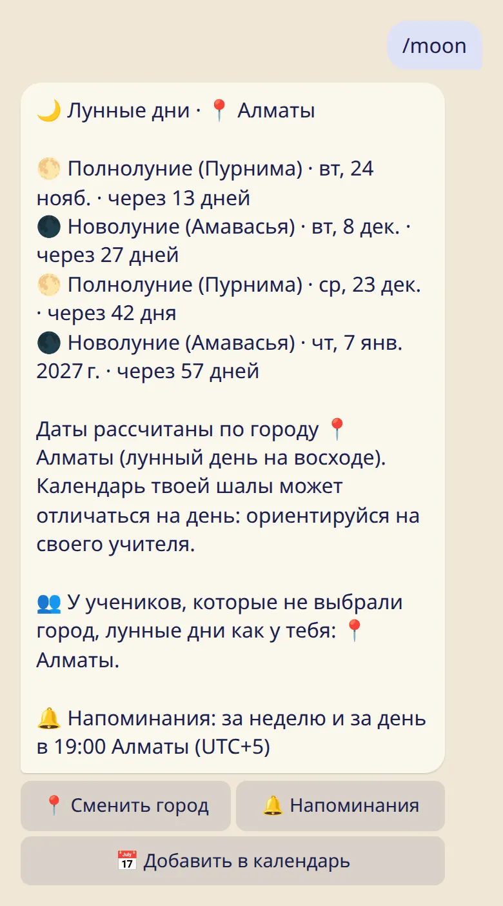

У учеников могут быть те же лунные дни, что и у тебя, и тогда зал может отдыхать в одни и те же дни.

## Как это устроено

Если ученик не выбрал город для лунных дней, они считаются по городу, который выбрал его основной учитель. Поэтому, когда ты выбираешь свой город, твои ученики отдыхают в те же дни, что и ты, и им ничего не нужно настраивать.

## Выбрать свой город

1. Отправь :cmd[moon].
2. Нажми :ftl[moon-change-city] и выбери город, по которому живёт твой зал.

Строка со значком 👥 показывает, по какому городу сейчас считаются лунные дни твоих учеников. Если ты в команде шалы, там же сказано, что у учеников из этой шалы лунные дни считаются по её календарю, а не по твоему городу.

## Откуда берутся лунные дни ученика, по порядку

1. Город, который ученик выбрал сам.
2. Город, который выбрал его основной учитель.
3. Календарь его шалы.
4. Майсур.

Если основной учитель преподаёт в шале ученика, календарь шалы идёт раньше города учителя.

## Полезно знать

- Ученикам передаётся только город, выбранный лично тобой. Если твои лунные дни считаются по городу твоего учителя или по календарю шалы, ученикам они не передаются.
- Если город не выбран и твои лунные дни считались по городу твоего учителя, это прекращается, когда появляется первый ученик. Бот сообщит об этом и предложит оставить тот же город одним нажатием.
- Дальше одного шага это не идёт: у учеников твоих учеников лунные дни считаются по городу их учителя, а не по твоему.
- Ученик может выбрать свой город в любой момент, и этот выбор всегда важнее.
- Даты рассчитаны для города, по лунным суткам (титхи) на восходе. Если в твоей шале лунный день отмечают в другой день, скажи об этом ученикам: бот советует им ориентироваться на учителя. Смотри [Как считаются лунные дни](../../reference/moon-calculation/).

## Дальше

- [Строка о списке SYC](../directory-line/)
