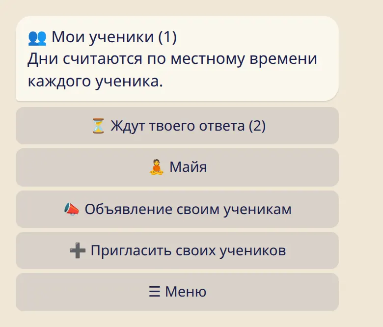
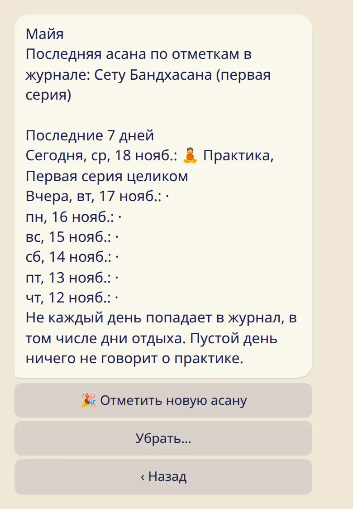
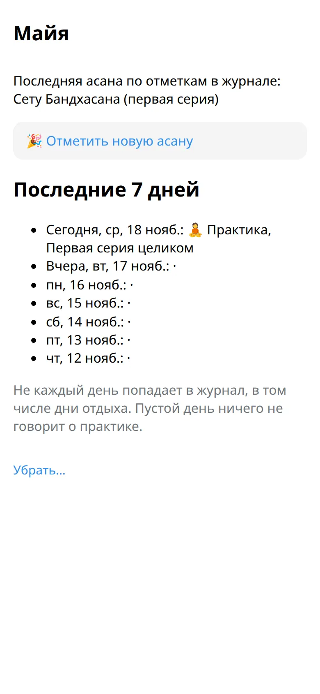

Список учеников и карточка каждого. Заметки, самочувствие и причина отдыха всегда остаются у ученика.

## Твои ученики

В боте открой :ftl[menu-open] → :ftl[menu-students]. В приложении открой вкладку :ftl[tab-shala] и нажми :ftl[link-students-open].

Рядом с каждым именем — отметка за сегодня: 🧘 практика, 😌 отдых. Имя без отметки значит, что за сегодня показать нечего.

В боте строка :ftl[request-waiting-open]{count=2} вверху значит, что ученики твоей шалы выбрали тебя и ждут ответа. Та же строка есть вверху раздела :ftl[menu-teacher]: смотри там, пока учеников ещё нет, потому что до тех пор раздела :ftl[menu-students] в меню нет. В приложении они вверху вкладки :ftl[tab-shala]. Смотри [Пригласить учеников](../invite-students/).

## Карточка ученика

Нажми на имя, чтобы открыть карточку.

- **Последняя асана** — так, как ученик отметил её у себя.
- **Последние 7 дней**: практика или отдых, а для практики — её объём, например «Первая серия целиком».

Дни считаются по времени города ученика, так что его «сегодня» может не совпадать с твоим.

## Что значит пустой день

Знак «·» значит, что за этот день показать нечего. В журнал попадает не каждый день, в том числе дни отдыха. А дни до того, как ученик добавил тебя или выбрал тебя в шале, пустые всегда. Пустой день ничего не говорит о практике.

Если показать нечего примерно три недели, в карточке появляется одна строка: :ftl[students-quiet]. Причину она не называет.

## Чего ты не видишь никогда

- Заметки и самочувствие.
- Причину отдыха. Лунный день, выходной, поездка, болезнь и 🌸 выглядят для тебя одинаково: 😌 отдых.
- Дни до даты, когда ученик добавил тебя или выбрал тебя в шале, даже если он заполнит их позже.
- Журнал человека, который выбрал тебя в шале, пока ты не подтвердишь. Видно только имя и шалу.
- Значки, счётчики и статистику.
- Историю асан. Видно только, где ученик сейчас.

Показать больше нельзя: такой настройки нет.

## Полезно знать

- Карточку можно только смотреть: изменить журнал ученика нельзя. Единственное, что можно добавить, — новую асану, об этом на следующей странице.
- Команда шалы видит имена учеников и ничего из их журналов. Это ученики шалы, а не твой список. Чтобы видеть карточку ученика, подтверди его, когда он выберет тебя в шале, или отправь ему свою ссылку учителя.
- Ученик может убрать тебя из своего списка в любой момент. Сообщение об этом не приходит.

## Дальше

- [Отметить новую асану](../mark-new-asana/)
