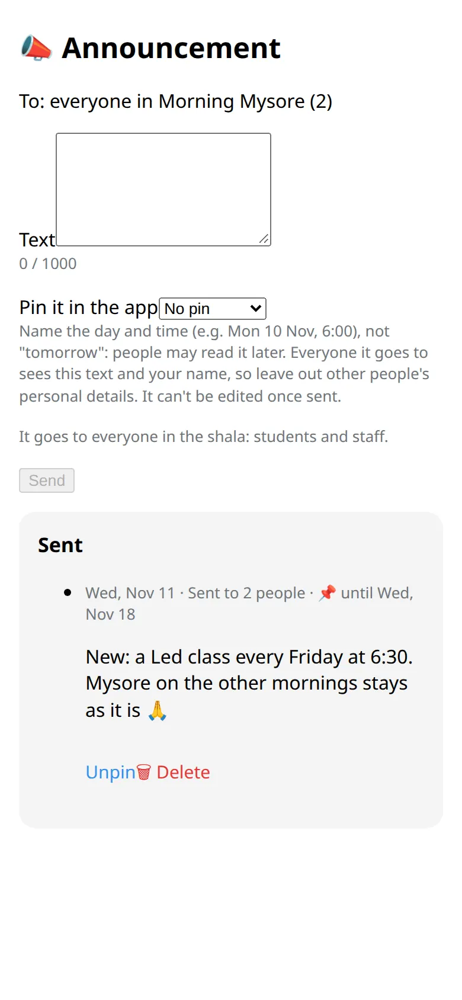

Tell everyone in the shala about a change, all at once.

## Send one

1. Open the shala and tap :ftl[ann-announce]. In the bot this button opens the form in the app.
2. Write the text, up to 1000 characters.
3. If you like, pin it for a week or a month.
4. Tap :ftl[ann-send] and confirm.

It goes to everyone in the shala, students and the team, as a message from the bot with the shala's name and yours.

## Who can send

The owner, managers, teachers and the front desk. Assistants can't.

## Pin, unpin, delete

- A pinned announcement shows on the shala card and at the top of people's announcements in the app.
- You can delete or unpin your own announcement. The owner and managers can do that with anyone's.
- Deleting takes it out of the app and stops it from going to anyone who hasn't received it yet. Messages already delivered stay in people's chats.

## Good to know

- A shala can send up to 3 announcements in 24 hours, counting everyone who writes for it.
- It arrives within about 10 minutes. During someone's quiet hours it arrives without a sound.
- Members can mute the shala's announcements and still read them in the app. Nobody is told.
- An announcement can't be edited. For a typo, delete it and send it again.
- Name the day and the time, not "tomorrow".

## Next

- [Questions and answers](../../reference/faq/)
