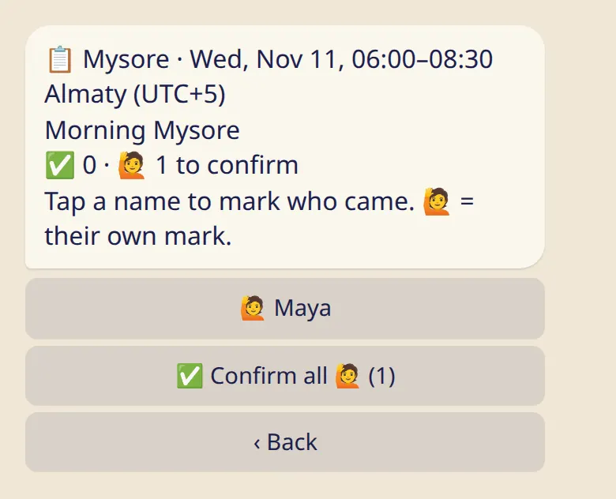

See who came to a class and adjust the list. Attendance is separate from anyone's personal practice log.

## Open the list

- **In the bot:** send :cmd[classes], or open the shala's schedule, and tap :ftl[attend-staff-open]{from=bot}. Choose the class.
- **In the app:** tap the class on its date in the shala's schedule.

You can mark a class once it has started, for 7 days.

## Mark who came

- Tap a name to mark that the person came. Tap again to remove the mark.
- 🙋 next to a name is the student's own mark. :ftl[attend-confirm-all]{n=1} confirms all of them at once.
- ✅ is a confirmed mark.

In the app you tick the names, search by name if the list is long, and save.

## Who is on the list

The shala's students, and people on the team who practice there.

## What students see

- Their own marks, and nobody else's. They can remove a mark at any time.
- Nothing ever shows that someone was absent. There is no list of people who didn't come.
- Nobody gets a message when you mark or confirm.

## Good to know

- Anyone on the team can mark attendance, assistants and the front desk included.
- A cancelled class can't be marked.
- Attendance is separate from the practice log. Marking a class doesn't log a practice for the student, and you see nothing from their log here.

## Next

- [Shala announcements](../announcements/)
