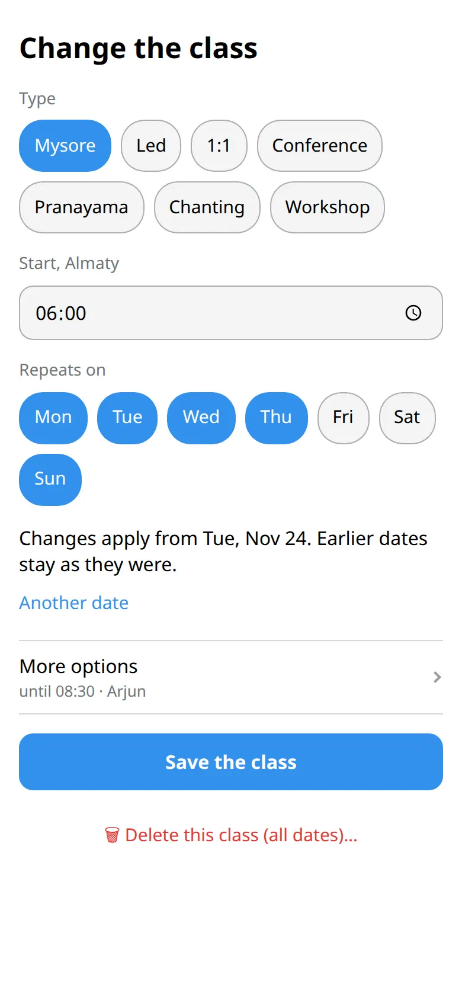
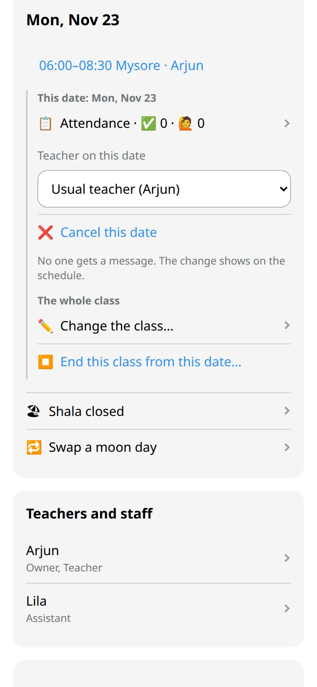

Move a class to another time or day, end it from a date, or delete it. Earlier dates stay as they were.

## Change a class

1. In the app, open the :ftl[tab-shala] tab and tap your shala.
2. In the schedule, tap the class on the date the change should start from.
3. Tap :ftl[class-edit] to open the form.
4. Change what you need and tap :ftl[class-form-save].

- **The change starts from the date you chose.** Earlier dates stay as they were. Need a different one? Tap :ftl[class-form-applies-other]: any date from today on.
- **If that date's class has already begun**, the change starts from the class's next date.
- **A class whose first date is still ahead**, or a class on one date, simply changes.

## End a class

1. In the schedule, tap the class on the first date it should no longer run.
2. Tap :ftl[class-end] and confirm.

That date and every later one go from the schedule. Earlier dates stay. The row shows only while that date hasn't begun.

## Delete a class

Open the form as in "Change a class": :ftl[occurrence-delete] is at the bottom. Use it for a class added by mistake. To stop a class that has already run, end it instead.

## Good to know

- Does the class have a last date? The form and the question before ending or deleting show which dates change.
- The owner, managers, teachers and the front desk can change classes. Assistants can't.
- Nobody gets a message about these changes. If it matters, send an announcement.
- To cancel or change one date only, see [Closures, swaps and substitutes](../closures-and-swaps/).

## Next

- [Closures, swaps and substitutes](../closures-and-swaps/)
- Back to [Classes and the week](../classes/)
