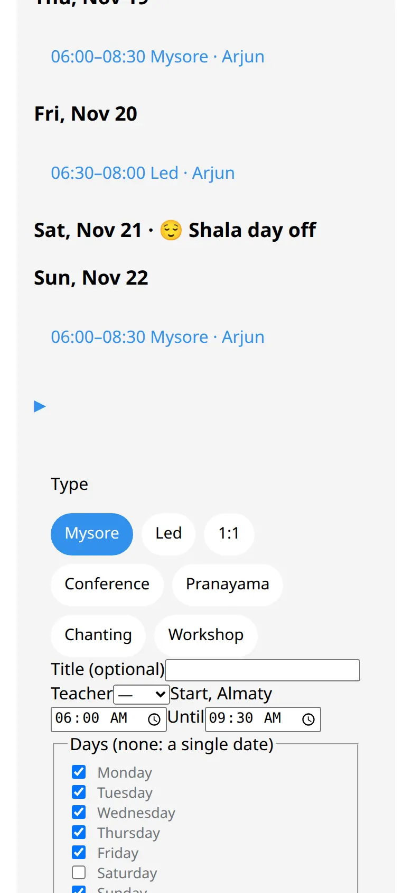

Add Mysore, Led and other classes once, and everyone sees the week by their own city's clock.

## Add a class

1. In the app, open the :ftl[tab-shala] tab, tap your shala and then :ftl[schedule-add-class], the first row of the schedule.
2. Choose the :ftl[class-form-type]: :ftl[context-mysore], :ftl[context-led], :ftl[context-private], :ftl[class-type]{type=conference}, :ftl[class-type]{type=pranayama}, :ftl[class-type]{type=chanting} or :ftl[class-type]{type=workshop}.
3. Set the start, in the shala's time, and the days under :ftl[class-form-days]. For a class on one day only, choose :ftl[class-form-once] and set the date.
4. Tap :ftl[class-form-save].

Mysore comes filled in: 06:00 to 09:30, every day but the shala's day off. Two taps and it's saved.

The rest is under :ftl[class-form-more]:

- **:ftl[class-form-length]**: 60, 75, 90 or 120 minutes, or :ftl[class-form-length-other] and a number of minutes. Mysore has :ftl[class-form-until] instead.
- **A title and the teacher.** If you are a teacher in this shala, your name is already filled in.
- **:ftl[class-form-every]**: every week, or every 2 to 4 weeks.
- **:ftl[class-form-from]** and **:ftl[class-form-end]**.
- **:ftl[class-form-online]**, with the city whose time the class goes by.

Saved it and want something different? See [Change, end or delete a class](../change-class/).

## How people see it

- Everyone in the shala sees the week by their own city's clock, with the city named. If they live by another city's time, they see the shala's time too.
- 1:1 classes are shown to the team only.
- An online class is marked 🌐, and you can set its time by another city.
- You set times by the clock in the shala's city, so a 06:00 class stays at 06:00 when the clocks change.

## The classes you teach

In the bot, open :ftl[menu-open] → :ftl[menu-classes] and tap :ftl[my-schedule-filter]{f=mine} to see your own week across all your shalas, including a class you are covering for someone.

## The day off and moon days

The owner or a manager sets these under :ftl[shala-edit]:

- **The day off**, one or two days. They show as :ftl[schedule-day-off] in the week.
- **Moon days**: :ftl[shala-moon-policy-option]{p=closed}, :ftl[shala-moon-policy-option]{p=pranayama} or :ftl[shala-moon-policy-option]{p=open}. With the first choice, classes on a moon day show as cancelled by themselves.

## Good to know

- The owner, managers, teachers and the front desk can change the schedule. Assistants can't.
- Nobody gets a message when the schedule changes. If it matters, send an announcement.
- A shala can have up to 40 classes at a time.

## Next

- [Change, end or delete a class](../change-class/)
- [Closures, swaps and substitutes](../closures-and-swaps/)
