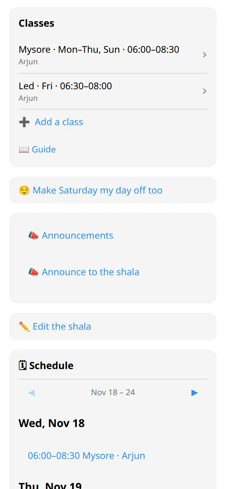
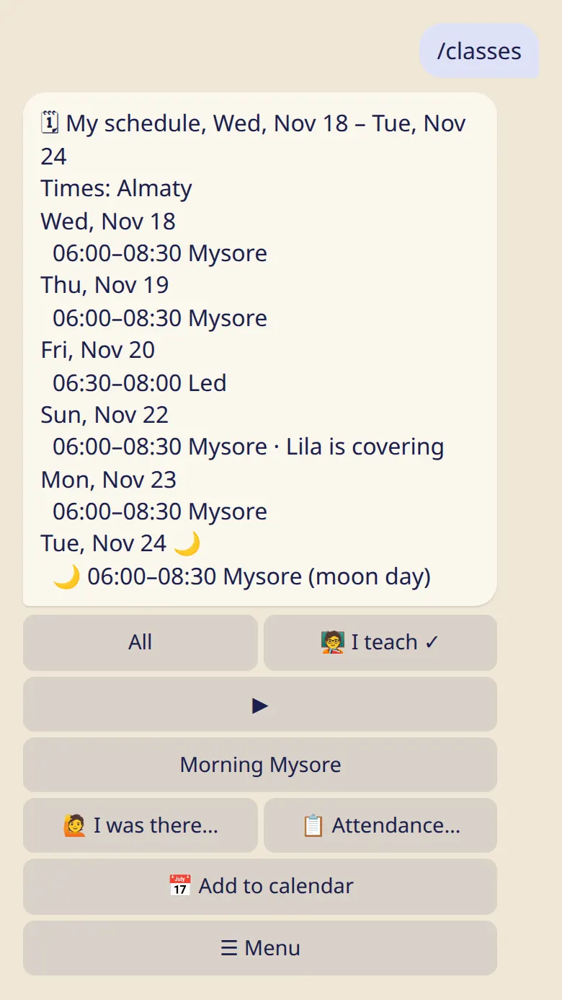

Set up the shala's weekly classes once, and everyone sees the week by their own city's clock.

## One class or two?

A class is one type at one time, on the days it repeats. A different time or a different type is another class. Say your week is:

- Mysore, Monday to Friday, 06:00 to 09:30;
- Led on Sunday, 08:00 to 09:30, with the title "Full Primary" (the title is under :ftl[class-form-more]).

That is two classes. Save the first one, then tap :ftl[class-add-another] and add the second. On the shala's card they are two rows under :ftl[shala-classes-title]:

- "Mysore · Mon–Fri · 06:00–09:30"
- "Led Full Primary · Sun · 08:00–09:30"

The same time on several days stays one class. Mysore Monday to Thursday, plus Led at 07:00 on Friday and Sunday, is also two classes: "Mysore · Mon–Thu · 06:00–09:30" and "Led · Fri, Sun · 07:00–08:30".

## Where the classes are

- **In the app:** open the :ftl[tab-shala] tab and tap your shala. The :ftl[shala-classes-title] section lists every class, one row each, and ends with :ftl[schedule-add-class].
- **From the bot:** open the shala's card (:ftl[menu-open] → :ftl[menu-teacher] → your shala, or :ftl[menu-help] → :ftl[help-shala-classes]). The card lists the classes too. Tap :ftl[shala-classes-edit]: the app opens on that card. While the shala has no classes yet, the button is :ftl[schedule-add-class] and opens the form straight away.

## Add a class

1. On the shala's card in the app, tap :ftl[schedule-add-class] under :ftl[shala-classes-title].
2. Choose the :ftl[class-form-type]: :ftl[context-mysore], :ftl[context-led], :ftl[context-private], :ftl[class-type]{type=conference}, :ftl[class-type]{type=pranayama}, :ftl[class-type]{type=chanting} or :ftl[class-type]{type=workshop}.
3. Set the start, in the shala's time, and under :ftl[class-form-days] the days this class runs at this time. For a class on one day only, choose :ftl[class-form-once] and set the date.
4. Tap :ftl[class-form-save]. The card says :ftl[class-form-saved], and the row under the list now reads :ftl[class-add-another]: tap it for the next class.

Mysore comes filled in: 06:00 to 09:30, every day but the shala's day off. Two taps and it's saved.

The rest is under :ftl[class-form-more]:

- **:ftl[class-form-length]**: 60, 75, 90 or 120 minutes, or :ftl[class-form-length-other] and a number of minutes. Mysore has :ftl[class-form-until] instead.
- **A title and the teacher.** If you are a teacher in this shala, your name is already filled in.
- **:ftl[class-form-every]**: every week, or every 2 to 4 weeks.
- **:ftl[class-form-from]** and **:ftl[class-form-end]**.
- **:ftl[class-form-online]**, with the city whose time the class goes by.

## Change a class

Tap its row under :ftl[shala-classes-title]. Its form opens, with the date the change applies from. See [Change, end or delete a class](../change-class/).

## How people see it

- Everyone in the shala sees the week by their own city's clock, with the city named. If they live by another city's time, they see the shala's time too.
- 1:1 classes are shown to the staff only.
- An online class is marked 🌐, and you can set its time by another city.
- You set times by the clock in the shala's city, so a 06:00 class stays at 06:00 when the clocks change.

## The classes you teach

In the bot, open :ftl[menu-open] → :ftl[menu-classes] and tap :ftl[my-schedule-filter]{f=mine} to see your own week across all your shalas, including a class you are covering for someone.

## The day off and moon days

The owner or a manager sets these under :ftl[shala-edit]:

- **The day off**, one or two days. They show as :ftl[schedule-day-off] in the week.
- **Moon days**: :ftl[shala-moon-policy-option]{p=closed}, :ftl[shala-moon-policy-option]{p=pranayama} or :ftl[shala-moon-policy-option]{p=open}. With the first choice, classes on a moon day are shown as cancelled automatically.

## Good to know

- The owner, managers, teachers and the front desk can add and change classes. Assistants and students see the schedule by date, not the list of classes.
- Nobody gets a message when the schedule changes. If it matters, send an announcement.
- A shala can have up to 40 classes at a time. Only classes still running count: end one you no longer hold.

## Next

- [Change, end or delete a class](../change-class/)
- [Closures, swaps and substitutes](../closures-and-swaps/)
