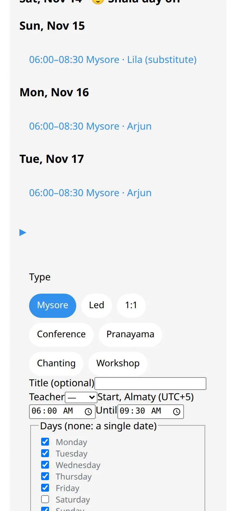
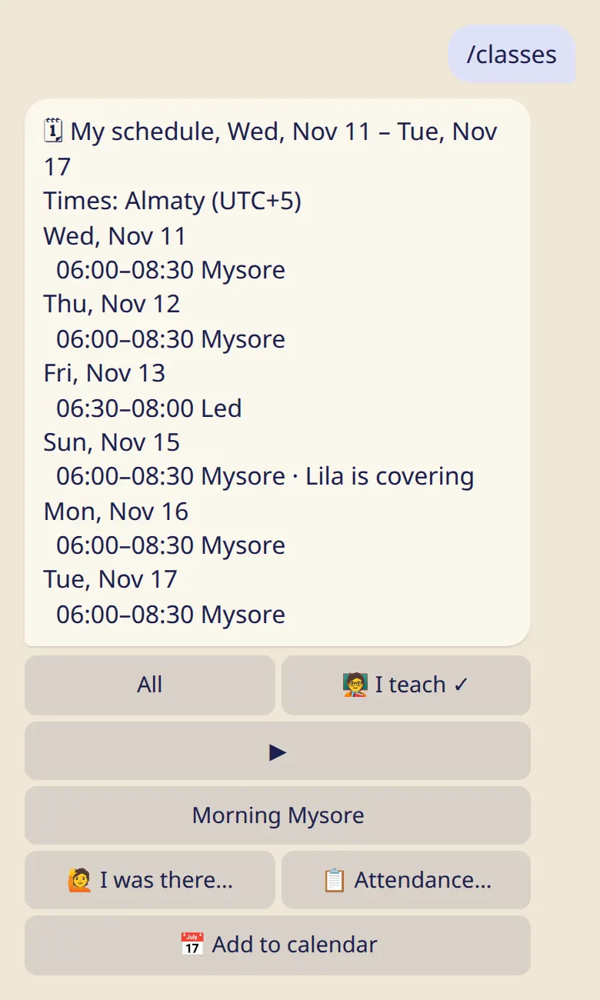

Add Mysore, Led and other classes once, and everyone sees the week in their own time zone.

## Add a class

1. In the app, open the shala and tap :ftl[schedule-add-class].
2. Choose the :ftl[class-form-type]: :ftl[context-mysore], :ftl[context-led], :ftl[context-private], :ftl[class-type]{type=conference}, :ftl[class-type]{type=pranayama}, :ftl[class-type]{type=chanting} or :ftl[class-type]{type=workshop}.
3. Set the teacher, the start and end in the shala's time, and the days of the week. A class can repeat every week or every 2 to 4 weeks. With no days ticked it happens once, on the first date.
4. Tap :ftl[class-form-save].

## How people see it

- Everyone in the shala sees the week in their own time zone, with the zone's name. If they are in another zone, they see the shala's time too.
- 1:1 classes are shown to the team only.
- An online class is marked 🌐, and you can set its time by another city.
- You set times by the clock in the shala's city, so a 06:00 class stays at 06:00 when the clocks change.

## Change or delete a class

Tap a class in the schedule.

- You can change it for all dates, or from a date you choose. Earlier dates stay as they were.
- :ftl[occurrence-delete] removes it from every date.

For a single date, see [Closures, swaps and substitutes](../closures-and-swaps/).

## The classes you teach

:cmd[classes] shows your own week across all your shalas, including a class you are covering for someone.

## The day off and moon days

The owner or a manager sets these under :ftl[shala-edit]:

- **The day off**, one or two days. They show as :ftl[schedule-day-off] in the week.
- **Moon days**: :ftl[shala-moon-policy-option]{p=closed}, :ftl[shala-moon-policy-option]{p=pranayama} or :ftl[shala-moon-policy-option]{p=open}. With the first choice, classes on a moon day show as cancelled by themselves.

## Good to know

- The owner, managers, teachers and the front desk can change the schedule. Assistants can't.
- Nobody gets a message when the schedule changes. If it matters, send an announcement.
- A shala can have up to 40 classes at a time.

## Next

- [Closures, swaps and substitutes](../closures-and-swaps/)
