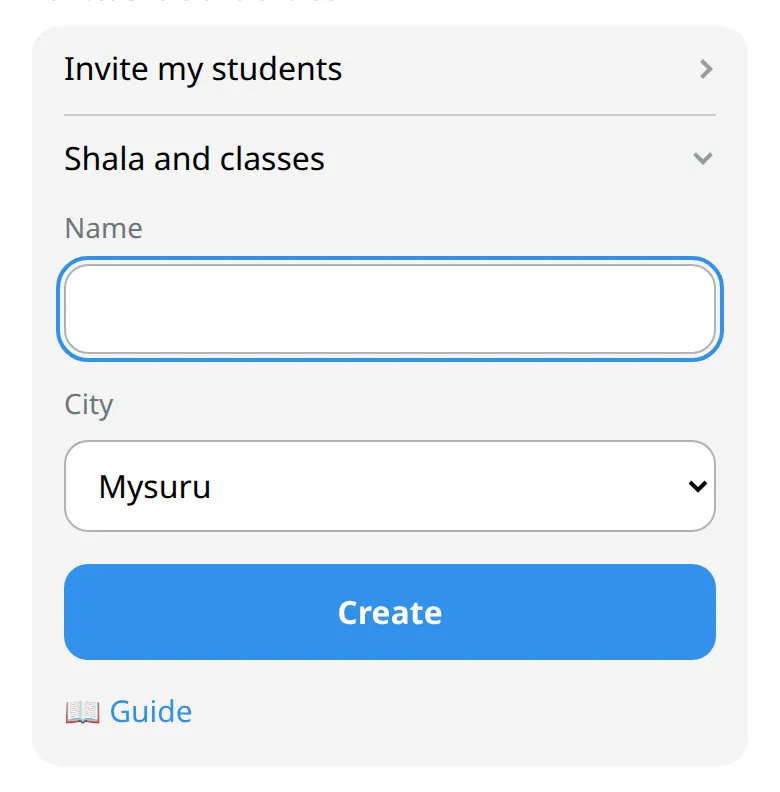
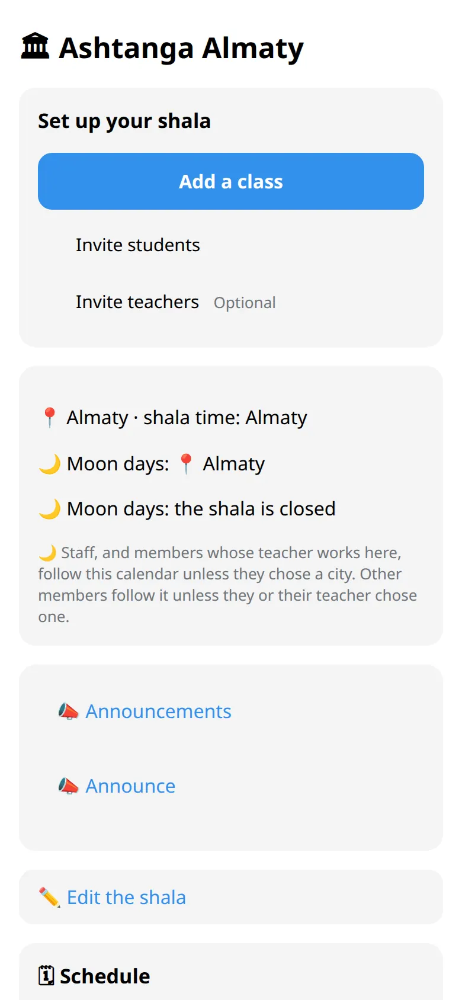
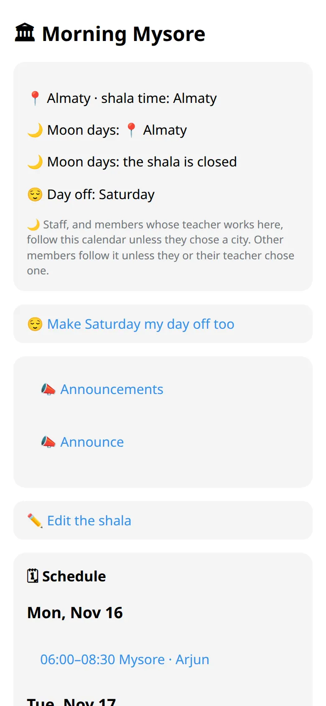
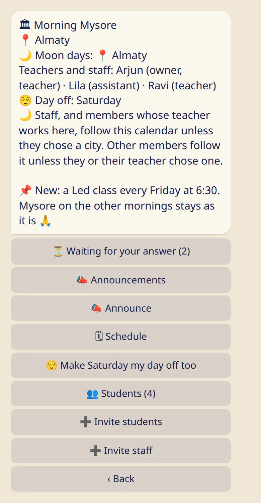
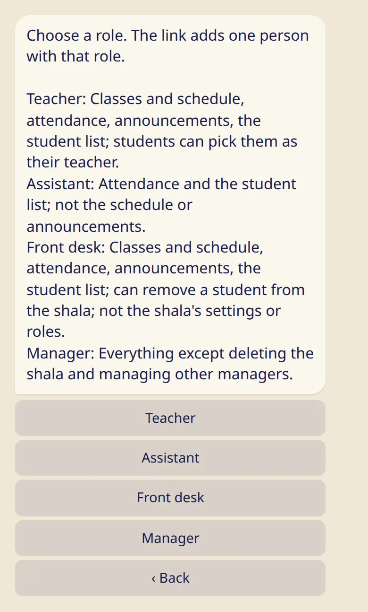

Set up your shala in a few minutes and invite the other teachers and helpers.

## Create your shala

1. In the bot, open :ftl[menu-open] → :ftl[menu-teach] → :ftl[welcome-path-shala] and tap :ftl[shala-create]: the app opens straight on the form. Already have students or a shala? Then that Menu row is gone. In the app, open the :ftl[tab-shala] tab and tap :ftl[shala-start-shala], under :ftl[shala-starts-title] at the bottom.
2. Fill in :ftl[shala-name-label] and :ftl[shala-city-label]. The city sets the shala's time zone and its moon days.
3. Tap :ftl[shala-create-submit]. Your shala's screen opens.

That's all the form asks. You are the owner and a :ftl[shala-role]{role=teacher} from the start. Online only? Tick :ftl[shala-online-only] later, under :ftl[shala-edit].

## First steps

On a new shala's screen the owner sees a short list, :ftl[setup-title]:

1. :ftl[setup-class]: see [Classes and the week](../classes/).
2. :ftl[setup-students]: a link and a QR code, the same for everyone.
3. :ftl[setup-staff]: only if you want to. No team? Tap :ftl[setup-staff-skip] once it's the only step left.

A finished step gets a tick. When nothing is left, the list goes away.

## The shala card

In the app, open the :ftl[tab-shala] tab and tap the shala's name.

In the bot, open :ftl[menu-open] → :ftl[menu-teacher] and tap the shala's name.

The card shows the place and the shala's time, the city for moon days, the team, the day off and a pinned announcement if there is one. In the bot, a teacher whose answer students are waiting for also sees :ftl[request-waiting-open]{count=2} there. In the app, those people are at the top of the :ftl[tab-shala] tab.

## Invite your team

1. On the card, tap :ftl[shala-invite-staff].
2. Choose a role.
3. Send the link to that person.

This link adds one person, works once and lasts 7 days. Before confirming, the person sees what joining means. You get a message when they join.

## Roles

| Role                             | What they can do                                                                                                                                                        |
| -------------------------------- | ----------------------------------------------------------------------------------------------------------------------------------------------------------------------- |
| :ftl[shala-role]{role=owner}     | Everything. Only the owner can make managers or delete the shala.                                                                                                       |
| :ftl[shala-role]{role=admin}     | Edit the shala, invite and remove staff (other managers excepted), remove a student, make a new student link, remove any announcement, and everything a teacher can do. |
| :ftl[shala-role]{role=teacher}   | Classes, closures and swaps, announcements, attendance. Students of the shala can pick them as their teacher.                                                           |
| :ftl[shala-role]{role=office}    | The same as a teacher, and can remove a student from the shala.                                                                                                         |
| :ftl[shala-role]{role=assistant} | Attendance.                                                                                                                                                             |

Everyone on the team sees the students' names, can show the student link and can mark attendance. One person can have several roles. The owner or a manager changes them by tapping the person under :ftl[shala-staff-title]{from=app} on the shala's screen in the app. The owner can change their own roles there too: tap your own name.

## Invite students

Tap :ftl[shala-invite-students] for a link and a QR code. This link is for everyone and doesn't expire. Each student confirms for themselves: see [My shala](../../students/my-shala/).

After joining, the bot asks each student who their teacher is. They can pick only people with the :ftl[shala-role]{role=teacher} role, and nothing from a log is shown until that teacher confirms: see [Invite your students](../../teachers/invite-students/). A teacher's own link works as before.

The team sees students' names and nothing from their logs. Who picked whom stays between the student and that teacher: the owner and the rest of the team don't see it.

## Moon days and the day off

The owner or a manager sets the moon-day city, what happens on moon days and the day off under :ftl[shala-edit]: see [Classes and the week](../classes/).

## Good to know

- If nobody on the team has the :ftl[shala-role]{role=teacher} role, students have nobody to pick. The shala card in the bot says so to the owner and managers.
- You can own up to 3 shalas. A shala can have up to 30 people on the team and 1000 students.
- Anyone on the team can leave at any time, except the owner. The owner can only delete the shala.
- Deleting a shala removes it for everyone in it and can't be undone. Everyone's own logs stay.
- Nobody gets a message when they are removed or when the shala is deleted.

## Next

- [Classes and the week](../classes/)
