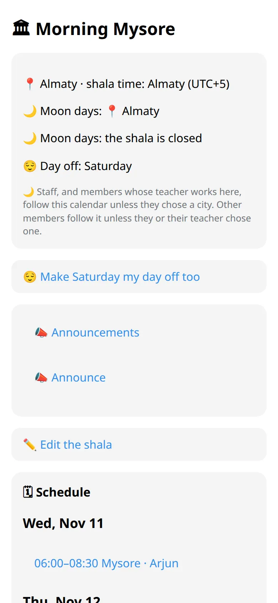
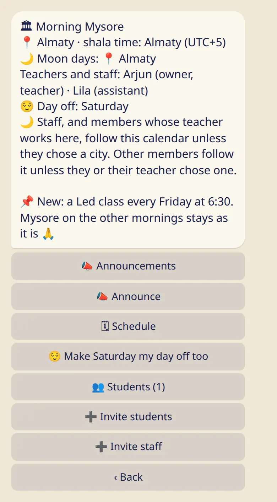
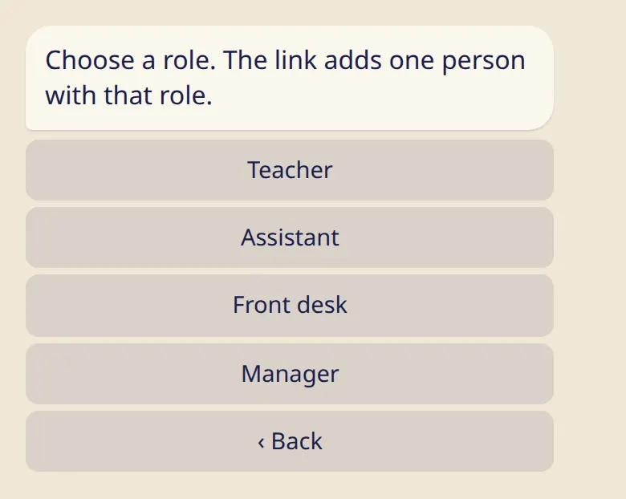

Set up your shala in a few minutes and invite the other teachers and helpers.

## Create your shala

1. In the app, open :ftl[settings-open] → :ftl[links-title] and tap :ftl[shala-create].
2. Fill in :ftl[shala-name-label] and :ftl[shala-city-label]. The city sets the shala's time zone and its moon days. For a shala with no room, tick :ftl[shala-online-only].
3. Under :ftl[shala-my-roles], tick Teacher if you teach there yourself.
4. Tap :ftl[shala-create-submit].

## The shala card

In the bot, send :cmd[teachers] and tap the shala's name.

The card shows the place and the shala's time, the city for moon days, the team, the day off and a pinned announcement if there is one.

## Invite your team

1. On the card, tap :ftl[shala-invite-staff].
2. Choose a role.
3. Send the link to that person.

This link adds one person, works once and lasts 7 days. Before confirming, the person sees what joining means. You get a message when they join.

## Roles

| Role                             | What they can do                                                                                                                                                        |
| -------------------------------- | ----------------------------------------------------------------------------------------------------------------------------------------------------------------------- |
| :ftl[shala-role]{role=owner}     | Everything. Only the owner can make managers or delete the shala.                                                                                                       |
| :ftl[shala-role]{role=admin}     | Edit the shala, invite and remove staff (other managers excepted), remove a student, make a new student link, remove any announcement, and everything a teacher can do. |
| :ftl[shala-role]{role=teacher}   | Classes, closures and swaps, announcements, attendance.                                                                                                                 |
| :ftl[shala-role]{role=office}    | The same as a teacher, and can remove a student from the shala.                                                                                                         |
| :ftl[shala-role]{role=assistant} | Attendance.                                                                                                                                                             |

Everyone on the team sees the students' names, can show the student link and can mark attendance. One person can have several roles. The owner or a manager changes them by tapping the person on the shala's screen in the app.

## Invite students

Tap :ftl[shala-invite-students] for a link and a QR code. This link is for everyone and doesn't expire. Each student confirms for themselves: see [My shala](../../students/my-shala/).

The team sees students' names and nothing from their logs. To see a student's practice, a teacher shares their own link: see [Invite your students](../../teachers/invite-students/).

## Moon days and the day off

The owner or a manager sets the moon-day city, what happens on moon days and the day off under :ftl[shala-edit]: see [Classes and the week](../classes/).

## Good to know

- You can own up to 3 shalas. A shala can have up to 30 people on the team and 1000 students.
- Anyone on the team can leave at any time, except the owner. The owner can only delete the shala.
- Deleting a shala removes it for everyone in it and can't be undone. Everyone's own logs stay.
- Nobody gets a message when they are removed or when the shala is deleted.

## Next

- [Classes and the week](../classes/)
