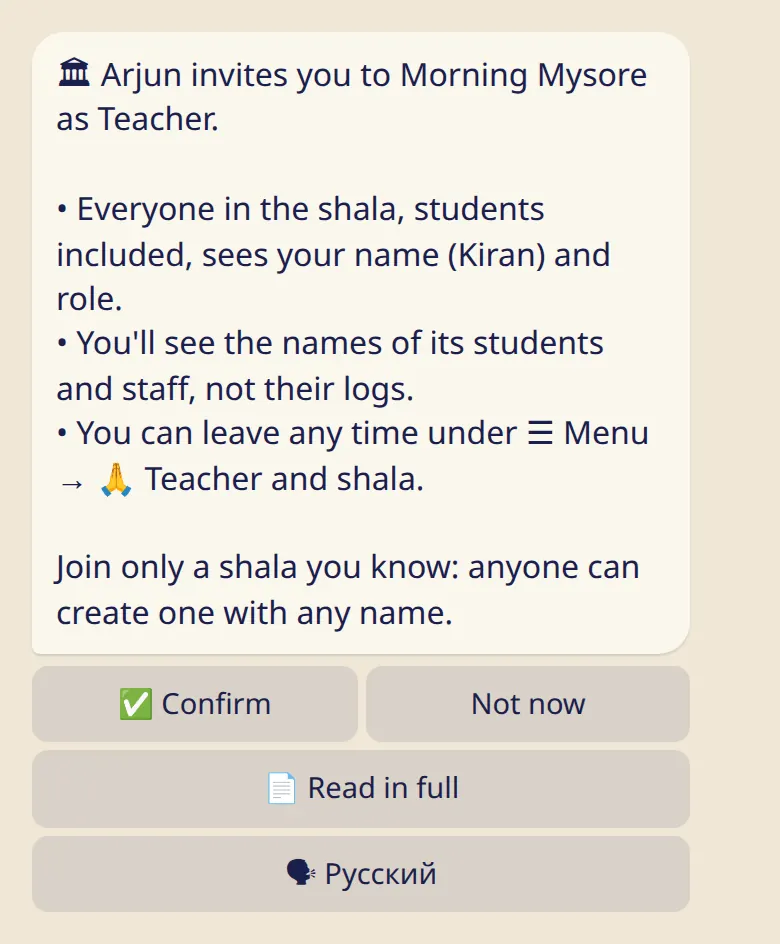
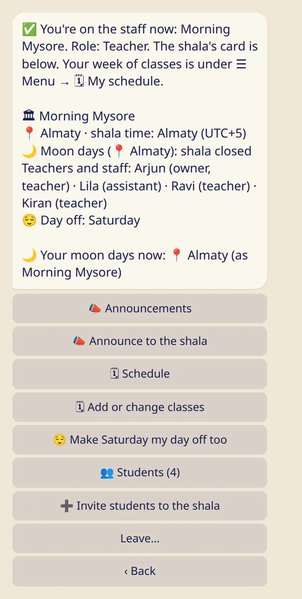

What a staff link does: your role, the shala's card, your week of classes, the shala's students and your own.

## Accept the invite

1. The shala's owner or a manager sends you a link. Open it. The bot says who is inviting you, to which shala and with which role, and in short what joining means. :ftl[consent-details] has the full text.
2. Rather read it in the other language? The button with that language's name switches the bot to it.
3. Tap :ftl[shala-staff-yes]. Not sure yet? Tap :ftl[invite-decline].

The link adds one person, works once and lasts 7 days. If it has run out, ask the person who sent it for a new one.

## What your role can do

| Role                             | What it can do                        |
| -------------------------------- | ------------------------------------- |
| :ftl[shala-role]{role=admin}     | :ftl[shala-role-hint]{role=admin}     |
| :ftl[shala-role]{role=teacher}   | :ftl[shala-role-hint]{role=teacher}   |
| :ftl[shala-role]{role=office}    | :ftl[shala-role-hint]{role=office}    |
| :ftl[shala-role]{role=assistant} | :ftl[shala-role-hint]{role=assistant} |

Everyone on the staff sees the names of the shala's students and staff, never their logs, and can mark who came to a class. You can have several roles. The owner or a manager changes them in the app.

## You're on the staff

Right after you confirm, the bot says you're on the staff, names the shala and your role, and shows the shala's card below.

On the card, depending on your role:

- the place, the shala's moon days and its staff;
- :ftl[shala-classes-title], one line per class, and :ftl[shala-classes-edit] to change them in the app;
- :ftl[schedule-open]: the shala's week, date by date;
- :ftl[shala-students]{n=12}: the shala's students;
- :ftl[shala-invite-students]: the link that lets students join the shala.

Later the card is under :ftl[menu-open] → :ftl[menu-teacher] → the shala, or :ftl[menu-help] → :ftl[help-shala-classes]. In the app, open the :ftl[tab-shala] tab and tap the shala.

## Your week

:ftl[menu-open] → :ftl[menu-classes] shows this week's classes at all your shalas. :ftl[my-schedule-filter]{f=mine} keeps the ones you teach, including a class you cover for someone. In the app it is the :ftl[tab-shala] tab → :ftl[my-schedule-open]{from=app}, with the weeks after this one.

## The shala's students and your own

- **The shala's students** joined by the shala's link. Under :ftl[shala-students]{n=12} on the card you see their names, and nothing from their logs.
- **Your own students** are under :ftl[menu-open] → :ftl[menu-students], with their practice. A student of the shala joins your list when they pick you as their teacher and you confirm (they can pick you if you have the :ftl[shala-role]{role=teacher} role), or when they open your own link.

So there are two links. :ftl[shala-invite-students] joins the shala. :ftl[links-invite] is yours alone. See [Invite your students](../../teachers/invite-students/).

## Moon days

Your moon days now follow the shala's, unless you chose your own city, or to follow your teacher, under :ftl[menu-moon]. Do you have students of your own and no city chosen? Then the bot offers, with the card, to keep the shala's city as your own, so your students rest on the same days. See [Moon days your students follow](../../teachers/moon-days/).

## Leave

On the shala's card, tap :ftl[shala-leave] and then :ftl[shala-leave-yes]. Nobody gets a message, and your log stays as it is. With the :ftl[shala-role]{role=teacher} role, the question adds: :ftl[shala-leave-own-students]

## Good to know

- The shala's announcements come to you through the bot too. You can mute them.
- The owner or a manager can change your roles or remove you from the staff. Nobody gets a message.
- The owner can't leave, only delete the shala.

## Next

- [Classes and the week](../classes/)
- [Attendance](../attendance/)
