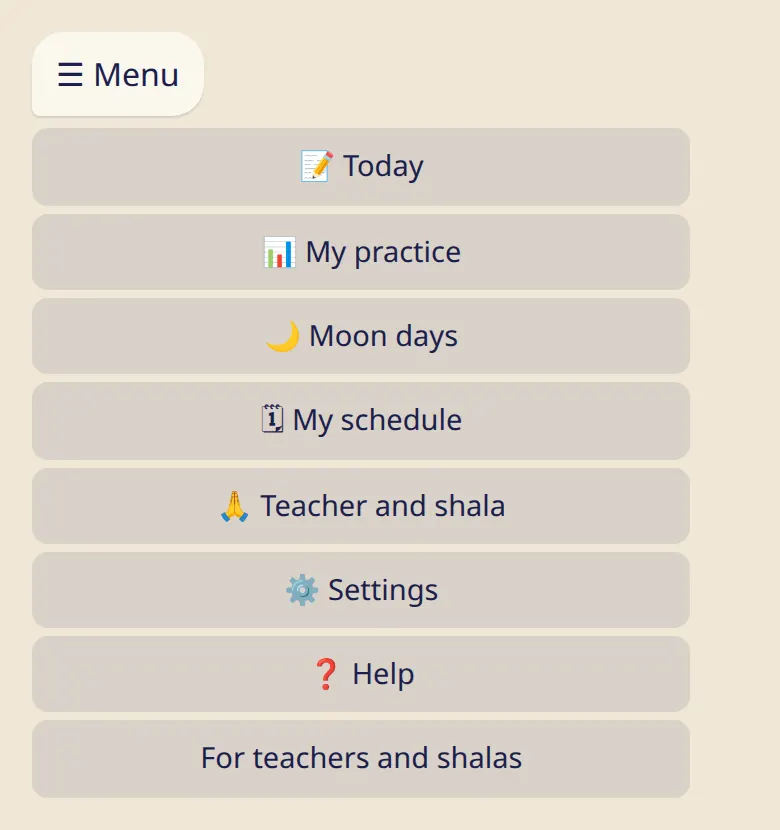
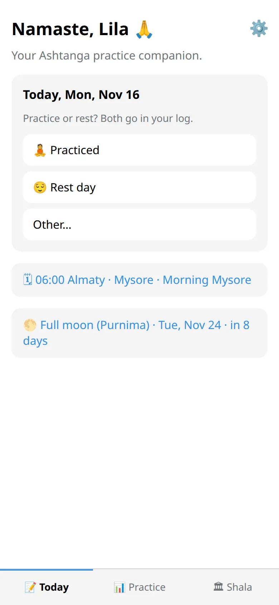

Tristhana has two parts that share one log. The bot is for quick taps and reminders. The app is for the calendar, stats and everything with more detail.

## The bot

It's the chat with [@tristhana_bot](https://t.me/tristhana_bot). Use it to:

- log today in two taps (:cmd[start] opens today);
- get a gentle daily reminder and a heads-up before moon days;
- see the next moon days and your classes;
- mark a new asana;
- receive messages from your teacher or your shala.

You don't need to type commands. :ftl[menu-open] is the last button under today's question and leads to everything else. Writing any message to the bot opens it too.

## The app

It opens inside Telegram: tap the button next to the message field, or :ftl[menu-open] → :ftl[menu-practice] in the bot. Use it to:

- see your year at a glance and each month in detail;
- fill in or change earlier days from a calendar;
- look at your badges and your check-ins over time, and make a card to share;
- change your name, city, day off, reminders and quiet hours.

## Good to know

- Everything you log in the bot shows up in the app, and the other way round.
- You don't need the app to use the bot, or the bot to use the app. Reminders, though, always come from the bot.
- The app follows your Telegram theme, light or dark.
- Want a quick look around? In the bot, :ftl[menu-help] lists the things people ask most, one tap each. The app has a :ftl[tour-open] in :ftl[settings-open]: it points at what is on your screen, so a teacher or a shala member sees a step or two more.

## Next

- [Log a practice](../../students/log-practice/)
- [All bot commands](../../reference/commands/)
