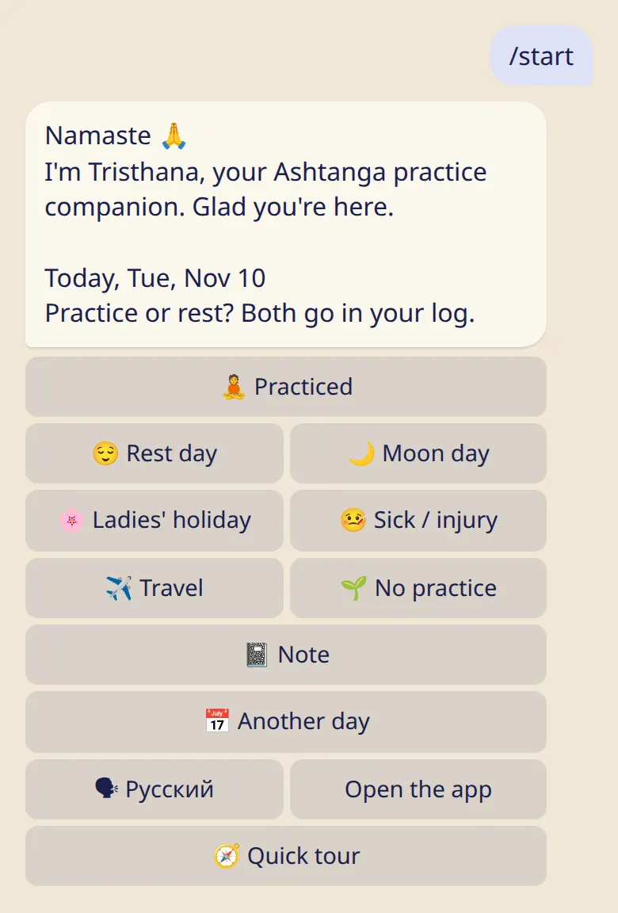

Open the bot, pick your language and log your first day. It takes about two minutes.

## Steps

1. Open [@tristhana_bot](https://t.me/tristhana_bot) in Telegram and send :cmd[start].
2. The bot asks how today was. Tap :ftl[status-practiced] or :ftl[status-rest]: both go in your log.
3. That's it, your first day is logged. Want the calendar and stats? Tap :ftl[start-open-app].

_Pictures of the bot are drawn from its real messages._
